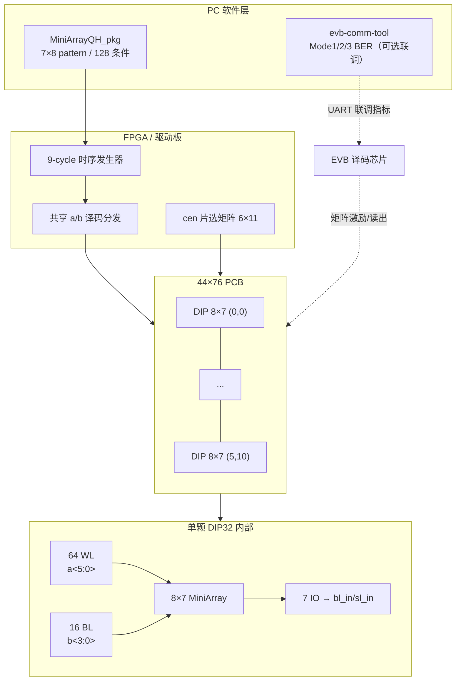
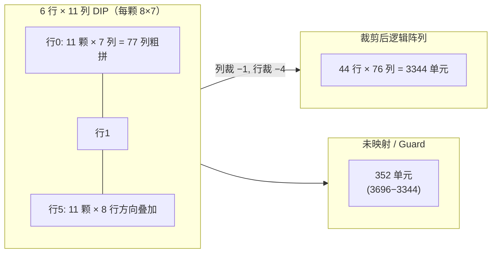
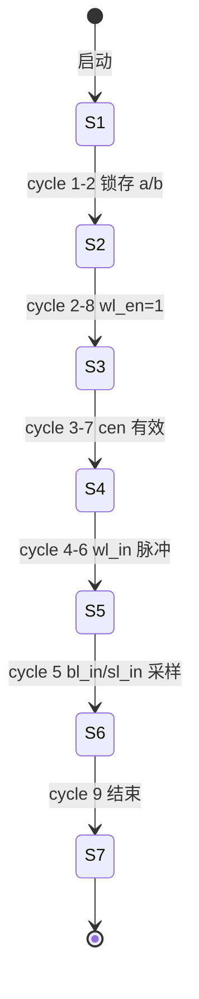

# 44×76 忆阻器阵列 — 物理与系统集成评估

> **文档性质**：基于项目技术幻灯片（9 页）整理的硬件物理评估与系统集成分析。  
> **保密声明**：原始幻灯片含 **Confidential / 内部资料** 水印；本文档仅供项目组内部技术讨论，不得对外传播。  
> **编制日期**：2026-07-06  
> **关联仓库**：`evb-comm-tool`（EVB 通信质量监测上位机）

---

## 目录

1. [项目概述](#1-项目概述)
2. [DIP32 引脚物理映射](#2-dip32-引脚物理映射)
3. [阵列信号体系](#3-阵列信号体系)
4. [单芯片内部寻址](#4-单芯片内部寻址)
5. [PCB 级联拓扑与几何推算](#5-pcb-级联拓扑与几何推算)
6. [时序要求](#6-时序要求)
7. [硬件操作流程](#7-硬件操作流程)
8. [软件接口](#8-软件接口)
9. [与 Mode1/2/3 测试的关联](#9-与-mode123-测试的关联)
10. [风险与开放问题](#10-风险与开放问题)
11. [系统框图（Mermaid）](#11-系统框图mermaid)

---

## 1. 项目概述

### 1.1 目标

本项目旨在将多颗 **8×7 小规模 RRAM/忆阻器阵列** 芯片，通过 PCB 级联与共享译码，拼合为可用于 **矩阵-向量乘（MAC）或类乘加运算** 的大规模物理阵列，标称规模为 **44 行 × 76 列（44×76）**。

单颗芯片封装为 **DIP32**，便于手工焊接、探针台调试与多板拼接；整板采用 **6×11 = 66 颗** 芯片网格布局（幻灯片标题 *「44×76 Multiplier」*）。

### 1.2 规模一览

| 层级 | 参数 | 说明 |
|------|------|------|
| 单芯片有效阵列 | **8 × 7** | 每颗 MiniArray 子阵 |
| PCB 芯片数 | **66** | 6 行 × 11 列 DIP32 |
| 粗算总单元 | **66 × 8 × 7 = 3696** | 若每颗 56 单元全部计入 |
| 标称大阵 | **44 × 76 = 3344** | 幻灯片目标规模 |
| **差额** | **352 单元（≈9.5%）** | 见 [§5.4](#54-规模差额分析3696-vs-3344) |

### 1.3 与 EVB 通信工具的关系

本仓库 **`evb-comm-tool`** 是 **Turbo 通信译码芯片评估板（EVB）** 的 PC 端 UART 上位机，核心职责为：

- 加载 MATLAB 仿真 CSV，经 **25 B TX / 17 B RX** 与 EVB 逐帧通信；
- 对 **CH1–4（Mode1/3）或 Out[3,5,6,7]（Mode2）** 做 Sim-to-Real BER 统计；
- 物理量层面，TX 侧 `In[i]` 经 DAC 转为 **行电压 V_row**（忆阻器阵列行激励），RX 侧 ADC raw 转为 **列电流 I_col** 再硬判 bit。

**边界说明**：

| 对象 | 本 44×76 阵列项目 | evb-comm-tool 当前测什么 |
|------|-------------------|--------------------------|
| 被测硬件 | 66 颗 DIP32 MiniArray 忆阻子阵 + PCB 互连 | EVB 上的 **DAC/译码 SoC**（含内嵌或外接阵列接口） |
| 通信接口 | 并行地址/使能 + `bl_in`/`sl_in`/`wl_in` 等（待接 FPGA/驱动板） | **UART 9600**，AA 帧协议 |
| 软件包 | **MiniArrayQH_pkg**（7×8 pattern） | PyQt6 GUI + `protocol/codec.py` |
| 数据产物 | 阵列读写波形、128 条件扫描 | BER/迭代曲线、Excel/CSV 报告 |

二者在 **概念上同属忆阻器阵列测试链路**：EVB 工具验证的是 **已封装进通信芯片的阵列读写与译码行为**；44×76 项目则是 **裸片/DIP 级物理阵列拼接与驱动验证**。若未来译码芯片直接驱动该 44×76 PCB，则 EVB 的 `V_row`/`I_col` 换算公式与 Mode 选择逻辑可作为 **系统级指标对齐参考**，但 **引脚级、时序级接口并不直接等价**。

---

## 2. DIP32 引脚物理映射

### 2.1 封装与取向

- **封装**：DIP32（双列直插，32 pin）
- **Pin 1**：通常位于缺口/斜角侧，逆时针编号 1→16（一侧），再 17→32（对侧返回）
- **电源**：`VDD`、`GND` 各至少 1 脚（幻灯片标注于 pin 表末行）

### 2.2 完整引脚功能表（据幻灯片 Page 1 整理）

下表按 **Pin 1–32** 顺序列出信号名；位宽在「功能」列注明。若与实物丝印有出入，以 **最新版 Bonding Diagram** 为准。

| Pin | 信号名 | 方向 | 位宽 | 功能摘要 |
|-----|--------|------|------|----------|
| 1 | `sl_in[0]` | In | 1 | 源线 0 数据/选通 |
| 2 | `sl_in[1]` | In | 1 | 源线 1 |
| 3 | `sl_in[2]` | In | 1 | 源线 2 |
| 4 | `sl_in[3]` | In | 1 | 源线 3 |
| 5 | `sl_in[4]` | In | 1 | 源线 4 |
| 6 | `sl_in[5]` | In | 1 | 源线 5 |
| 7 | `sl_in[6]` | In | 1 | 源线 6 |
| 8 | `b[0]` | In | 1 | BL 地址 bit 0（LSB） |
| 9 | `b[1]` | In | 1 | BL 地址 bit 1 |
| 10 | `b[2]` | In | 1 | BL 地址 bit 2 |
| 11 | `b[3]` | In | 1 | BL 地址 bit 3（MSB，共 16 BL） |
| 12 | `a[0]` | In | 1 | WL 地址 bit 0（LSB） |
| 13 | `a[1]` | In | 1 | WL 地址 bit 1 |
| 14 | `a[2]` | In | 1 | WL 地址 bit 2 |
| 15 | `a[3]` | In | 1 | WL 地址 bit 3 |
| 16 | `a[4]` | In | 1 | WL 地址 bit 4 |
| 17 | `a[5]` | In | 1 | WL 地址 bit 5（MSB，共 64 WL） |
| 18 | `bl_in[0]` | In | 1 | 位线 0 驱动/数据 |
| 19 | `bl_in[1]` | In | 1 | 位线 1 |
| 20 | `bl_in[2]` | In | 1 | 位线 2 |
| 21 | `bl_in[3]` | In | 1 | 位线 3 |
| 22 | `bl_in[4]` | In | 1 | 位线 4 |
| 23 | `bl_in[5]` | In | 1 | 位线 5 |
| 24 | `bl_in[6]` | In | 1 | 位线 6 |
| 25 | `wl_in` | In | 1 | 字线输入（全局 WL 数据/选通） |
| 26 | `sel_8wl` | In | 1 | **8-WL 并行读选择**：接 **VDD** = 8 路 WL 并行读；接 **VSS** = 单 WL 读 |
| 27 | `wl_en` | In | 1 | 字线使能 |
| 28 | `cen` | In | 1 | 芯片使能（Chip Enable） |
| 29 | `VDD` | PWR | — | 核心/IO 电源 |
| 30 | `GND` | PWR | — | 地 |
| 31 | `VDD` 或 NC | PWR/NC | — | 第二电源脚或预留（以 Bonding 为准） |
| 32 | `GND` 或 NC | PWR/NC | — | 第二地或预留 |

> **注**：Pin 31–32 在部分版本可能为重复 `VDD`/`GND` 或 `NC`；幻灯片 Page 1 将电源集中在表尾，设计 PCB 时应 **就近布去耦电容（100 nF + 1 µF）** 并保证回流路径最短。

### 2.3 引脚分组速查

```
sl_in<6:0>  ── 7 路源线输入（与 7 个 IO 通道对应）
b<3:0>      ── 4-bit BL 译码（0–15）
a<5:0>      ── 6-bit WL 译码（0–63）
bl_in<6:0>  ── 7 路位线输入
wl_in       ── 字线数据
sel_8wl     ── 1×读 / 8×读 模式
wl_en, cen  ── 使能链
VDD, GND    ── 电源
```

---

## 3. 阵列信号体系

### 3.1 地址总线

| 信号 | 位宽 | 范围 | 作用 |
|------|------|------|------|
| `a<5:0>` | 6 | 0–63 | 片内 **64 条字线（WL）** 译码 |
| `b<3:0>` | 4 | 0–15 | 片内 **16 条位线（BL）** 译码 |

地址在时序上需 **多周期锁存/移位**（见 [§6](#6-时序要求)），并非静态并行地址总线一次性有效。

### 3.2 数据与选通

| 信号 | 位宽 | 说明 |
|------|------|------|
| `wl_in` | 1 | 选中 WL 上的写/读激励 |
| `bl_in<6:0>` | 7 | 7 路 BL 独立数据（每 IO 控制 16 BL 的子集） |
| `sl_in<6:0>` | 7 | 7 路 SL（源线）独立数据，与 BL 配对完成读写路径 |

### 3.3 模式与使能

| 信号 | 有效条件 | 功能 |
|------|----------|------|
| `sel_8wl` | VDD | **8× 并行读**：同一 BL 地址下 8 条 WL 同时读出 |
| `sel_8wl` | VSS | **1× 单 WL 读**：精确单点 |
| `wl_en` | 高（假定） | 打开字线驱动 |
| `cen` | 低有效（常见）或高有效 | 片选；多颗 DIP 级联时配合 PCB 译码 |

### 3.4 电源域

- **VDD**：核心译码 + IO；DIP 手工板需注意 **66 颗芯片同时切换** 时的 **IR drop** 与 **同步噪声**。
- **GND**：建议 **星形或网格地**，各 DIP 旁独立去耦，大电流读写阶段避免长回路。

### 3.5 PCB 级「共享译码信号」

幻灯片 *44×76 Multiplier* 页指出：66 颗芯片 **共享部分译码信号**（`a`、`b` 或子集在 PCB 上并联/缓冲树分发），以降低 FPGA 引脚数。这意味着：

- 同一时刻可能 **多颗芯片响应相同 `a/b`**，需靠 **`cen` 或 PCB 级片选** 区分；
- 或采用 **分区寻址**：行方向 6 组、列方向 11 组，组内共享、组间独立。

---

## 4. 单芯片内部寻址

### 4.1 物理结构

| 维度 | 数量 | 说明 |
|------|------|------|
| 字线 WL | **64** | `a<5:0>` 译码 |
| 位线 BL | **16** | `b<3:0>` 译码 |
| 源线 SL | **16**（与 BL 配对） | 通过 `sl_in<6:0>` 按 IO 分组驱动 |
| IO 通道 | **7** | 每 IO **独立**，各控制 **16 条 BL** 中的一组（幻灯片明确） |
| 对外可见 MiniArray | **8 × 7** | 软件 pattern 与封装宣传尺寸 |

**128 读条件**：幻灯片给出 **128 = 8 × 16**，对应 **8 条 WL 组 × 16 BL** 的并行读扫描空间（与 `sel_8wl` 8-WL 模式一致）。

### 4.2 寻址与 8×7 子阵的关系

片内逻辑寻址空间为 **64×16 = 1024 交叉点**，但 **有效 MiniArray 仅暴露 8×7=56 单元** 用于本项目的乘加 tile。可能原因包括：

- 其余 WL/BL 用于 **冗余、校准或内部旁路**；
- **7 IO × 8 WL** 的映射窗口滑动选取 8×7 可见区；
- 键合/探针 pad 限制导致 **仅 56 单元引出至 DIP**。

### 4.3 1× 读 vs 8× 读

#### 模式选择

| `sel_8wl` | 模式 | WL 行为 |
|-----------|------|---------|
| VSS | **1× 读** | 仅 `a<5:0>` 指定 **1 条** WL |
| VDD | **8× 读** | **8 条** WL 并行（通常为 `a<5:3>` 固定、`a<2:0>` 扫描 8 路） |

#### 地址通配符示例（据幻灯片 Page 4–5）

**1× 读** — 单点 `(WL=i, BL=j)`：

```
a<5:0> = i          （精确 6 bit）
b<3:0> = j          （精确 4 bit）
sel_8wl = 0
```

**8× 读** — 同一 BL 上 8 个 WL 并行：

```
a<5:3> = 组号        （高 3 bit 选择 8-WL 块，共 64/8=8 组）
a<2:0> = ×           （通配 / 并行有效，不单独扫描）
b<3:0> = j
sel_8wl = 1
```

幻灯片用 **「×」** 标记通配位，表示该 bit 在 8× 模式下 **不参与细粒度译码**，由硬件内部展开为 8 路并行。

#### 读路径数据流（概念）

```
                    ┌─────────┐
  wl_in ──────────►│ WL 驱动 │──► 64 WL ──┐
  a<5:0> ──译码──►│ + wl_en │            │
  sel_8wl ───────►│ 1/8 选择│            ▼
                    └─────────┘      ┌──────────┐
  b<3:0> ──译码──► BL/SL 选择 ─────►│ 8×7 单元 │──► 7 IO ──► bl_in/sl_in
  bl_in/sl_in ────────────────────►└──────────┘
```

---

## 5. PCB 级联拓扑与几何推算

### 5.1 芯片网格

```
        列 0    1    2   ...  10
行 0   [DIP] [DIP] [DIP] ... [DIP]    ← 11 颗/行
行 1   [DIP] [DIP] [DIP] ... [DIP]
 ...
行 5   [DIP] [DIP] [DIP] ... [DIP]    ← 6 行
       ─────────────────────────
       共 6 × 11 = 66 颗，每颗 8×7
```

### 5.2 拼接几何假设

标称大阵 **44 × 76** 与芯片网格 **6 × 11** 均 **不能整除** 单颗 8 或 7，说明存在 **裁剪、重叠或边界不参与映射**。以下为可行几何模型（待硬件确认）：

#### 假设 A：列向 11×7、行向 6×8 粗拼后裁剪

| 方向 | 芯片数 | 单颗贡献 | 粗拼尺寸 | 标称 | 裁减量 |
|------|--------|----------|----------|------|--------|
| 列（76） | 11 | 7 列/颗 | 11×7 = **77** | 76 | **−1 列** |
| 行（44） | 6 | 8 行/颗 | 6×8 = **48** | 44 | **−4 行** |

裁减 77×48 → 44×76 后，有效单元 = **3344**；粗拼单元 = **3696**；差额 **352 = 48×(77−76) + 76×(48−44) − 4×1 = 48+304 = 352** ✓（容差边界 1 单元重复计数需 Bonding 确认）。

#### 假设 B：行列转置

| 方向 | 芯片数 | 单颗贡献 | 粗拼 | 标称 |
|------|--------|----------|------|------|
| 行 | 11 | 4 行/颗（部分重叠） | 44 | 44 ✓ |
| 列 | 6 | ~12.67 列/颗 | — | 需非均匀 tile |

假设 B 需 **非均匀 tile 或共享 WL**，工程复杂度更高；幻灯片 **7 行 8 列 software pattern** 更支持 **假设 A 的「行 8 / 列 7」取向**。

#### 假设 C：共享译码导致逻辑 44×76、物理 66×8×7

PCB 将 66 颗划分为 **逻辑分区**，仅 **3344 个逻辑地址** 映射到 EVB/FPGA 向量，其余 **352 单元为 dummy/校准/未绑定**。

### 5.3 共享译码拓扑（概念）

```
                    FPGA / 驱动板
                         │
         ┌───────────────┼───────────────┐
         │  共享 a<5:0>, b<3:0> 总线      │
         ▼               ▼               ▼
    ┌─────────┐    ┌─────────┐    ┌─────────┐
    │ cen[0]  │    │ cen[1]  │    │ cen[k]  │  ← 6 或 11 路片选
    │ 11×DIP  │    │ 11×DIP  │    │ ...     │
    │ 行 0    │    │ 行 1    │    │ 行 5    │
    └─────────┘    └─────────┘    └─────────┘
         │               │               │
         └───────────────┴───────────────┘
                    44×76 有效阵列
```

### 5.4 规模差额分析（3696 vs 3344）

| 计算 | 结果 |
|------|------|
| 66 × 8 × 7 | **3696** |
| 44 × 76 | **3344** |
| 差额 | **352** |
| 占比 | **352 / 3696 ≈ 9.52%** |

**352 的因数分解**：352 = **8 × 44** = **11 × 32** = **16 × 22**。

**解读**：

1. **边界裁剪**：若行方向有效 44 = 6×8 − 4，则 **4 行 × 76 列 = 304** 单元可能为 guard band；再加 **1 列 × 48 行 = 48**，合计 **352**，与假设 A 一致。
2. **未启用 IO/块**：66 颗中若有 **部分 cen 永不为真**，对应 tile 不参与大阵。
3. **文档/幻灯片口径**：3696 为 **物理 die 计数**，3344 为 **算法可用乘法维度**（如 Turbo 译码矩阵块大小）。
4. **键合/yield**：边缘 chip 部分 WL/BL 未引出至 DIP。

**结论**：差额 **不是简单算术错误**，而应在 **PCB netlist + MiniArrayQH 地址 map** 中给出 **逐单元有效表**；在 map 到位前，软件应 **预留 3696 物理 / 3344 逻辑** 双坐标系。

---

## 6. 时序要求

### 6.1 时钟周期总览

幻灯片 Page 6–7 给出 **9 个 clock 周期** 的嵌套波形，各信号有效长度不同：

| 信号 | 有效 clock 数 | 相对关系 |
|------|---------------|----------|
| `a<5:0>`, `b<3:0>` | **9** | 最长；地址移位/锁存全程 |
| `wl_en` | **7** | 在 `a/b` 稳定区间内 asserted |
| `cen` | **5** | 居中窗口，片选有效 |
| `wl_in` | **3** | WL 数据脉冲 |
| `bl_in<6:0>`, `sl_in<6:0>` | **1** | 最窄；读写数据采样脉冲 |

### 6.2 嵌套关系（9-cycle 时间轴）

```
Cycle:     1    2    3    4    5    6    7    8    9
           ─────────────────────────────────────────►

a<5:0>     ████████████████████████████████████████  (9)
b<3:0>     ████████████████████████████████████████  (9)

wl_en          ████████████████████████████            (7, 通常 cycle 2–8)

cen                 ██████████████████                 (5, 通常 cycle 3–7)

wl_in                      ███████                      (3, 通常 cycle 4–6)

bl_in/sl_in                     █                       (1, 通常 cycle 5)
```

**解读要点**：

1. **先地址、后使能、再数据**：`a/b` 最先建立；`wl_en` 覆盖中间段；`cen` 进一步缩窗；`wl_in` 与 `bl_in/sl_in` 在最后阶段脉冲。
2. **单周期数据脉冲**：`bl_in/sl_in` 仅 **1 clock** 有效，对 FPGA setup/hold 与 **PCB 传播延迟** 要求严格；建议 **cycle 5 前后留 margin**。
3. **9 cycle 为最小读写原子操作**：完整 **128 条件扫描** 需重复该序列并递增 `a/b` 或切换 `sel_8wl`。

### 6.3 与 128 条件扫描

| 模式 | 条件数 | 说明 |
|------|--------|------|
| 8× 读 | 8 WL 组 × 16 BL = **128** | `sel_8wl=1`，`b` 扫 0–15，`a<5:3>` 扫 0–7 |
| 1× 读 | 64 × 16 = **1024** | 全交叉，较慢 |

幻灯片强调 **128 条件** 为 **快速并行读** 场景，与 MAC 向量乘的 **8 路并行** 一致。

---

## 7. 硬件操作流程

### 7.1 DIP32 对接

1. **目检**：Pin 1 定位（缺口/斜角），确认无弯脚、无氧化。
2. **插座/焊接**：建议使用 **精密 DIP 插座** 便于换片；批量验证时可焊接，注意 **热敏忆阻体** 温度限制（以芯片手册为准）。
3. **首次上电前**：
   - 万用表测 **VDD–GND** 无短路；
   - 确认 `sel_8wl`、`cen` 默认安全电平（避免 floating）；
   - 未连接 FPGA 时，输入脚 **下拉或上拉** 至已知态。

### 7.2 上电顺序（推荐）

```
1. GND 可靠连接
2. 逻辑 IO（a, b, bl_in, sl_in, wl_in, sel_8wl, wl_en, cen）→ 默认无效/安全
3. VDD 软启动（可选串联限流或电源 slow ramp）
4. 延时稳定（≥ ms 级，视去耦与 LDO 而定）
5. FPGA 释放复位，开始 9-cycle 时序
6. 先 1× 读单点确认，再 8× 读 128 条件扫描
```

### 7.3 多芯片 PCB 注意事项

- **66 路 cen 或分组 cen** 需与 **共享 a/b** 配合，避免 **多片同时导通** 造成 BL 冲突；
- 大阵列读写电流峰值可能达 **数百 mA 级**（视 RRAM 状态与并行度），电源容量与 **地弹** 需实测；
- 长 PCB 走线导致 **bl_in/sl_in 1-clock 脉冲** 畸变时，应 **降低 clock 频率** 或 **在源端加串阻/使用 LVDS 缓冲**。

---

## 8. 软件接口

### 8.1 MiniArrayQH_pkg

幻灯片 Page 8–9 给出 MATLAB/SystemVerilog 侧包名 **`MiniArrayQH_pkg`**（命名以仓库为准），职责包括：

| 功能 | 说明 |
|------|------|
| 引脚约束生成 | 将 `a/b/bl_in/sl_in/...` 映射到 FPGA IO |
| 9-cycle 波形模板 | 参数化 `T_clk`、各信号 offset/width |
| 128 条件序列 | 自动展开 `sel_8wl=1` 扫描表 |
| 7×8 pattern | 与单芯片可见阵列一致的 **测试图样** |

### 8.2 7 行 × 8 列 Pattern

软件测试 pattern 维度为 **7 行 × 8 列**，与 DIP 宣传的 **8×7** 差 **转置关系**：

| 视角 | 行 | 列 |
|------|----|----|
| 硬件 slide | 8 | 7 |
| 软件 pattern | **7** | **8** |

使用时应在 **`MiniArrayQH_pkg` 内统一 `(row,col)` 定义**，避免 Simulink/MATLAB 与 PCB 物理方向不一致导致 **向量乘维度错配**。

### 8.3 建议 API 形态（评估用，非本仓库实现）

```matlab
% 概念接口
cfg = MiniArrayQH_cfg('n_chip_row', 6, 'n_chip_col', 11, ...
                       'logic_rows', 44, 'logic_cols', 76);
seq = MiniArrayQH_gen_read128(cfg, 'mode', '8wl');
MiniArrayQH_play(fpga, seq);   % 下发 9-cycle 波形
data = MiniArrayQH_capture(io); % 7×8 或 44×76 聚合
```

### 8.4 与 evb-comm-tool 数据格式对比

| 项目 | MiniArrayQH | evb-comm-tool |
|------|-------------|---------------|
| 输入向量 | 7×8 或 44×76 矩阵 | `In[0..11]` → 12 路 DAC |
| 输出 | 7 IO × 读电流 | `Out[0..7]` → I_col |
| 帧格式 | 自定义并行时序 | 25 B TX / 17 B RX UART |
| BER | 阵列电阻/电导容差 | InfoBit / CodeBit 比对 |

---

## 9. 与 Mode1/2/3 测试的关联

本仓库测试模式摘要（详见 [EVB通信工具_代码需求书.md](./EVB通信工具_代码需求书.md)、[SIM_TO_REAL.md](./SIM_TO_REAL.md)）：

| 模式 | 矩阵/通道特点 | BER 比对对象 | 与 44×76 阵列 |
|------|---------------|--------------|---------------|
| **Mode1** | CH1 高 4 bit = 1（矩阵模式 1） | InfoBit[0..3] vs CH1–4 I_col | EVB 内嵌阵列 **Mode1 行电压激励** 与本文 **wl_in/bl_in** 属不同抽象层 |
| **Mode2** | 无 InfoBit 列；G 解码 | Out[3,5,6,7] CodeBit 硬判 | 译码输出 bit，**不直接测 66 DIP** |
| **Mode3** | 仅 CH1–2 | InfoBit[0..1] | 低通道数调试模式 |

**关联方式**：

1. **指标对齐**：EVB 的 `V_row`（行压）、`I_col`（列流）可作为 **阵列读写物理量的上位机参考公式**；44×76 PCB 实测电流应 **在同一量纲下** 与 EVB RX 对比，验证 **Sim-to-Real 一致性**。
2. **规模边界**：EVB 单次 UART 帧仅携带 **有限路 DAC/ADC**；44×76 全阵扫描必须经 **MiniArrayQH + FPGA**，**不能**直接用 `evb-comm-tool` 25 B 帧驱动。
3. **测试分工建议**：
   - **Phase 1**：单 DIP MiniArray + 示波器/FPGA，验证 9-cycle 与 128 条件；
   - **Phase 2**：66 片 PCB + MiniArrayQH，验证 44×76 map 与 352 差额解释；
   - **Phase 3**：与 EVB 译码芯片联调，用 Mode1 CSV 的 **In[] 向量** 作为 **期望输入**，比对译码输出 BER。

---

## 10. 风险与开放问题

### 10.1 尺寸不整除

| 问题 | 影响 | 建议 |
|------|------|------|
| 76 ≠ 11×7 | 1 列冗余或隐藏 | 在 map 文档标注 **无效列索引** |
| 44 ≠ 6×8 | 4 行 guard | Layout 标注 **不编程行** |
| 7 vs 8 行列转置 | 软件/硬件坐标系混乱 | `MiniArrayQH_pkg` 强制单一 `(row,col)` 约定 |

### 10.2 共享译码

- **风险**：多 chip 同时选中 → **BL 短路/读值叠加**。
- **开放**：`cen` 是 **66 独立** 还是 **6/11 分组**？需 netlist 确认。

### 10.3 电源与 IR drop

- 66 颗 DIP 同时 8× 读时 **峰值电流** 未在幻灯片给出；
- **开放**：每颗 `VDD` 电流上限、是否需 **分区上电**。

### 10.4 键合与封装

- DIP32 引脚数 **32**，而片内 **64×16** 交叉 + 7 IO，大量 **内部复用/串行化**；
- **开放**：8×7 有效区与 **1024 交叉点** 的 **精确映射表**、未引出 WL/BL 如何处理。

### 10.5 时序 margin

- `bl_in/sl_in` **仅 1 clock**；66 片 PCB **skew** 可能导致 **部分 chip 采样失败**；
- **建议**：首版 **降频 50%** 扫通后再提频；在 chain 末端加 **回读校验**。

### 10.6 保密与版本

- 幻灯片 **Confidential** 水印 → 对外资料需脱敏；
- Pin 31–32、`cen` 极性、时钟边沿（上升/下降采样）以 **最新 bonding 图** 为准，本文按 slide 描述整理，**实施前必须硬件 sign-off**。

### 10.7 开放问题清单

| # | 问题 | 负责人（待填） | 状态 |
|---|------|----------------|------|
| 1 | 3344 vs 3696 官方 map 表 | | 开放 |
| 2 | `cen` 分组与 FPGA pin 规划 | | 开放 |
| 3 | `sel_8wl` 并行 8 WL 的具体编码（a<2:0> 是否忽略） | | 开放 |
| 4 | 7×8 pattern 与 8×7 die 原点对齐 | | 开放 |
| 5 | 与 EVB Mode1 `In[]` 维度如何映射到 44×76 | | 开放 |
| 6 | 读写脉冲电压幅度（与 `V_row` 4.096 V 满量程关系） | | 开放 |

---

## 11. 系统框图（Mermaid）

### 11.1 系统架构



### 11.2 PCB 拼接示意（6×11 → 44×76 逻辑）



### 11.3 单芯片 9-cycle 时序状态机（概念）



---

## 附录 A：符号对照表

| 符号 | 含义 |
|------|------|
| WL | Word Line，字线 |
| BL | Bit Line，位线 |
| SL | Source Line，源线 |
| RRAM | Resistive RAM，阻变存储器 |
| MAC | Multiply-Accumulate，乘加 |
| EVB | Evaluation Board，评估板 |
| DIP32 | 32 引脚双列直插封装 |

## 附录 B：参考文献（仓库内）

- [EVB通信工具_代码需求书.md](./EVB通信工具_代码需求书.md)
- [SIM_TO_REAL.md](./SIM_TO_REAL.md)
- [PROTOCOL_UART.md](./PROTOCOL_UART.md)
- [DEBUG_调试分析.md](./DEBUG_调试分析.md)

---

*本文档由项目幻灯片描述整理生成；Pin 31–32 及精确 cycle 对齐以最新硬件版本为准。*
