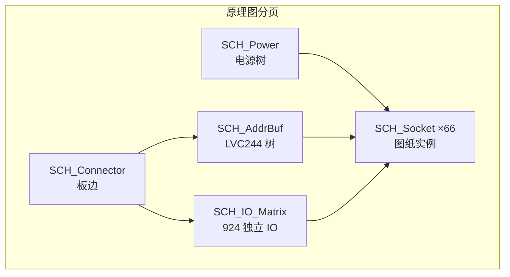

# Altium Designer 原理图与 PCB 设计指导书 — RRAM 44×76 大阵列项目

> **文档性质**：面向硬件工程师的 **手把手操作指导书**（Altium Designer + 嘉立创/国内板厂制造）  
> **适用范围**：66 颗 DIP32 MiniArray（6×11）→ 44×76 逻辑大阵列 PCB  
> **编制日期**：2026-07-06  
> **关联文档**：[RRAM阵列_PCB_IO信号说明.md](./RRAM阵列_PCB_IO信号说明.md)、[PCB大阵列拼接评估需求说明.md](./PCB大阵列拼接评估需求说明.md)、[44×76阵列物理评估.md](./44x76阵列物理评估.md)、[嘉立创_原理图与PCB设计指导书.md](./嘉立创_原理图与PCB设计指导书.md)（立创 EDA 对照版）  
> **保密声明**：本项目资料含 Confidential 内容；本文档仅供项目组内部使用。

---

## 目录

1. [工具与环境](#1-工具与环境)
2. [工程立项](#2-工程立项)
3. [原理图设计流程](#3-原理图设计流程)
4. [PCB 布局指导](#4-pcb-布局指导)
5. [PCB 布线指导](#5-pcb-布线指导)
6. [设计规则（DRC）](#6-设计规则drc)
7. [制造输出与嘉立创下单](#7-制造输出与嘉立创下单)
8. [与本项目检查清单](#8-与本项目检查清单)
9. [AD 常见问题](#9-ad-常见问题)
10. [AD vs 立创 EDA 对照](#10-ad-vs-立创-eda-对照)

---

## 1. 工具与环境

### 1.1 推荐工具链

| 环节 | 推荐工具 | 说明 |
|------|----------|------|
| 原理图 / PCB | **Altium Designer**（AD20 / AD22 / AD23+） | 大板（~944 网络、>360 mm）性能与规则引擎成熟；本指导以 **AD22/AD23 菜单** 为主，AD20 差异见 §9 |
| PCB 打样 / 量产 | **嘉立创 PCB**（jlc.com）或国内 8 层板厂 | AD 导出 **Gerber + 钻孔** 上传；与立创 EDA 无绑定 |
| 阻抗预计算 | [嘉立创阻抗计算神器](https://tools.jlc.com/jlcTools/index.html#/impedanceCalculatenew) | 8 层 1.6 mm、50 Ω 单端 / 100 Ω 差分；结果写入 AD **Layer Stack Manager** |
| Gerber 预览 | **CAM350** / 嘉立创 Gerber 查看器 / Altium **CAMtastic** | 下单前必查钻孔对齐、阻焊开窗 |
| 版本管理 | Git + **ASCII 优先**（`.SchDoc`、`.PcbDoc` 为二进制） | 建议 **Release 打包** 或 SVN；大工程勿频繁 diff 二进制 |

### 1.2 版本与许可证

| 项目 | 建议 |
|------|------|
| Altium Designer | **AD22 或 AD23+** 稳定版；AD20 可用但 Room/等长 UI 略有差异 |
| 许可证 | **Professional** 或 **Enterprise**（多页原理图、Rooms、xSignals、高级 DRC）；Student 版功能受限，**不建议**用于 944 网络首版 |
| 操作系统 | **Windows 10/11 64-bit**（本项目主环境）；大板建议 **32 GB RAM**、SSD、独显可选 |
| 协作 | **Altium 365**（可选）云协作；无云时 **共享库 + 设计规则模板** 统一团队 |

### 1.3 安装与首日前置

1. 安装 Altium Designer，激活许可证；首次启动完成 **Initial Preferences** 向导。
2. **Preferences**（`DXP` → `Preferences` 或右上角齿轮）建议预设：
   - **Schematic** → Grids：原理图网格 **100 mil**；启用 **Snap to Grid**。
   - **PCB Editor** → Defaults：过孔、线宽、覆铜间距与 §6 基线一致。
   - **Data Management** → 指定团队 **库路径**（§3.1）。
   - **System** → Memory Management：大板开启 **Release unused memory**。
3. 将 `docs/` 下三份对齐文档（IO 信号、拼接需求、物理评估）置于设计旁；全程 **以 [RRAM阵列_PCB_IO信号说明.md](./RRAM阵列_PCB_IO信号说明.md) 的 `MA_*` 网络名为准**。
4. 从立创 EDA 迁移者：先读 §9.3 与 §10，勿直接导入后改网络名。

### 1.4 与嘉立创下单兼容

AD 与嘉立创 **无一键下单**，但工艺完全兼容：

| 输出 | 嘉立创要求 | AD 对应 |
|------|------------|---------|
| Gerber RS-274X | 必须 | `File` → `Fabrication Outputs` → `Gerber` |
| 钻孔 Excellon | 必须 | 同上 Job 含 `Drill` |
| 层序说明 | 建议附 PDF | `Layer Stack Manager` 截图 |
| 阻抗 | 可选 ±10% | 附线宽表 + 叠构 |
| 单位 | **mm** 或 **inch** 一致 | Gerber 设置 **2:4** 或 **3:3**（与厂确认） |

**原则**：制造文件以 **Gerber** 为准；ODB++ 可作部分板厂备选（§7）。

### 1.5 与本项目的关系

本指导书 **不替代** 信号/时序规格书，而是把规格落到 **Altium Designer 操作步骤 + 嘉立创工艺参数**。软件侧 MiniArrayQH_pkg、测试机 FPGA 不在本文展开，见关联文档 §6。

---

## 2. 工程立项

### 2.1 新建工程

1. `File` → `New` → `Project` → `PCB Project`，命名：`RRAM_44x76_Array_V1.PrjPcb`。
2. 工程描述（`Project` → `Project Options` → `General` → Comments）写明：66× DIP32、6×11、DB_DIP32_BOARD_V1_0 引脚表优先、目标 44×76 逻辑阵。
3. 添加文档：
   - `Project` → `Add New to Project` → `Schematic`（多页，见下）
   - `Project` → `Add New to Project` → `PCB`
4. 保存整个工程至 **无中文路径** 的目录（部分 CAM 工具对 Unicode 路径敏感）。
5. 建议原理图分页（`Sheet Symbol` + `Sheet Entry` 层次化）：

| 图纸 | 文件名建议 | 内容 |
|------|------------|------|
| 顶层 | `SCH_Top.SchDoc` | 块图、电源入口、板边连接器 |
| 电源 | `SCH_Power.SchDoc` | 电源树、Bulk、保险丝/TVS |
| 地址缓冲 | `SCH_AddrBuf.SchDoc` | 74LVC244 缓冲树 |
| IO 矩阵 | `SCH_IO_Matrix.SchDoc` | 924 路 bl/sl 扇出（可按行再分） |
| 插座单元 | `SCH_Socket_Unit.SchDoc` | 单颗 ZIF/DIP **可复用图纸** |
| 连接器 | `SCH_Connector.SchDoc` | 测试机/FPGA 板边 |

6. **设计关联**：原理图与 PCB 同属一个 `.PrjPcb` 即已关联；改图后 `Design` → `Update PCB Document`（或 `Import Changes Into [PCB名]`）同步。

### 2.2 层数与板厚（Layer Stack Manager）

`Design` → `Layer Stack Manager`（PCB 打开时）：

| 参数 | 首版建议 | 依据 |
|------|----------|------|
| 层数 | **8 层**（最低）；布线紧张 **10 层** | ~944 网络；924 根独立 bl/sl + 共享总线 |
| 板厚 | **1.6 mm**；机械强度优先 **2.0 mm** | 大板翘曲与 66 插座共面度 |
| 铜厚 | 外层 **1 oz**；**内层电源 L4 优先 2 oz**（厂可选） | VAA IR drop、forming 峰值电流 |
| 表面处理 | **沉金 ENIG** | 精密插座、多次插拔 |

**推荐 8 层叠构（起点，须用阻抗计算器复核）**：

```
L1  Top       信号（元件面 — 插座、去耦）
L2  Mid1      GND 平面
L3  Mid2      信号（地址广播、局部扇出）
L4  Mid3      PWR（VAA1/2/3 分区）
L5  Mid4      信号（bl/sl 中段）
L6  Mid5      GND 平面
L7  Mid6      信号（bl/sl 远端）
L8  Bottom    信号 / 次要电源（焊接面）
```

**AD 操作**：

1. `Layer Stack Manager` → `Add Layer` 至 8 层；命名 `GND` / `PWR` 介质层。
2. 介质厚度按嘉立创 **8 层 1.6 mm 标准叠构** 填入（或厂提供 PDF）。
3. `Impedance Profile`（AD22+）：新建 **50 Ω SE**、**100 Ω Diff**；线宽待计算器输出后回填。
4. `Save as Stackup` → `Stackup_RRAM_8L_1p6mm`。

原则：**完整地平面相邻信号层**；VAA 与 GND 相邻；`MA_WL_IN` 优先 L3/L5 并包地。

### 2.3 板尺寸估算

| 项目 | 数值 | 备注 |
|------|------|------|
| 单颗 DIP32 占位 | ~20 mm × 52 mm（2.54 mm 间距） | 含两侧行针 |
| 芯片中心节距（含走线区） | **~60 mm**（待 Layout 锁定） | 热间距 ≥ 5 mm |
| 66 颗网格 | **6 行 × 11 列** | chip_id：`U_R{r}C{c}`，r=0..5，c=0..10 |
| PCB 外形（估算） | **~360 mm × 660 mm** | 不含工艺边；**超大板**须嘉立创计价页确认上限 |
| 工艺边 | 建议 **10 mm** 双侧或四侧 | 贴片/测试夹具 |

**立项时操作**：

1. PCB 编辑器 → 切换到 **Mechanical 1**（或 `Keep-Out Layer` + 板框专用层）。
2. `Place` → `Line` / `Region` 画 **360×660 mm** 矩形（`Q` 切换 mm）。
3. 短边一侧留 **80–120 mm** 接插件区（FPGA 连接器、电源入口）。
4. `Design` → `Board Shape` → `Define from selected objects`（若使用封闭线）。

### 2.4 设计规则模板

1. `Design` → `Rules` → 右下角 **Create Rule** 或 **Import Rules**（从模板 PCB）。
2. 基线（与 [嘉立创指导书 §2.4](./嘉立创_原理图与PCB设计指导书.md#24-设计规则模板) 一致）：
   - Clearance：**5 mil**（0.127 mm）
   - Width：**5 mil** 默认；电源网络 Class 例外（§6）
   - Via：**0.45 / 0.2 mm**（外径/孔）；电源 **0.6 / 0.3 mm**
3. `File` → `Save As` 将规则 PCB 存为 **`DRC_RRAM_44x76_8L.PcbDoc`** 模板，新建工程时 **Copy Rules**。

---

## 3. 原理图设计流程

### 3.1 库管理

Altium 库体系：**SchLib**（符号）+ **PcbLib**（封装）→ **IntLib**（集成库，推荐发布）；或 **Database Library** 对接 ODBC。

#### 3.1.1 工程库结构建议

```
Libraries/
  RRAM_44x76.SchLib      # 符号：DIP32、LVC244、去耦、连接器
  RRAM_44x76.PcbLib      # 封装：DIP32、ZIF、0402/0805、测试点
  RRAM_44x76.IntLib      # 编译发布（团队统一）
```

`Project` → `Add Existing to Project` 添加 SchLib/PcbLib；修改后 **右键 SchLib → Make Integrated Library**。

#### 3.1.2 DIP32 / ZIF 插座

| 任务 | AD 操作步骤 |
|------|-------------|
| DIP32 符号 | SchLib → `Tools` → `New Component`；32 Pin + 底部 **Pin 33 = VSS4**；按 [IO 说明 §3.2](./RRAM阵列_PCB_IO信号说明.md#32-完整对照表--html-修正版db_dip32_board_v1_0layout-优先) **逐 pin 命名** `MA_*` |
| DIP32 封装 | PcbLib → 2×16，**2.54 mm** 间距，跨距 **15.24 mm**；**Pin1 方焊盘** + 丝印三角 |
| ZIF 插座 | 按实物型号（3M / 广濑 2×16 ZIF）建 **3D Body**；机械高度写入 **Component Height** |
| 底部 VSS4 | 封装加 **散热焊盘**（多边形或圆形），原理图 Pin 名 `MA_VSS4` |
| 3D | `Place` → `3D Body` 标注 ZIF 高度，PCB `View` → `3D` 检查干涉 |

**关键**：引脚编号 **必须以 DB_DIP32_BOARD_V1_0（HTML 修正版）为准**，勿套用 Altium 自带 `DIP-32` 通用顺序。可用 **Multi-Part Component** 将电源脚与信号脚分组显示。

#### 3.1.3 74LVC244（地址缓冲）

- 符号：TI `SN74LVC244A` 或自建 **2× 4 位**；`OE` 默认拉有效。
- 每颗 244 驱动 **~15–20 颗 DIP 等效负载**；66 颗至少 **2–3 级树**。
- 封装：**TSSOP-20 / SOIC-20**；`VCC` 接 FPGA I/O bank 同压（1.8 V 或 3.3 V）；**每颗 100 nF** 贴脚。

#### 3.1.4 去耦与电源入口

| 位置 | 元件 | 网络 |
|------|------|------|
| 每颗 DIP 各 VAA 脚 | 100 nF（0402）+ 10 µF（0805） | `MA_VAA1/2/3` |
| 每 11 颗一行 | 100 µF Bulk + 可选磁珠 | 分区 `MA_VAAx_Zn` |
| 板边入口 | 保险丝 / TVS / 共模扼流 | `PWR_VAAx_IN` |

#### 3.1.5 其它常用库

- 0 Ω 跳线（`R0` 电阻符号，值 `0 Ω`）
- 测试点：SchLib 端口符号 + PcbLib **SMD/Testpoint** 或 **Ø1 mm 钻孔焊盘**
- 板边连接器：按测试机机械图导入 **DXF** 或手建

### 3.2 模块化划分



**层次化复用（推荐）**：

1. 在 `SCH_Socket_Unit.SchDoc` 画完整 **单插座模块**（ZIF + 去耦 + 端口）。
2. 顶层用 **`Sheet Symbol`** 引用该图 **66 次**；`Designator` 用 **Designator List** 或手动 `U_R0C0` … `U_R5C10`。
3. 端口用 **`Sheet Entry`** 与顶层 **`Port`** 同名连接（AD 层次化端口规则）。

**单芯片座模块应包含**：

- ZIF/DIP 插座 32+1 脚
- 三路 VAA 去耦、三路 VSS 短接至地
- 端口：`MA_BL_IN0..6`、`MA_SL_IN0..6`（顶层加 `_Uxx` 后缀）
- 共享总线端口：`MA_A0..5`、`MA_B0..3`、`MA_SEL_8WL`、`MA_WL_IN`（块内不重复画 244）

**电源树**：`MA_VAA1/2/3` 分域树状；`MA_VSS` / `MA_GND` 用 **Power Port** `GND` 与 **VCC** 符号。

**地址总线**：FPGA → 一级 244 → 6 行 → 二级 244 → 各插座；网络名全板统一 `MA_A0` … `MA_A5`。

**IO 扇出**：462×2 路在 `SCH_IO_Matrix` 用 **Net Label** + **Bus** 接到各模块端口；源端串阻 **22–47 Ω**。

### 3.3 网络命名（对齐 `MA_*`）

**强制规则**（与 [IO 信号说明 §3.1](./RRAM阵列_PCB_IO信号说明.md#31-命名规则) 一致）：

| 类型 | 格式 | 示例 |
|------|------|------|
| 共享地址/控制 | `MA_<信号>` | `MA_A0`、`MA_SEL_8WL`、`MA_WL_IN` |
| 独立 bl/sl | `MA_BL_IN<i>_U<id>` | `MA_BL_IN3_U42` |
| 独立 sl | `MA_SL_IN<i>_U<id>` | `MA_SL_IN3_U42` |
| chip_id | `U_id = row×11 + col` | U00 … U65 |
| 片选 cen | `MA_CEN_U<id>` 或 `MA_CEN_R<r>` | 待架构 sign-off |
| 电源 | `MA_VAA1`、`MA_VSS1` … | 分区可加 `_Z0` |

**AD 操作**：

1. 导线/端口放置 **Net Label**（`P` 快捷键）；禁止 `Net1`。
2. 大网络用 **Bus** + **Bus Entry**；编译后 `Project` → `View` → `Nets` 核对。
3. **Net Classes**（可选）：`Design` → `Net Classes` 建 `MA_ADDR`、`MA_BL_SL`、`MA_PWR` 便于 PCB 规则绑定。
4. 编译后导出 **网表**：`Design` → `Netlist For Project` → `Protel`；用脚本/Excel 核对 **924 路 bl/sl**（U00–U65 × 7）。

**`wl_en` / `cen`**：HTML V1_0 **32 脚无独立脚位**；原理图用 **测试点 + 0 Ω 预留** 或 Bonding 确认脚位；幻灯片 Pin27/28 **仅交叉参考**。

### 3.4 原理图检查与 ERC

| 步骤 | AD 菜单 / 操作 | 本项目要点 |
|------|----------------|------------|
| 1 | `Project` → `Project Options` → `Error Reporting` | 配置悬空输入、电源脚未接为 **Error** |
| 2 | `Project` → `Validate Project`（或原理图 `Project` → `Compile`） | ERC 报告无 Error |
| 3 | 物料 BOM 预检 | 66× 插座、去耦、244、串阻数量 |
| 4 | 引脚对照 | 打印 [IO 说明 §3.2 表](./RRAM阵列_PCB_IO信号说明.md#32-完整对照表--html-修正版db_dip32_board_v1_0layout-优先) 逐项打勾 |
| 5 | 设计评审 | wl_en/cen、cen 66 路 vs 分组、VAA 电压 |

**编译与同步 PCB**：

1. `Project` → `Compile PCB Project`。
2. `Design` → `Update PCB Document [PCB_Array.PcbDoc]` → 勾选 **Engineering Change Order** → `Execute Changes`。
3. 确认 66 个插座 **Designator**、**Footprint**、**Comment** 正确落入 PCB。

---

## 4. PCB 布局指导

### 4.1 6×11 阵列摆放

**坐标约定**：

- **行 r = 0..5**（全板统一上下方向）
- **列 c = 0..10**（自左而右）
- `chip_id = r × 11 + c`

**摆放步骤**：

1. **板框与安装孔**：`Mechanical` 层画 **M3 螺丝孔**（四角 + 长边中点）；`Place` → `Pad` 或 `Mounting Hole`。
2. **板边连接器 / 电源入口** 先固定（避免后期挪动）。
3. 从 `U_R0C0` 起，按 **60 mm 节距** 放置首颗 ZIF 封装。
4. **阵列复制**（三选一）：
   - **Room Copy**（推荐）：框选首颗及周边去耦 → `Design` → `Rooms` → `Create Room from selected components` → 命名 `ROOM_U00` → `Design` → `Rooms` → `Copy Room Formats` 或 **PCB Replicate**（AD22+ **Design** → **Replicate Layout**）；
   - **Step & Copy**：选中组件 → 复制 → **Paste Array**（若安装插件可用）；
   - **脚本**：66 颗坐标表 CSV → Altium **Script** 批量放置（二次迭代推荐）。
5. 复制后 **逐颗改 Designator** 为 `U_RrCc`；**Annotate**：`Tools` → `Annotation` → `Re-annotate` 谨慎使用，建议 **手动受控编号**。
6. **全板 Pin1 同向**；丝印 **三角 + "PIN1" + `U_RrCc`**。

```
        C0    C1    C2   ...   C10
R0    [U00] [U01] [U02] ... [U10]
R1    [U11] [U12] ...         [U21]
 ...
R5    [U55] ...               [U65]
      ↑
   板边接插件区（地址缓冲、FPGA、电源）
```

### 4.2 Room 与设计复用（AD 特有）

| 功能 | 用途 | 操作 |
|------|------|------|
| **Room** | 约束插座区布线密度 | `Design` → `Rooms` → 按行建 `ROOM_ROW0` … `ROOM_ROW5` |
| **Room Rule** | 行内 clearance/width 可略松 | `Design` → `Rules` → `Room` 作用域 |
| **Replicate Layout** | 复制已布好的 **单颗单元** | 选中源 Room + 目标 Room → `Design` → `Replicate Layout` |
| **PCB Snippets** | 保存去耦+插座片段 | 右键 → `Snippets` → `Create Snippet` |

首颗 **U_R0C0** 布局含去耦、测试点、地过孔模板；复用至全板可节省 **>50%** 布局时间。

### 4.3 Pin1 方向与防呆

| 要求 | 实施 |
|------|------|
| 机械防呆 | ZIF 卡扣方向一致；丝印三角与实物 Pin1 对齐 |
| 电气防呆 | Pin1 远离 VAA 汇聚；`3D` 视图核对 |
| 首件检验 | 空板试插良好 DIP；万用表测 VAA–VSS |

### 4.4 热间距与散热

| 项目 | 建议 |
|------|------|
| 芯片中心间距 | **≥ 5 mm** |
| Thermal via | 插座腹部 **Place` → `Via Stitching`** 或手动密集地过孔至 Bottom 铜皮 |
| 背面 | 裸露铜皮 + 绝缘涂层或散热底板（评估项） |

### 4.5 插座朝向与走线出口

- **推荐**：插座行针 **垂直于板边接插件**；地址 **行中心鱼骨** 馈入；bl/sl **列方向** 扇入/扇出。
- **测试点**：每行电源 TP；最远端 U65 的 `MA_A0`、`MA_WL_IN` 各 1。

### 4.6 有效区与 Guard 丝印

- **Mechanical** 或 **Overlay** 绘 **44×76 有效区框**；guard 352 单元丝印 **"NON-PROGRAMMABLE"** / **"GUARD"**。
- 与 [PCB需求 §3.3](./PCB大阵列拼接评估需求说明.md#33-几何拼接模型评估假设-a待硬件-sign-off) 一致。

### 4.7 布局阶段 Design Rules 检查

`Tools` → `Design Rule Check` → **Run DRC**（允许封装间距 Warning）；确认 **Room 内** 无 Component Clearance 违规。

---

## 5. PCB 布线指导

### 5.1 总体策略

| 优先级 | 信号类 | 层 / 方式 |
|--------|--------|-----------|
| P0 | `MA_VSS`、`MA_VAA*` | 平面 + 加粗 + 密集过孔 |
| P1 | `MA_A*`、`MA_B*`、`MA_SEL_8WL` | 等长组；244 后鱼骨 |
| P2 | `MA_WL_EN` → `MA_WL_IN` | 顺序不可颠倒；包地 |
| P3 | `MA_BL_*` / `MA_SL_*` | 占线量最大；分区多层 |
| P4 | `MA_CEN_*` | 片选；避免多片同时导通 |

### 5.2 电源平面与 Polygon Pour

1. **完整地平面**：L2、L6 设为 **Solid Plane**（`Design` → `Layer Stack` → 层类型 `Plane`）；或 Top/Bottom **Polygon Pour** 接 `GND`。
2. **铺铜操作**：
   - `Place` → `Polygon Pour` → 选网络 `GND` 或 `MA_VAA1`；
   - 右键 Pour → **Polygon Pour Manager** → **Repour All**；
   - **Pour Over Same Net Objects** 开启；**Remove Dead Copper** 制造前关闭孤岛前先评审。
3. **分割电源**：L4 上 `MA_VAA1/2/3` 用 **Split Plane**（`Place` → `Split Plane`）或 **独立 Polygon**；跨区单点连接须 PI 批准。
4. **IR drop 目标**：8× 读全板 simultaneous，ΔV/VAA **< 3%**。
5. **去耦**：0402 **距 DIP 电源脚 < 2 mm**；先布电容再布密线。

**地过孔围栏**：选中插座区 → `Tools` → `Via Stitching` / `Stitching Vias`，间距 **2–3 mm**。

### 5.3 广播信号 vs 独立 bl/sl 扇出

#### 广播信号（共享译码）

| 网络 | 策略 |
|------|------|
| `MA_A0..5`、`MA_B0..3` | 板边 **星型/鱼骨**；每级 244 后 **短线等长**；66 片 skew **< 1–2 ns** |
| `MA_SEL_8WL` | 与地址同组等长；远离 bl 平行线 |
| `MA_WL_IN` | **包地** stripline；与 bl 间距 **≥ 3× 线宽** |
| `MA_WL_EN` | 走线 **短于 wl_in 逻辑路径** |

**勿** 66 颗地址脚直连 FPGA（C<sub>L</sub> 100–200 pF）。

#### 独立 bl/sl（924 线）

| 规则 | 说明 |
|------|------|
| 不可共享 | 每颗 `MA_BL_IN<i>_Uxx` 独立至 DAC/GPIO |
| 成对 | bl/sl **相邻平行**（可选 100 Ω 差分） |
| 组内等长 | 同一 Uxx 的 **7 路 bl** 等长；**7 路 sl** 等长 |
| 组间 | 芯片间不要求 bl 全局等长；8× 并行 **同时到达 < 5 mm** |
| 端接 | 源端 **22–47 Ω** 串阻 |

**Fanout 924 bl/sl**：

1. 每颗 DIP：**底层扇出**（`Route` → `Fanout` → `Component`）至内层；**≤ 4 过孔/信号** 换层策略。
2. IO 驱动放 **板边接插件同侧**；按列 **蛇形** 进入各 Uxx。
3. **L1/L3/L5/L7** 交替布线；换层 **就近地过孔**（间距 < 3 mm）。
4. 完成率：**100% 连通** → **调等长** → **优化串扰**。

### 5.4 等长组与 Tune Length（AD）

**xSignals / Length / Matched Length**（AD22+ 推荐）：

1. `Design` → `xSignals` → 创建 **xSignal Group** `GRP_MA_A`：成员 `MA_A0` … `MA_A5`。
2. 或 `Design` → `Net Classes` 建 `CLASS_ADDR`，再 `Design` → `Rules` → **Matched Length**：
   - **Group Margin**：**5 mm**（地址组，保守）；
   - **Max Skew**：按 Tclk 反算。
3. **交互式等长**：
   - 布线时 `~`（波浪键）或 `Route` → `Interactive Length Tuning`；
   - 或 `Route` → `Interactive Diff Pair Routing`（bl/sl 差分对）；
   - 拖动 **Accordion / Amplitude** 调节蛇形。
4. `MA_BL_IN0..6_Uxx`：**每组 7 路 bl** 单独 Matched Length；**sl 组同理**。
5. **Tuning Style**：Gap **4 mil**、Amplitude **8 mil** 起步；大板可用 **90°** 圆弧蛇形减反射。

**差分布线**（可选）：

1. `Design` → `Rules` → `Routing` → `Routing Width`：差分对 **100 Ω** 线宽/间距（计算器输出）。
2. `Route` → `Interactive Differential Pair Routing`；`bl`/`sl` 成对命名 `MA_BL_IN3_U42` / `MA_SL_IN3_U42` 可用 **Net Pair** 约束。

### 5.5 Class to Class 间距

`Design` → `Rules` → `Electrical` → **Clearance** → 新建：

| 规则名 | Class 1 | Class 2 | 间距 |
|--------|---------|---------|------|
| Addr_to_BL | `CLASS_ADDR` | `CLASS_BL_SL` | **≥ 0.2 mm** 或 3× 线宽 |
| WL_to_BL | `MA_WL_IN`（Net Class） | `CLASS_BL_SL` | **≥ 0.2 mm** |
| PWR_default | `CLASS_PWR` | `CLASS_BL_SL` | **8 mil** |

**Component Class**：244 与插座分 Class，避免 **Component Clearance** 误报。

### 5.6 时序关键路径与延迟预算

与 [IO 说明 §6](./RRAM阵列_PCB_IO信号说明.md#6-读写时序与-io-时序关系) 对齐：

| 参数 | 首版预算 | PCB 动作 |
|------|----------|----------|
| Tclk | **200 ns（5 MHz）** | 首版降频扫通 |
| 地址 Tsu | 10–20 ns | 缩短 FPGA→U65 路径 |
| 66 片 skew | **< 2 ns** | 地址等长 + 缓冲树对称 |
| wl_en → wl_in | **wl_in 延迟 ≥ wl_en + 5 ns** | wl_in 物理长度 **长于** wl_en |
| bl/sl 1-cycle 窗 | margin ≥ **20% Tclk** | **cycle 5** 最远芯片实测 |

**9-cycle 最严时刻**：**cycle 5** `bl_in/sl_in` 单周期有效 — Layout 后在 **U65** 测到达时刻。

### 5.7 过孔与串扰

- 换层：**地过孔伴随**（Via Stitching）。
- 避免 **长 stub**；高速区评估 **back drill**（厂工艺）。
- bl/sl 平行：**3W**；交叉 **垂直**。
- `sel_8wl`：**不同层 + 地隔离**。

---

## 6. 设计规则（DRC）

### 6.1 线宽线距（首版基线）

| 对象 | 线宽 | 线距 | 备注 |
|------|------|------|------|
| 信号（50 Ω） | 按 **Impedance Profile**（常 5–6 mil） | ≥ 5 mil | 叠构先算 |
| bl/sl 差分（100 Ω） | 成对计算器输出 | 对内/对间按计算器 | 可选 |
| `MA_VAA*` | **≥ 20 mil** | — | 2 oz 层优先 |
| `MA_WL_IN` | 加宽 + 包地 | 与 bl **≥ 0.2 mm** | 电压 sign-off 后复核 |
| 共面地 | 地铜 **≥ 3× 线宽** | — | wl_in、sel_8wl |

**AD 设置**：`Design` → `Rules` → `Routing` → `Width` / `Clearance`；对 `Net Class = CLASS_PWR` **Preferred Width = 20 mil**。

### 6.2 过孔

| 类型 | 外径 / 孔径 | AD 封装名建议 |
|------|-------------|---------------|
| 信号 | 0.45 / 0.2 mm | `VIA_0P45_0P2` |
| 电源/地 | 0.6 / 0.3 mm | `VIA_PWR_0P6_0P3` |
| 密集地阵列 | 0.45 / 0.2 mm，间距 1–2 mm | Stitching 模板 |

`Design` → `Rules` → `Routing` → `Routing Via Style` 绑定默认过孔。

### 6.3 铜厚

| 层 | 铜厚 |
|----|------|
| 信号层 | 1 oz（35 µm） |
| 电源层 L4 | **2 oz（70 µm）** 若厂可选 |
| 地平面 | 1 oz；大电流区 **开窗加粗** |

在 **Layer Stack Manager** → 各层 `Copper Weight` 标注；下单 PDF **附_stackup 截图**。

### 6.4 阻抗

1. [嘉立创阻抗计算器](https://tools.jlc.com/jlcTools/index.html#/impedanceCalculatenew) → 8 层 1.6 mm → 50 Ω / 100 Ω。
2. AD **Layer Stack Manager** → `Impedance Profile` 录入；布线时 **Dynamic Display** 显示阻抗。
3. 下单选 **阻抗 ±10%** + 说明附件。
4. 地址/bl 首版 **可不强制阻抗**（5 MHz CMOS）；提频至 10–50 MHz **必须**管控。

### 6.5 DRC 执行

1. `Tools` → `Design Rule Check` → **Run DRC**。
2. **制造前 0 Error**（Warning 逐项评审：丝印、阻焊桥、silk over pad）。
3. **未连接网络**：`Reports` → `Board Information` → **Nets** 无 `No Route`（或仅允许测试点）。
4. **孤立铜皮**：DRC `Polygon` 孤岛；确认无意外 floating copper。

---

## 7. 制造输出与嘉立创下单

### 7.1 输出文件清单

| 文件 | AD 生成方式 | 用途 |
|------|-------------|------|
| **Gerber + 钻孔** | `File` → `Fabrication Outputs` → `Gerber` / `NC Drill` | 嘉立创 / 国内板厂 |
| **ODB++** | `File` → `Fabrication Outputs` → `ODB++` | 部分厂优先 ODB |
| **BOM** | `Reports` → `Bill of Materials` 或 `Output Job` | SMT / 手工焊 |
| **坐标 PnP** | `File` → `Assembly Outputs` → `Pick Place` | 贴片机（244 等） |
| **装配图** | `File` → `Assembly Outputs` → `Assembly Drawings` → PDF | 66 插座手工焊 |
| **阻抗说明** | PDF（Layer Stack + 线宽表） | 阻抗订单附件 |
| **测试点报告** | `Reports` → `Testpoint Report` | 飞针 / ICT |

### 7.2 Output Job 推荐（可复用）

1. `File` → `New` → `Output Job File` → `Job_Outputs.OutJob`。
2. 添加：
   - **Gerber X2**（或 RS-274X）：所有铜层、阻焊、丝印、板框、钻孔；
   - **NC Drill**；
   - **Pick Place**（Centroid）；
   - **BOM**；
   - **DRC Report** PDF（附制造包证明 0 Error）。
3. `Configure` → Gerber **Format 2:4**、**Unit mm**；**Embedded apertures**；**Use software arcs**。
4. `Generate Content` → 输出至 `ProjectOutputs/Gerber_YYYYMMDD/`。

### 7.3 Gerber 层映射（8 层板示例）

| Gerber 层名 | AD 源层 |
|-------------|---------|
| GTL | Top Layer |
| G1 | Mid-Layer 1 |
| G2 | Mid-Layer 2 |
| G3 | Mid-Layer 3 |
| G4 | Mid-Layer 4 |
| GBL | Bottom Layer |
| GTS / GBS | Top/Bottom Solder Mask |
| GTO / GBO | Top/Bottom Overlay |
| GM1 | Mechanical 1（板框） |
| GKO | Keep-Out（若单独导出） |
| DRL | NC Drill |

### 7.4 Gerber 自检要点

- [ ] 板框层完整，工艺边含在内或单独说明
- [ ] 顶层/底层阻焊无意外开窗
- [ ] 插座 PTH 孔径 ≥ 实物脚径 + 0.1 mm
- [ ] 钻孔未偏移（**2:4 / 3:3** 与厂一致）
- [ ] 大铜皮 **泪滴**（`Design` → `Rules` → `Plane` → **Teardrop**）已启用
- [ ] CAM350 / 嘉立创查看器 **逐层对齐**

### 7.5 嘉立创 PCB 下单参数（首版建议）

| 参数 | 建议值 |
|------|--------|
| 层数 | 8 |
| 板厚 | 1.6 mm |
| 铜厚 | 外层 1 oz；内层 1 oz；**电源层 2 oz 若可选** |
| 表面处理 | 沉金 |
| 阻焊颜色 | 绿色（量产）；黑色与单芯片测试板一致（光学检查） |
| 字符颜色 | 白色 |
| 最小线宽/线距 | 5/5 mil |
| 阻抗 | 若需：±10%，附 AD 叠构截图 |
| 测试 | **飞针测试**；大板评估 **四线低阻** |
| 拼板 | 单板；或 **工艺边 10 mm + V 槽** |
| 上传 | jlc.com → PCB 下单 → **上传 Gerber ZIP** |

### 7.6 装配与 bring-up 顺序

与 [PCB需求 §6.3](./PCB大阵列拼接评估需求说明.md#63-pcb-bring-up-测试阶段) 一致：

1. **Phase 0**：单颗 DB_DIP32 小板验证（插座型号一致）。
2. **Phase 1**：大板 **1 行 × 11 颗** + 电源 + 缓冲 → skew / IR drop。
3. **Phase 2**：全 66 颗 → 924 IO、128 条件、3344 map。
4. 上电：**GND → IO 安全态 → VAA 软启动 → 释放时序**。

---

## 8. 与本项目检查清单

设计冻结前 **逐项签核**（与 [嘉立创指导书 §8](./嘉立创_原理图与PCB设计指导书.md#8-与本项目检查清单) 一致）：

### 8.1 引脚表签核

- [ ] 已采用 **DB_DIP32_BOARD_V1_0（HTML）** 作为 Layout 依据
- [ ] 已与幻灯片版 **逐 pin 交叉核对** 差异项
- [ ] **Bonding Diagram** 最新版已归档（含 wl_en/cen）
- [ ] 符号 Pin1–32 与实物 ZIF **一一对应**
- [ ] VSS4 底部焊盘已纳入封装与网表

### 8.2 wl_en / cen

- [ ] 已确认：**是否有独立 DIP 脚** 或内建常使能
- [ ] 若无脚：评审记录 **测试点 / 飞线 / 下版芯片** 方案
- [ ] T2 使能顺序：`wl_en`、`cen` **先于** `wl_in`
- [ ] `cen` 架构：**66 独立** vs **6/11 分组** 已书面确认
- [ ] 多片 **不得** 同时 cen 有效（netlist 审查）

### 8.3 3696 / 3344 边界

- [ ] 网表 / 丝印标注 **352 guard 单元**
- [ ] 有效区 **44×76** 与 MiniArrayQH **坐标原点** 一致（7×8 vs 8×7 转置）
- [ ] 提供 **chip_id ↔ 逻辑 (row,col) map** 表
- [ ] guard 区 **无** 与有效 bl/wl 短接

### 8.4 信号与规模

- [ ] 共享网络 10 路 + 控制 2–4 路命名符合 `MA_*`
- [ ] 独立 bl/sl **924** 路齐全（462×2）
- [ ] 电源 **VAA×3、VSS×4** 分域与去耦按 §3.1.4
- [ ] 测试点 **TP-xxx ↔ chip_id** 对照表已输出

### 8.5 时序与验收

- [ ] 首版 Tclk = 200 ns 已在 FPGA 模板注明
- [ ] 最远 chip **cycle 5** margin ≥ 20% Tclk（实测待填）
- [ ] 66 片 skew < 2 ns（实测待填）
- [ ] 8× 读 IR drop < 3%（实测待填）

### 8.6 AD 专项

- [ ] **Layer Stack** 与厂工艺 **1.6 mm 8L** 一致
- [ ] **Gerber 输出 Job** 已存档且 CAM 预览通过
- [ ] **DRC Report** PDF 附制造包，**0 Error**
- [ ] **BOM** 位号与 PCB **Annotate** 一致
- [ ] 大板 **Rooms / Replicate** 后 **66 颗 Designator** 无重复

---

## 9. AD 常见问题

### 9.1 大板性能与卡顿

| 现象 | 缓解 |
|------|------|
| 移动/缩放卡顿 | **关闭** 实时 3D；`View` → `Layers` 隐藏丝印/机械层 |
| 铺铜 Repour 慢 | 分区 **Room**；先 **Small** 区域 Pour；必要时 **关闭 Online DRC** 布线后再开 |
| 内存不足 | 32 GB RAM；`Preferences` → Release unused memory；定期 **Save Compact** |
| 944 网络导航难 | `Panels` → **PCB Filter** / **Nets** 按 `MA_BL*` 过滤 |
| 工程文件膨胀 | **Archive Project** 打包；历史版本用 **Release** 而非无限 Save |

### 9.2 更新与版本迁移

| 问题 | 处理 |
|------|------|
| AD20 → AD22/23 打开工程 | 首次打开 **自动转换**；备份原工程；检查 **Plane** 与 **Rules** |
| 库升级 | IntLib **重新编译**；`Update PCB` 核对 Footprint |
| Altium 365 同步冲突 | 以 **本地 Tagged Release** 为准；大板不建议多人同时编 PCB |

### 9.3 从立创 EDA 迁移

| 步骤 | 说明 |
|------|------|
| 1 | 立创 EDA 导出 **Altium Designer** 格式（若支持）或 **Gerber 仅作参考** |
| 2 | AD 导入后 **重建 `MA_*` 网络名**（勿保留 `Net1`） |
| 3 | **引脚表整体重做**（HTML V1_0）；对照 §8.1 |
| 4 | **设计规则** 从 `DRC_RRAM_44x76_8L` 模板导入，勿用 AD 默认 10/10 mil |
| 5 | 复用块 → AD **Sheet Symbol** 或 **Snippets** 重建 |

立创与 AD **无完美双向同步**；首版大板建议 **选定 AD 后单一工具维护**。

### 9.4 拼板与翘曲

- **~360×660 mm** 接近嘉立创单板上限 → 计价页确认。
- **工艺边 10 mm**、**V 槽**；插座机械高度勿对 V 槽应力侧。
- 翘曲：**2.0 mm 板厚**、对称叠层、背面 **平衡铜皮**（`Polygon Pour` 低密度区也铺 GND）。

### 9.5 布线塞不下

1. 升 **10 层**；2. bl/sl 密集区 **更细线宽**（仍满足 DRC）；3. **排线转接子卡** — 须架构评审。

### 9.6 引脚表版本冲突

**停止 Layout**，先完成 [IO 说明 §3.4 决策树](./RRAM阵列_PCB_IO信号说明.md#34-版本差异决策树)：Bonding → HTML 测试板 → 再出 Gerber。

### 9.7 Gerber 与厂不对齐

| 问题 | 处理 |
|------|------|
| 钻孔偏移 | NC Drill **Unit mm**、**2:4**；与厂 **3:3** 不一致时改 Output Job |
| 层序错 | 附 **Layer Stack PDF**；Gerber 文件加前缀 `GTL`…`GBL` |
| 阻焊桥缺失 | DRC `Solder Mask Sliver`；最小 **4 mil** 桥 |

---

## 10. AD vs 立创 EDA 对照

一页术语对照，便于双工具团队沟通（完整流程对照见 [嘉立创_原理图与PCB设计指导书.md](./嘉立创_原理图与PCB设计指导书.md)）。

| 概念 | Altium Designer | 嘉立创 EDA 专业版 |
|------|-----------------|-------------------|
| 工程 | `.PrjPcb` | 工程（`.epro` 等） |
| 原理图页 | `.SchDoc` | `.esch` |
| PCB | `.PcbDoc` | `.epcb` |
| 符号库 | `.SchLib` | 符号库 |
| 封装库 | `.PcbLib` | 封装库 |
| 集成库 | `.IntLib` | 器件-封装绑定（库管理） |
| 层次化图纸 | `Sheet Symbol` / `Sheet Entry` | 模块 / 图纸层次 |
| 复用布局 | `Room` / `Replicate Layout` / `Snippets` | 复用模块 Block |
| 原理图→PCB | `Update PCB` / ECO | 更新 PCB |
| ERC | `Compile` / `Validate Project` | 设计检查器 ERC |
| DRC | `Design Rule Check` | 设计检查器 DRC |
| 设计规则 | `Design` → `Rules` | 设计规则 |
| 铺铜 | `Polygon Pour` | 铺铜 |
| 电源平面 | `Plane Layer` / `Split Plane` | 内电层 |
| 等长 | `Matched Length` / `Tune Length` (`~`) | 等长组 / 等长_tune |
| 差分对 | `Differential Pair` | 差分对 |
| 网络类 | `Net Class` / `Differential Pair Class` | 网络类 |
| 类间距 | `Clearance` + Class scope | 类到类间距 |
| 扇出 | `Fanout` | 扇出 |
| 泪滴 | `Teardrop` 规则 | 泪滴 |
| 3D | `View` → `3D Layout Mode` | 3D 预览 |
| Gerber | `Fabrication Outputs` → `Gerber` | 生成 PCB 制板文件 |
| 钻孔 | `NC Drill` | 钻孔文件 |
| BOM | `Reports` → `BOM` | BOM 导出 |
| 坐标 | `Pick Place` | 坐标导出 |
| 阻抗 | `Layer Stack` → `Impedance Profile` | 阻抗配置 |
| 一键下单 | **无**（导出 Gerber 上传 jlc.com） | 嘉立创 PCB 一键下单 |
| 协作 | Altium 365（可选） | 工程分享 |
| 版本管理 | Git（二进制差分差） | Git / zip 归档 |

**选型建议**：团队已购 AD 许可证 → **本指导书 + AD 全流程**；需嘉立创深度集成下单 → [嘉立创指导书](./嘉立创_原理图与PCB设计指导书.md)。**`MA_*` 网络名与 DRC 基线两工具相同**。

---

## 附录 A：首版工作日建议（参考）

| 阶段 | 工作日 | 产出 |
|------|--------|------|
| 库 + 单芯片模块 | 2–3 | SchLib/PcbLib、引脚表签核 |
| 电源 + 地址缓冲原理图 | 2 | ERC 通过 |
| IO 矩阵原理图 | 3–5 | 924 网络清单 |
| PCB 布局 6×11 | 3–4 | Room 模板、装配图草案 |
| 广播线布线 + 等长 | 3–5 | skew 仿真/初测 |
| bl/sl 扇出 | 10–15 | 连通 DRC |
| PI/SI 评审 + Gerber | 2–3 | Output Job 下单包 |

*周期随 cen 架构、层数、是否阻抗管控而变化；首版建议 **留 30% 布线余量**。*

---

## 附录 B：参考链接

### Altium 官方

| 资源 | URL |
|------|-----|
| Altium Documentation | https://www.altium.com/documentation |
| Layer Stack Manager | https://www.altium.com/documentation/altium-designer/pcb-design-object-layer-stack-manager |
| Design Rules | https://www.altium.com/documentation/altium-designer/pcb-design-rules |
| Length Tuning | https://www.altium.com/documentation/altium-designer/length-tuning |
| Gerber Setup | https://www.altium.com/documentation/altium-designer/gerber-setup |

### 嘉立创制造

| 资源 | URL |
|------|-----|
| 嘉立创 PCB 下单 | https://www.jlc.com/ |
| 阻抗计算神器 | https://tools.jlc.com/jlcTools/index.html#/impedanceCalculatenew |

### 本项目仓库文档

| 文档 | 说明 |
|------|------|
| [RRAM阵列_PCB_IO信号说明.md](./RRAM阵列_PCB_IO信号说明.md) | **网络名、引脚表、时序（设计主依据）** |
| [PCB大阵列拼接评估需求说明.md](./PCB大阵列拼接评估需求说明.md) | Layout/SI/PI 评估项 |
| [44×76阵列物理评估.md](./44x76阵列物理评估.md) | 系统集成、9-cycle |
| [嘉立创_原理图与PCB设计指导书.md](./嘉立创_原理图与PCB设计指导书.md) | 立创 EDA 对照流程 |

---

*本文档为 RRAM 44×76 大阵列项目在 Altium Designer 工具链上的实施指导；引脚、电压、Tclk 以最新硬件 sign-off 为准。*
