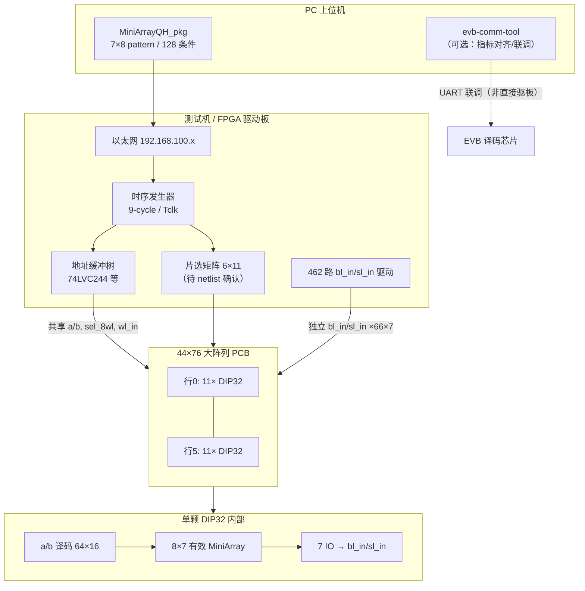
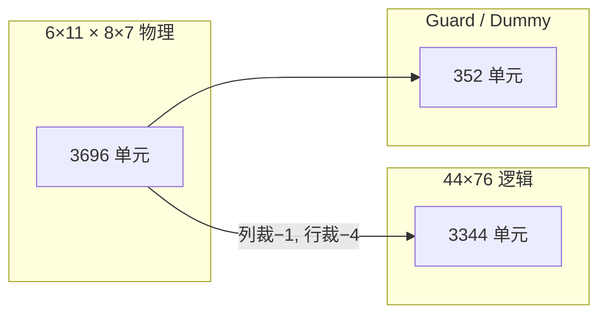
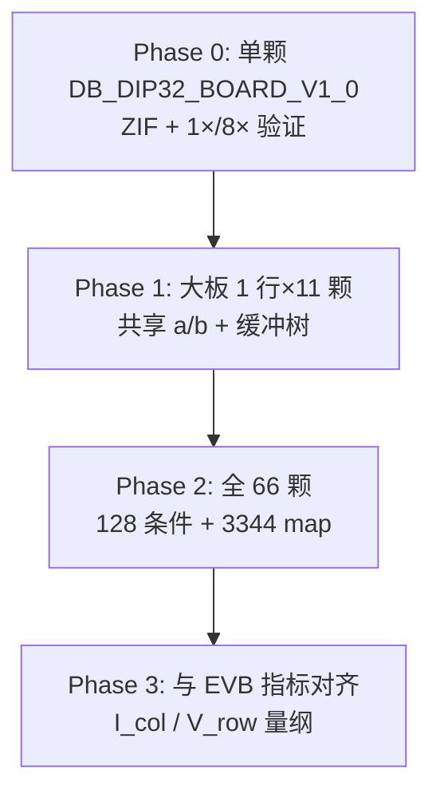

# PCB 大阵列拼接评估需求说明

> **文档性质**：PCB 设计/Layout/SI/PI 评估需求书（Requirements Specification）  
> **适用范围**：66 颗 DIP32 MiniArray 忆阻子阵 → 6×11 PCB 拼接 → 44×76 逻辑大阵列  
> **编制日期**：2026-07-06  
> **关联文档**：[44×76阵列物理评估.md](./44x76阵列物理评估.md)（系统集成与协议侧）、[EVB通信工具_代码需求书.md](./EVB通信工具_代码需求书.md)  
> **主要参考**：`RRAM_阵列项目_物理信息详尽解析_修正版.html`（Reliance Memory 内部资料，含 DB_DIP32_BOARD_V1_0 实物引脚表）  
> **保密声明**：原始资料含 Confidential 水印；本文档仅供项目组内部 PCB/硬件评估，不得对外传播。

---

## 目录

1. [文档目的与范围](#1-文档目的与范围)
2. [系统架构](#2-系统架构)
3. [物理规模指标](#3-物理规模指标)
4. [PCB 设计评估项](#4-pcb-设计评估项)
5. [电气与协议约束](#5-电气与协议约束)
6. [软件与测试流程](#6-软件与测试流程)
7. [验收标准](#7-验收标准)
8. [风险清单与待确认项](#8-风险清单与待确认项)
9. [附录](#9-附录)

---

## 1. 文档目的与范围

### 1.1 文档目的

本需求说明面向 **PCB 工程师、SI/PI 工程师、测试硬件负责人**，明确将 **单颗 8×7 MiniArray（DIP32）** 拼接为 **44×76 大阵列 PCB** 时，Layout/布线/电源/接口/时序/可测性各维度须回答的问题，并给出 **可量化评估项与 pass/fail 判据**。

PCB 评估须能回答以下核心问题：

| # | 评估问题 | 成功判据概要 |
|---|----------|--------------|
| Q1 | 6×11 颗 DIP32 在单板上的 **布局、间距、散热、机械安装** 是否满足 66 片并行读写？ | 温升、IR drop、插座插拔力在规格内 |
| Q2 | **共享译码**（`a<5:0>`、`b<3:0>`、`sel_8wl`、`wl_in`）与 **462 路独立 IO**（`bl_in`/`sl_in`）能否在目标频率下 **等长/skew 受控**？ | 9-cycle（或等效）时序 margin ≥ 规格 |
| Q3 | **VAA1–3 / VSS1–4** 分区、去耦、铜厚能否支撑峰值电流与 IR drop 预算？ | 各域 IR drop、纹波在阈值内 |
| Q4 | **DIP32 插座 / Pin1 对齐 / 键合-封装接口** 是否防呆、可重复、可换片？ | 引脚一一对应，无反插烧毁风险 |
| Q5 | `wl_en`、`cen`、9-cycle 嵌套时序在 **PCB 传播延迟** 下是否仍满足芯片 setup/hold？ | 全板 worst-case 延迟 < 预算 |
| Q6 | **测试点 / 边界扫描 / 单颗旁路** 能否支撑 bring-up 与故障隔离？ | 66 颗中任一颗可独立断连或观测 |
| Q7 | 逻辑 **3344** 单元与物理 **3696** 单元的 **映射差额（352）** 是否在 Layout/Netlist 中显式标注？ | 提供有效单元 map，guard 区不布线冲突 |

### 1.2 范围边界

| 在范围内 | 不在范围内（另文/另项目） |
|----------|---------------------------|
| 66×DIP32 大阵列 PCB、插座、电源树、共享/独立信号布线 | EVB 译码 SoC 内部阵列（见 `evb-comm-tool`） |
| FPGA/测试机 ↔ PCB 连接器、缓冲树、测试点 | MiniArrayQH_pkg 源码实现细节 |
| 单芯片 DB_DIP32_BOARD_V1_0 向大板的 **接口继承** | 芯片内部 64×16 译码电路晶体管级设计 |
| 9-cycle / 128 条件扫描的 **PCB 延迟预算** | UART 25 B TX / 17 B RX 协议（见 PROTOCOL_UART） |

### 1.3 术语对齐

与 [44×76阵列物理评估.md](./44x76阵列物理评估.md) 保持一致：

- **MiniArray / 8×7**：单颗 DIP 对外有效子阵（56 单元）
- **7×8 pattern**：MiniArrayQH_pkg 软件侧矩阵维度（与硬件 8×7 **转置**，须统一坐标原点）
- **共享译码**：66 颗芯片并联同一组 `a/b`（及子集控制线），以 **片选或分区** 区分响应芯片
- **128 conditions**：8 WL 组 × 16 BL，单配置下快速并行读扫描空间

---

## 2. 系统架构

### 2.1 自顶向下链路



### 2.2 小芯片 → PCB → 大阵列

| 层级 | 实体 | 职责 |
|------|------|------|
| L0 Die | 64 WL × 16 BL RRAM + 7 IO | 片内 1024 交叉点；对外仅映射 **8×7** 有效区 |
| L1 封装 | DIP32 + 金丝键合 | 32 脚引出；Pin1 防呆；VAA/VSS 多点分布 |
| L2 单芯片测试板 | **DB_DIP32_BOARD_V1_0**（2025-09-24） | 验证单颗 bring-up；ZIF 插座；黑阻焊 |
| L3 大阵列 PCB | **6 行 × 11 列 = 66 颗** | 共享译码 + 独立 IO；拼成 **44×76 逻辑阵** |
| L4 测试机 | 嵌入式控制器 + FPGA/DAC | 以太网收配置；驱动 944 量级网络 |
| L5 上位机 | MiniArrayQH_pkg | 7×8 pattern、OTP/MTP、128 条件序列 |

### 2.3 与测试机 / DIP32 / 译码的关系

**测试机（Test Machine）**

- 单芯片阶段：ZIF **双列 DIP32 插座**，引脚 **一一对应**（"matched and connected one by one"）；镀金触点；Pin1 三角/丝印防呆。
- 大阵列阶段：须扩展为 **66 组独立 bl_in/sl_in 驱动** + **共享地址缓冲**；通信建议以太网（192.168.100.100 Device / .101 Host），带宽与距离优于 USB 长距方案。

**DIP32**

- 标准 **2.54 mm** 间距；单颗测试板估算 **~20 mm × 52 mm**（不含工艺边）。
- 66 颗网格估算 PCB **~360 mm × 660 mm**（芯片中心距 ~60 mm 含走线区，**待 Layout 确认**）。

**译码芯片（EVB SoC）**

- `evb-comm-tool` 所测对象为 **Turbo 译码 EVB**，经 UART 验证 Mode1/2/3 BER。
- 44×76 PCB 为 **裸 DIP 级物理拼接**；未来若 EVB 直接驱动该 PCB，仅 **V_row/I_col 量纲** 可对齐，**引脚/时序接口不等价**。

---

## 3. 物理规模指标

### 3.1 规模一览

| 指标 | 数值 | 说明 |
|------|------|------|
| 单芯片有效阵列 | **8 × 7 = 56** | 每颗 MiniArray tile |
| PCB 芯片数 | **66** | **6 × 11** DIP32 网格 |
| 粗算物理单元 | **66 × 56 = 3696** | 全部有效 tile 计入 |
| 标称逻辑大阵 | **44 × 76 = 3344** | 乘法器 / MAC 目标维度 |
| **规模差额** | **352（≈9.5%）** | 见 [附录 B](#附录-b规模差额-3696-vs-3344) |
| 片内寻址空间 | **64 × 16 = 1024** | `a<5:0>` × `b<3:0>` |
| IO 通道 | **7** | `bl_in<6:0>` / `sl_in<6:0>` 一一对应 |
| 128 读条件 | **8 × 16** | `sel_8wl=1` 快速并行读 |
| 1× 全扫 | **64 × 16 = 1024** | 单芯片单点读（故障定位） |

### 3.2 信号规模与复用

| 类别 | 信号 | 数量 | 复用方式 |
|------|------|------|----------|
| 共享地址 | `a<5:0>`, `b<3:0>` | 10 | 66 颗并联；须缓冲树；负载电容估算 **100–200 pF** |
| 共享控制 | `sel_8wl`, `wl_in` | 2 | 全板广播（`wl_en`/`cen` 见 [§4.5](#45-信号完整性)） |
| 独立数据 | `bl_in<6:0>` × 66 | 462 | 每颗独立；不可共享 |
| 独立数据 | `sl_in<6:0>` × 66 | 462 | 与 bl_in 成对；建议差分/邻近布局 |
| 电源 | VAA1–3, VSS1–4 | 7 域 | 分散引脚；大板须分区铜皮 |
| **网络合计（估算）** | — | **~944** | 10 地址 + 3 控制 + 7 电源 + 924 数据线 |

> **注**：HTML 修正版引脚表 **未列出独立 `wl_en`/`cen` 脚位**（32 脚已占满）；信号描述仍定义二者为有效使能。大板设计须以 **最新 Bonding Diagram** 为准，并与 [44×76阵列物理评估.md](./44x76阵列物理评估.md) 幻灯片版 Pin27/28 交叉核对。

### 3.3 几何拼接模型（评估假设 A，待硬件 sign-off）

| 方向 | 芯片数 | 单颗贡献 | 粗拼 | 标称 | 裁减 |
|------|--------|----------|------|------|------|
| 列（76） | 11 | 7 列/颗 | 77 | 76 | −1 列 |
| 行（44） | 6 | 8 行/颗 | 48 | 44 | −4 行 |



---

## 4. PCB 设计评估项

### 4.1 布局（6×11 拼接、间距、热、机械）

#### 4.1.1 芯片网格

| 评估项 | 要求 | 评估方法 |
|--------|------|----------|
| 网格拓扑 | 6 行 × 11 列，编号 (row 0–5, col 0–10) | Layout 图与 BOM 一致 |
| 芯片取向 | 全板 **Pin1 同向**（三角/丝印/红块） | 装配图 + 首件检验 |
| 中心间距 | 建议 **≥ 5 mm** 热间距；走线区含 **~60 mm** 节距估算 | 热仿真 / 实测 |
| PCB 外形 | 大型板 **~360×660 mm** 量级；须机架/加强筋 | 机械图纸 |
| 插座 vs 焊接 | Bring-up 阶段 **精密 DIP 插座（ZIF）**；量产可焊，须控温 | 工艺评审 |
| 有效区标注 | 44×76 逻辑区 vs 352 guard 单元 **丝印框线** | 与 map 文件一致 |

#### 4.1.2 热与机械

| 评估项 | 指标（建议） | 依据 |
|--------|--------------|------|
| 单颗估算功耗 | ~10 mW（读）；forming 更高 | HTML 推断 |
| 66 颗总功耗 | ~660 mW（读）；forming 峰值 **可达数百 mA–数 A 级** | 须实测 |
| 散热 | 芯片下 **thermal via** 至背面铜皮；间距 ≥5 mm | HTML 推断 |
| 板厚/层数 | 建议 **≥ 8 层**（944 网络） | HTML 推断 |
| 铜厚 | 电源层 **≥ 2 oz** | HTML 推断 |
| 加强 | 大面积板防翘曲；重插座处结构件 | 机械评估 |

### 4.2 布线（地址共享、IO 独立、等长、阻抗）

#### 4.2.1 共享译码总线

| 信号 | 走线策略 | 评估指标 |
|------|----------|----------|
| `a<5:0>`, `b<3:0>` | 星型或鱼骨 + **74LVC244 级缓冲**；避免 66 负载直连 FPGA | 上升沿单调；负载电容 100–200 pF 下仍满足 Tclk |
| `sel_8wl` | 关键模式线；**远离** 高速/模拟敏感线 | 串扰 < 规格 |
| `wl_in` | 精密模拟/高压；包地；与 bl 线隔离 | 编程电压爬升无振铃 |
| 地址等长 | 66 颗 **skew < 1 ns**（@10 MHz 为 1% 周期） | TDR / 示波器 |

**系统约束（HTML）**：66 颗共享地址时 **无法在同一时刻对不同芯片施加不同 WL 组**；须 **分时** 或靠 **bl_in/sl_in 分区** 实现多 tile 并行读。

#### 4.2.2 独立 IO（bl_in / sl_in）

| 评估项 | 要求 |
|--------|------|
| 线数 | **462 × 2 = 924** 根（bl + sl） |
| 配对 | `bl_in<i>` 与 `sl_in<i>` **一一对应**；读时 bl=1 则 sl=0（接 VSS 逻辑） |
| 布局 | 同芯片 7 路 IO **等长**（组内 skew 最小）；**bl/sl 成对差分或紧耦合** |
| 组间 | 芯片间 **不要求** bl 线等长；但 8× 并行同时读时须满足 **同时到达** 容差 **< 5 mm**（@10 MHz ≈ 25 ps 量级，裕量充足） |
| 1-clock 脉冲 | `bl_in/sl_in` 有效窗最窄（9-cycle 模型中为 **1 cycle**）；须 **端接/串阻** 防过冲 |

#### 4.2.3 层叠与阻抗

| 评估项 | 建议 |
|--------|------|
| 层数 | **8+ 层**：信号-地-电源-信号交替 |
| 单端阻抗 | 50 Ω ±10%（FPGA–缓冲–插座链路） |
| 差分（若采用） | bl/sl 100 Ω 差分对（可选优化） |
| 过孔 | 电源/地 **密集过孔围栏**；信号换层 stub 最小化 |

### 4.3 电源（VAA1–3, VSS1–4 分区、去耦、电流）

#### 4.3.1 引脚分布（DB_DIP32_BOARD_V1_0，HTML 事实）

| 引脚 | 电源域 | PCB 要求 |
|------|--------|----------|
| 10 | VAA1 | 宽铜皮 + 去耦 |
| 12 | VAA2 | 宽铜皮 + 去耦 |
| 20 | VAA3 | 宽铜皮 + 去耦 |
| 5 | VSS1 | 短粗接地，就近过孔 |
| 13 | VSS2 | 短粗接地，就近过孔 |
| 30 | VSS3 | 短粗接地，就近过孔 |
| 底部 | VSS4 | 大面积接地/散热铜皮 |

> **推断（HTML）**：VAA1/2/3 可能对应 **数字译码 / WL 高压驱动 / IO 检测** 不同域；**须芯片手册确认**，Layout 阶段 **默认分域隔离**，单点汇聚需 PI 仿真批准。

#### 4.3.2 去耦与电流

| 评估项 | 要求 |
|--------|------|
| 单颗去耦 | **100 nF（0402，距 pin < 2 mm）+ 10 µF（0805，同域）** × 各 VAA |
| 66 颗聚合 | 分区 **bulk 电容**（如每 11 颗一组 100 µF）；避免单点供电 |
| IR drop | 全板 simultaneous 8× 读：VAA 域 **IR drop < 3%**（建议值，待 sign-off） |
| 纹波 | VAA 在 pulse 期间 **< 50 mVpp**（建议值） |
| 峰值电流 | forming 66 片并行：**估算 198 mA+**（3 V × 1 mA/颗）；Set/Reset 更高 |
| 上电顺序 | **GND → IO 默认安全 → VAA 软启动 → 释放时序** | 防 latch-up / 误编程 |

### 4.4 键合/封装接口（DIP32 插座、Pin1 对齐）

| 评估项 | 要求 |
|--------|------|
| 封装 | DIP-32，2.54 mm 间距，透明盖保护 Die |
| 测试板版本 | DB_DIP32_BOARD_V1_0，2025-09-24 |
| Pin1 | 三角 + "PIN 1" 丝印；插座防呆 |
| 引脚对应 | 测试机通道与封装 **严格 1:1**；错插 **电源反接烧毁** |
| 插座 | ZIF，镀金触点 **R_contact < 10 mΩ** |
| ESD | 插座/板边 **TVS**；操作防静电手环 |
| 键合 | 金丝 ~25 µm，~1 nH/mm；RRAM <10 MHz 时可忽略 |
| 大板插座 | 66 套插座 **共面度**；换片不损伤焊盘 |

### 4.5 信号完整性（wl_en, cen, 9-cycle 延迟预算）

#### 4.5.1 使能极性与顺序（HTML 事实）

| 信号 | 有效 | 作用 |
|------|------|------|
| `wl_en` | **VDD（高）** | 对选中 WL 施加 Vwl |
| `cen` | **VDD（高）** | 对选中 BL/SL 施加 Vbl/Vsl |
| `sel_8wl` | VDD=8×读；VSS=1×读 | 模式切换 |

**严格顺序（单周期内 T1→T4，HTML）**：

1. **T1** 地址建立：`a/b` 稳定  
2. **T2** 使能：`wl_en`, `cen` 拉高  
3. **T3** 电压：`wl_in` 拉高 → `bl_in/sl_in` 变化  
4. **T4** 传感与复位  

#### 4.5.2 9-cycle 嵌套模型（幻灯片 / 44×76 文档，FPGA 实现）

与 HTML「单 clock 内四阶段」并行采用：**宏观 9-cycle 原子读写** 为 FPGA/MiniArrayQH 模板。

| 信号 | 有效 cycle 数 | 典型窗口 |
|------|---------------|----------|
| `a<5:0>`, `b<3:0>` | **9** | cycle 1–9 |
| `wl_en` | **7** | cycle 2–8 |
| `cen` | **5** | cycle 3–7 |
| `wl_in` | **3** | cycle 4–6 |
| `bl_in/sl_in` | **1** | cycle 5 |

```
Cycle:     1    2    3    4    5    6    7    8    9
           ─────────────────────────────────────────►
a/b        ████████████████████████████████████████  (9)
wl_en          ████████████████████████████            (7)
cen                 ██████████████████                 (5)
wl_in                      ███████                      (3)
bl/sl_in                     █                           (1)
```

#### 4.5.3 PCB 延迟预算（评估须填实测）

| 参数 | 建议预算 | 说明 |
|------|----------|------|
| Tclk | 100 ns–1 µs（首版 **200 ns / 5 MHz**） | HTML 推断；66 负载降频 |
| 地址 Tsu | 10–20 ns | FPGA 输出到 **最远** 芯片 pin |
| 时钟 skew（66 颗） | **< 2 ns** | 时钟缓冲树 |
| bl/sl 1-cycle 窗 | ≥ **2×（max_skew + Tr）+ Tsense** | cycle 5 前后留 margin |
| wl_en→wl_in 顺序 | PCB 不得颠倒；**wl_in 延迟 ≥ wl_en + 5 ns** | 防误冲击 |

### 4.6 测试点 / 边界扫描 / 可测性

| 评估项 | 要求 |
|--------|------|
| 电源测试点 | 每 **VAA 域**、每 **11 颗分区** 至少 1 个 TP |
| 共享总线 TP | `a/b`、`sel_8wl`、`wl_in` 近 FPGA 入口与 **最远芯片** 各 1 |
| 片选观测 | 66 路或分组 cen 波形可探针（待架构确认） |
| 单颗旁路 | 每颗 **电源跳线或 0 Ω 可拆** / 逻辑隔离，故障 chip 不拖死全板 |
| 边界扫描 | 若用 JTAG 缓冲器链，须覆盖地址缓冲 **BYPASS** 路径 |
| 开短路 | 首件 **ICT/Flying Probe**：VAA–VSS 无短路；各 IO 无对地短路 |
| 日志关联 | TP 编号与 MiniArrayQH **chip_id (0–65)** 一致 |

---

## 5. 电气与协议约束

> 来源：HTML 修正版信号描述 + [44×76阵列物理评估.md](./44x76阵列物理评估.md)

### 5.1 寻址

| 总线 | 位宽 | 范围 | 功能 |
|------|------|------|------|
| `a<5:0>` | 6 | 0–63 | WL 译码 |
| `b<3:0>` | 4 | 0–15 | BL/SL 译码 |

- 10 bit 地址 → 1024 交叉点；对外 MiniArray 仅 **8×7** 映射至 DIP。
- 软件地址输入：**十六进制** `addr_wl` / `addr_bl`；内部补零为 6/4 bit 二进制。

### 5.2 1× 读 vs 8× 读

| `sel_8wl` | 模式 | WL 行为 | 用途 |
|-----------|------|---------|------|
| **VSS** | 1× 读 | 仅 `a<5:0>` 指定 **1** 条 WL | 故障定位、单点校准、IV |
| **VDD** | 8× 读 | **8** 条 WL 并行（`a<5:3>` 定组，`a<2:0>` 通配 ×） | 128 条件、MAC 并行 |

**8× 读地址示例（HTML 事实）**

```
# WL<7:0>, BL<15>, IO6
bl_in<6:0> = 1000000,  sl_in<6:0> = 0000000
b<3:0> = 1111,  a<5:0> = 000xxx (xxx=000~111)
sel_8wl = 1, wl_in = 1
```

**1× 读示例**

```
sel_8wl = 0 (VSS)
b<3:0> = 精确,  a<5:0> = 精确  → 单点 (WL=i, BL=j)
```

### 5.3 IO 互补规则（HTML 事实）

- `bl_in<i>` 与 `sl_in<i>` **严格一一对应**。
- 读 IO*i*：`bl_in<i>=1`，`sl_in<i>=0`（SL 接 VSS）；其余 IO 为 0。
- 违反互补 → **无电流回路**，读失败。

### 5.4 时序协议要点

| 要点 | 说明 |
|------|------|
| 原子操作 | 完整读 = **9-cycle 序列**（或 HTML 单周期四阶段，二者须在 FPGA 模板中对齐） |
| 128 扫描 | `sel_8wl=1`；`b` 扫 0–15；`a<5:3>` 扫 0–7 |
| 全扫 1024 | 1× 模式，较慢，用于 bring-up |
| 共享地址限制 | 同一时刻全板 **同一 a/b**；多芯片差异靠 **IO 数据** 或 **分时** |

---

## 6. 软件与测试流程

### 6.1 分工

| 组件 | 职责 | 接口 |
|------|------|------|
| **MiniArrayQH_pkg** | 7×8 pattern；WL/BL 十六进制地址；OTP/MTP；128 条件；Run/OpenLog | 以太网 → 测试机 |
| **测试机固件** | 解析网包 → GPIO/DAC → 32×66 引脚电平 | 192.168.100.100 |
| **44×76 PCB** | 物理阵列与 map | DIP32 × 66 |
| **evb-comm-tool** | EVB UART BER；**不直接驱动** 66 DIP | 9600 AA 帧 |

### 6.2 MiniArrayQH 操作流程（HTML 事实）

1. 打开 MiniArrayQH_pkg  
2. **Connect**（Host .101 ↔ Device .100）  
3. 选择 WL/BL **十六进制**地址  
4. 模式：**OTP**（一次性 forming）/ **MTP**（可重复 Set/Reset）  
5. 编辑 **7 行 × 8 列** pattern  
6. **Run**  
7. **OpenLog** 查看日志  

### 6.3 PCB bring-up 测试阶段



| 阶段 | PCB 验收焦点 |
|------|--------------|
| Phase 0 | Pin1、电源、单颗 9-cycle 波形 |
| Phase 1 | 11 负载地址缓冲、IR drop、skew |
| Phase 2 | 924 IO 连通、352 guard 无冲突、8× 并行 margin |
| Phase 3 | 与 evb-comm-tool Sim-to-Real 公式对照（非引脚级） |

### 6.4 坐标系约定

| 视角 | 行 | 列 |
|------|----|----|
| 硬件 slide / die | **8** | **7** |
| MiniArrayQH pattern | **7** | **8** |

**PCB map 与软件须统一 `(row, col)` 原点**，避免 44×76 向量乘维度错配。

---

## 7. 验收标准

### 7.1 可测量 pass/fail 指标

| 类别 | 指标 | Pass | Fail |
|------|------|------|------|
| **连通** | 66 颗 VAA–VSS 电阻 | > 1 kΩ（未上电） | < 10 Ω 短路 |
| **连通** | 各 bl_in/sl_in 开短路 | 与 netlist 一致 | 对地/对电源短路 |
| **IR drop** | 8× 读全板 simultaneous | ΔV/VAA < **3%** | ≥ 3% 或读失败率上升 |
| **纹波** | VAA 脉冲期间 | < **50 mVpp** | 超规格且 BER/margin 下降 |
| **时序** | 最远 chip cycle 5 setup | margin ≥ **20% Tclk** | bl/sl 采样失败 |
| **skew** | 66 颗 clock/地址 | < **2 ns** | ≥ 2 ns 且 8× 读不稳定 |
| **读写 margin** | 1× 单点 HRS/LRS 区分 | 可重复读 **100 次** 无误 | 随机 fail > 1% |
| **128 条件** | 8× 全扫描 | **128/128** 有效 | 任一条件持续 fail |
| **3344 map** | 逻辑单元读写 | 逐地址 pass | 越界或 guard 区误激活 |
| **热** | 连续 128×10 轮 | ΔT < **15°C**（环境+25°C） | 热关断或 drift |
| **机械** | 66 插座插拔 50 次 | R_contact 漂移 < 20% | 接触不良 |

### 7.2 文档交付物（PCB 评估完成标志）

- [ ] 66 颗 **坐标 + Pin1 方向** 装配图  
- [ ] **完整 netlist**（共享 vs 独立网络清单）  
- [ ] **3344 有效单元 map**（352 guard 标注）  
- [ ] PI 仿真报告（IR drop / 电流密度）  
- [ ] SI 报告（skew、Tclk margin、1-cycle 窗）  
- [ ] 测试点 **TP-xxx ↔ chip_id** 对照表  
- [ ] Phase 0–2 **实测波形** 存档（示波器 / LA）

---

## 8. 风险清单与待确认项

### 8.1 风险清单

| ID | 风险 | 影响 | 缓解 |
|----|------|------|------|
| R1 | **944 网络** 层数不足 | 无法布线 / 成本高 | 8+ 层；分区 fly-by |
| R2 | 66 负载 **地址上升沿变缓** | 9-cycle margin 不足 | 缓冲树；降频至 5 MHz |
| R3 | **共享 a/b** 多片同时响应 | BL 冲突 / 读值叠加 | cen 分组；严格片选 netlist |
| R4 | **bl/sl 1-cycle** 窗过窄 | 边沿 chip 读失败 | 等长；串阻；降频 |
| R5 | **352 guard** 未定义 | 软件/Layout 坐标混乱 | 官方 map 表 |
| R6 | **7×8 vs 8×7** 转置 | 向量乘错维 | MiniArrayQH 强制约定 |
| R7 | **引脚表版本不一致**（HTML vs 幻灯片） | 插座/netlist 错误 | Bonding sign-off |
| R8 | **wl_en/cen 无 DIP 脚**（HTML V1_0） | 使能不可控 | 确认 bonding / 下版芯片 |
| R9 | forming **峰值电流** | 电源 collapse | 分区上电；限流 |
| R10 | DIP **散热差** | 温漂 / RRAM drift | 间距；thermal via |
| R11 | 8× 读 **交叉干扰** | MAC 精度下降 | 状态精细控制；1× 校准 |
| R12 | 以太网 **控制延迟** | 实时性不足 | 本地 FPGA 直连备选 |

### 8.2 待确认项

| # | 问题 | 负责人 | 状态 |
|---|------|--------|------|
| 1 | 3344 vs 3696 **官方 map 表** | | 开放 |
| 2 | `cen`：**66 独立** vs **6/11 分组** | | 开放 |
| 3 | `wl_en`/`cen` **Bonding 脚位**（HTML 表缺失） | | 开放 |
| 4 | HTML vs 幻灯片 **DIP32 引脚顺序** 以何为准 | | 开放 |
| 5 | 9-cycle vs HTML **单周期四阶段** FPGA 模板统一 | | 开放 |
| 6 | VAA1/2/3 **电压值与域划分** | | 开放 |
| 7 | 66 颗 **simultaneous forming** 是否允许 | | 开放 |
| 8 | 测试机 **462 DAC** 架构或复用方案 | | 开放 |
| 9 | EVB Mode1 `In[]` → 44×76 **映射规则** | | 开放 |
| 10 | PCB 目标 **Tclk / 频率** 正式规格 | | 开放 |

---

## 9. 附录

### 附录 A：DIP32 引脚表

#### A.1 DB_DIP32_BOARD_V1_0（HTML 修正版，**PCB Layout 优先**）

| Pin | 信号 | 类型 | PCB 走线建议 |
|-----|------|------|--------------|
| 1 | `sl_in<3>` | 数据 | 与 bl_in<3> 成对 |
| 2 | `sl_in<4>` | 数据 | 与 bl_in<4> 成对 |
| 3 | `sl_in<5>` | 数据 | 与 bl_in<5> 成对 |
| 4 | `sl_in<6>` | 数据 | 与 bl_in<6> 成对 |
| 5 | **VSS1** | 地 | 短粗、就近过孔 |
| 6 | `b<3>` | 地址 | 共享总线 + 缓冲 |
| 7 | `b<2>` | 地址 | 共享总线 + 缓冲 |
| 8 | `b<1>` | 地址 | 共享总线 + 缓冲 |
| 9 | `b<0>` | 地址 | 共享总线 + 缓冲 |
| 10 | **VAA1** | 电源 | 宽铜 + 100 nF + 10 µF |
| 11 | `sel_8wl` | 控制 | 远离高速线 |
| 12 | **VAA2** | 电源 | 宽铜 + 去耦 |
| 13 | **VSS2** | 地 | 短粗、就近过孔 |
| 14 | `a<0>` | 地址 | 共享总线 + 缓冲 |
| 15 | `a<1>` | 地址 | 共享总线 + 缓冲 |
| 16 | `a<2>` | 地址 | 共享总线 + 缓冲 |
| 17 | `a<3>` | 地址 | 共享总线 + 缓冲 |
| 18 | `a<4>` | 地址 | 共享总线 + 缓冲 |
| 19 | `a<5>` | 地址 | 共享总线 + 缓冲 |
| 20 | **VAA3** | 电源 | 宽铜 + 去耦 |
| 21 | `wl_in` | 控制 | 精密/高压，包地 |
| 22 | `bl_in<0>` | 数据 | 独立，组内等长 |
| 23 | `bl_in<1>` | 数据 | 独立，组内等长 |
| 24 | `bl_in<2>` | 数据 | 独立，组内等长 |
| 25 | `bl_in<3>` | 数据 | 独立，组内等长 |
| 26 | `bl_in<4>` | 数据 | 独立，组内等长 |
| 27 | `bl_in<5>` | 数据 | 独立，组内等长 |
| 28 | `bl_in<6>` | 数据 | 独立，组内等长 |
| 29 | `sl_in<0>` | 数据 | 与 bl_in<0> 成对 |
| 30 | **VSS3** | 地 | 短粗、就近过孔 |
| 31 | `sl_in<1>` | 数据 | 与 bl_in<1> 成对 |
| 32 | `sl_in<2>` | 数据 | 与 bl_in<2> 成对 |
| — | **VSS4**（底部） | 地/散热 | 大面积铜皮 |

> **信号描述中的 `wl_en`、`cen`**：功能已定义（高有效），但上表 32 脚 **无独立 pin**。**待 Bonding 确认**是否内建常使能、或由其它脚复用。

#### A.2 幻灯片版引脚表（交叉参考）

详见 [44×76阵列物理评估.md §2.2](./44x76阵列物理评估.md#22-完整引脚功能表据幻灯片-page-1-整理)。与 A.1 **顺序不同**（例如幻灯片 Pin1=`sl_in<0>`，HTML Pin1=`sl_in<3>`）。**Layout 必须以实物测试板丝印与最新 Bonding 为准**。

### 附录 B：规模差额 3696 vs 3344

| 计算 | 结果 |
|------|------|
| 66 × 8 × 7 | **3696** |
| 44 × 76 | **3344** |
| **差额** | **352（≈9.52%）** |

**352 分解（假设 A：11×7 列拼 −1 列，6×8 行拼 −4 行）**

| 来源 | 单元数 |
|------|--------|
| 4 行 × 76 列 guard | 304 |
| 1 列 × 48 行 guard | 48 |
| **合计** | **352** |

**352 因数**：8×44 = 11×32 = 16×22。

**PCB 要求**：guard 区 **不得** 与有效区 BL/WL 网络短接；Layout 丝印 **Non-programmable**；软件 **双坐标系**（物理 3696 / 逻辑 3344）直至官方 map 发布。

### 附录 C：参考文献

- [44×76阵列物理评估.md](./44x76阵列物理评估.md)
- [EVB通信工具_代码需求书.md](./EVB通信工具_代码需求书.md)
- [SIM_TO_REAL.md](./SIM_TO_REAL.md)
- [PROTOCOL_UART.md](./PROTOCOL_UART.md)
- `RRAM_阵列项目_物理信息详尽解析_修正版.html`（外部，Reliance Memory Confidential）

---

*本文档用于 PCB 大阵列拼接工程评估；引脚、电压、Tclk 以最新硬件 sign-off 为准。推断项已在正文标注来源。*
