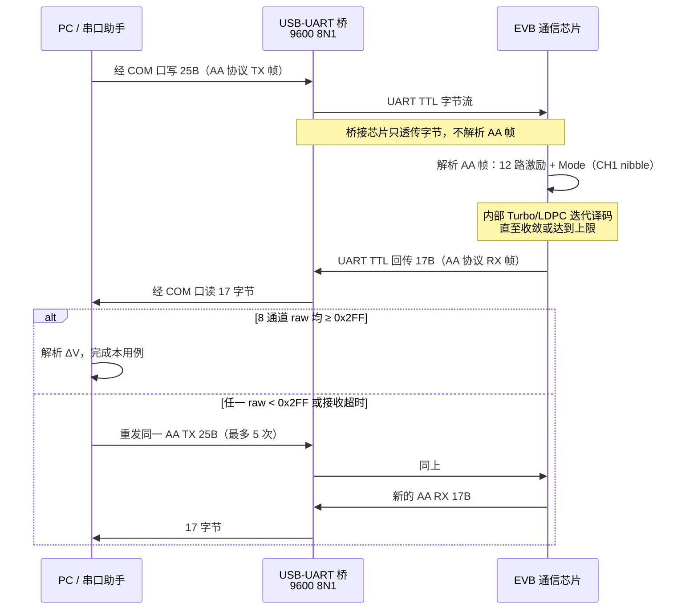

# EVB 芯片通信协议说明

**（UART 物理层 + AA 应用层）**

> 完整名称：**基于 UART 的 AA 定长二进制应用协议**  
> 面向使用**串口助手**（如正点原子 ATK-XCOM）手动抓包、联调的工程师。  
> 协议实现以 `protocol/codec.py` 为准；上位机收发逻辑见 `comm/serial_worker.py`。

---

## 0. 分层与命名：UART 是载体，AA 才是帧格式

文档文件名含「UART」，容易误以为 **UART 本身就是应用协议**。实际上二者是**不同层次**：

| 层次 | 名称 | 职责 | 本 EVB 中的具体参数 |
|------|------|------|---------------------|
| **物理 / 链路** | **UART 通信** | 字节如何在导线上传输 | 9600 bps，**8N1** 异步串行；无地址、无线上校验 |
| **应用 / 帧** | **AA 协议**（EVB 应用层协议） | 字节流中每帧的含义与布局 | TX **25 B**（`0xAA` 头 + 12×DAC）；RX **17 B**（迭代次数 + 8×ADC） |

**类比**：HTTP over TCP —— TCP 负责可靠传输字节流，HTTP 定义请求/响应格式；此处 **UART 负责传字节，AA 协议定义 25 B / 17 B 定长帧**。

### 0.1 物理连接路径（PC → EVB 芯片）

```
PC USB 口
  └─ USB 线缆
       └─ USB-UART 桥接芯片（CH340 / CP2102 / FT232 等）
            └─ UART TTL 电平（TX/RX/GND，通常 3.3 V）
                 └─ EVB 通信芯片 UART 引脚
```

- **PC 侧**：操作系统将桥接芯片枚举为 **虚拟 COM 口**（Windows 下即 `COMx`）。上位机 / 串口助手通过 COM 口读写，并不直接操作 USB 协议栈。
- **EVB 侧 Type-C 口**：因板卡设计不同，常见两种接法，**勿混为一谈**：

| 板卡接法 | Type-C 实际角色 | PC 侧现象 |
|----------|-----------------|-----------|
| **A. USB-UART 桥在 EVB 上** | Type-C = USB Device，板载 CH340 等 | 插 Type-C 后出现 COM 口；线路上芯片 UART ↔ 桥接芯片 |
| **B. Type-C 直连芯片 UART** | Type-C 经转接板引出 TTL UART | 需外接 USB-UART  dongle；COM 口在 dongle 上 |

无论 A 或 B，**到达芯片 UART 收发引脚的已是异步串行字节流**；PC 应用层只需打开 COM 口、按 AA 协议组帧即可。

### 0.2 正确用语

| 说法 | 是否准确 | 说明 |
|------|----------|------|
| 「UART 通信 / 串口通信」 | ✅ | 指物理链路与传输参数（9600 8N1） |
| 「AA 协议 / EVB 应用层协议」 | ✅ | 指定长帧格式（0xAA 头、Mode nibble、DAC/ADC 打包） |
| 「UART 协议 = 0xAA 帧格式」 | ❌ | UART 不规定帧内容；0xAA 属于 AA 应用层 |
| 「Modbus / 地址型总线协议」 | ❌ | 无从机地址、无功能码字节、无线上 CRC（见 §1） |

---

## 1. 重要前提：这不是 Modbus / 地址型协议

本 EVB 芯片在 UART 上传输的是**固定长度的原始二进制帧**，不是 Modbus RTU、不是「主机地址 + 从机地址 + 功能码 + CRC」那类工业总线协议。

| 常见误解 | 实际情况 |
|----------|----------|
| `0xAA` 是从机地址 | `0xAA` 是 **TX 帧固定帧头 / 同步字节**，仅出现在 PC→芯片方向 |
| 有独立「功能码」字节 | **矩阵模式**嵌入 CH1 高字节的高 4 bit，不是单独字段 |
| 线路上有 SUM/CRC 校验 | **线上无校验字节**；收敛判定与重发由 PC 端应用层完成 |
| RX 也以 `0xAA` 开头 | RX 首字节是**迭代次数**，无帧头 |

**正确心智模型**：PC 一次性发出 **25 字节**激励帧 → 芯片内部迭代译码 → 芯片一次性回 **17 字节**结果帧。一问一答，长度固定。

---

## 2. 与 XCOM「协议传输」术语对照

正点原子 XCOM 等工具的「协议传输」页签通常面向 Modbus 类帧格式，字段如下。下表说明**本芯片协议中对应关系**（多数字段**不适用**）。

| XCOM「协议传输」字段 | 本 EVB AA 协议 | 说明 |
|---------------------|----------------|------|
| **串口参数** | **9600，8N1** | 8 数据位、无校验、1 停止位；无 RTS/CTS 流控 |
| **主机地址** | PC（测试上位机） | 逻辑角色：发起方；**无地址字节** |
| **从机地址** | EVB 通信芯片 | 逻辑角色：响应方；**无地址字节** |
| **帧头 / 同步** | TX：`0xAA`（1 字节） | 仅发送帧 Byte0；**不是**从机地址 |
| **帧功能 / 功能码** | CH1 高字节高 4 bit（Mode 0~3） | 0=沿用，1/2/3=矩阵模式；**非独立功能码字节** |
| **数据长度** | TX 固定 24 B 载荷 + 1 B 头 = **25 B**；RX 固定 **17 B** | 长度恒定，无「长度字段」 |
| **数据区** | TX：12×12-bit DAC；RX：8×12-bit ADC | 每通道 **2 字节**（高字节在前） |
| **帧序列** | RX Byte0 = **迭代次数** | 芯片内部收敛轮数；TX 无序列号 |
| **校验方式 (SUM/CRC)** | **无** | 线上不含校验字节 |
| **校验值** | **无** | — |
| **帧周期** | 无硬性要求 | 收完 17 B 即可发下一帧 25 B |
| **重复次数** | 应用层重发（未收敛或超时） | 上位机默认最多 **5 次**（见 §6） |

### 2.1 「帧」的定义：TX 帧 vs RX 帧

| 方向 | 长度 | 别名 | 首字节含义 |
|------|------|------|------------|
| **TX 帧**（PC → 芯片） | 25 B | 发送帧 / 激励帧 | `0xAA` 帧头 |
| **RX 帧**（芯片 → PC） | 17 B | 接收帧 / 响应帧 | 迭代次数（**非** `0xAA`） |

---

## 3. 分层模型（与 §0 对照）

```
┌─────────────────────────────────────────────────────────────┐
│  业务应用   CSV 用例、BER 统计、收敛重发（raw ≥ 0x2FF）、GUI │
├─────────────────────────────────────────────────────────────┤
│  AA 应用层  定长帧：TX 25B（0xAA 头）/ RX 17B；Mode/DAC/ADC   │  ← 「AA 协议」
├─────────────────────────────────────────────────────────────┤
│  UART 链路  异步串行字节流；9600 8N1；无 RTS/CTS            │  ← 「UART 通信」
├─────────────────────────────────────────────────────────────┤
│  物理连接   PC USB → USB-UART 桥 → TTL UART → EVB 芯片        │  ← §0.1
└─────────────────────────────────────────────────────────────┘
```

- **物理连接**：见 §0.1；PC 经 USB 与桥接芯片通信，桥接芯片与 EVB 芯片之间为 **UART TTL**。
- **UART 链路层**：只约定**如何传字节**（波特率 **9600**、**8N1**、无硬件流控），**不规定**帧头、长度或字段含义。
- **AA 应用层**：在 UART 字节流上约定 **TX 25 B / RX 17 B** 定长帧；`0xAA` 帧头、Mode nibble、12-bit DAC/ADC 打包均属此层；无 Modbus 式寻址，无线上 CRC/SUM。
- **业务应用**：解析 12 路 DAC / 8 路 ADC；检查 8 通道 raw 是否均 ≥ `0x2FF`；不满足则**原帧重发**（最多 5 次）；超时同样重发。

---

## 4. TX 帧字节布局（PC → 芯片，25 字节）

发送序列以固定帧头 **`AA`** 开头，其后为 **12 组** DAC 数据，每组 **2 字节（1 个半字节）**。

```
偏移   长度    字段              编码
────   ────    ────              ────
0      1 B     帧头              固定 0xAA
1~2    2 B     通道 1            见 §4.1（高字节高 4 bit 含 Mode）
3~4    2 B     通道 2            见 §4.1（高字节高 4 bit = 0，沿用）
…      …       …                 …
23~24  2 B     通道 12           同上
```

**总长度**：1 B 帧头 + 12 × 2 B = **25 字节**。

### 4.1 单组 2 字节编码（1 个半字节 = 12-bit DAC）

每组占 **2 字节**，合称 **「1 个半字节」**——即 **12-bit DAC 码**（4 bit 高 + 8 bit 低，跨两字节）：

| 字节 | 位域 | 通道 1（CH1） | 通道 2~12（CH2–CH12） |
|------|------|---------------|------------------------|
| 第 1 字节 | `[7:4]` 高 4 bit | **Mode**（0~3） | 固定 **0**（**沿用**上一组矩阵模式） |
| 第 1 字节 | `[3:0]` 低 4 bit | DAC[11:8] | DAC[11:8] |
| 第 2 字节 | `[7:0]` | DAC[7:0] | DAC[7:0] |

**解析公式**（与 `protocol/codec.py` 一致）：

```
dac_raw = (高字节低 4 bit << 8) | 低字节     // 12-bit，范围 0x000~0xFFF
```

**Mode 仅出现在 CH1 高字节高 4 bit**；CH2–CH12 的高字节高 4 bit 恒为 **0**，表示 **沿用** CH1 所选的矩阵模式，不再重复携带 Mode。

| Mode（CH1 高 4 bit） | 含义 |
|----------------------|------|
| 0 | 沿用当前矩阵配置 |
| 1 | 矩阵模式 1 |
| 2 | 矩阵模式 2（上电默认） |
| 3 | 矩阵模式 3 |

> 12-bit DAC 有效范围 0~4095（0x000~0xFFF）。Legacy CSV 的 `cmd` 列（0x01, 0x02…）是**行序号元数据**，**不写入** TX 帧。

### 4.2 逐组解析示例（用例 A1，12 组 → 25 B）

下表与 DAC 规格表一致；完整线格式 hex 见 §4.3。

| 组 | 字节对 | 高字节高 4 bit | 12-bit DAC | 十进制 | 说明 |
|----|--------|----------------|------------|--------|------|
| 帧头 | `AA` | — | — | — | 固定同步字节 |
| CH1 | `16 F5` | **1**（矩阵模式 1） | **0x6F5** | 1781 | 高字节 `0x16` → Mode=1，DAC 高 4b=6；低字节 `0xF5` |
| CH2 | `07 72` | **0**（沿用） | **0x772** | 1906 | 高 4b=0，DAC=0x772 |
| CH3 | `0B 5A` | 0（沿用） | 0xB5A | 2906 | |
| CH4 | `0C 15` | 0（沿用） | 0xC15 | 3093 | |
| CH5 | `0B 1B` | 0（沿用） | 0xB1B | 2843 | |
| CH6 | `08 0E` | 0（沿用） | 0x80E | 2062 | |
| CH7 | `0C F0` | 0（沿用） | 0xCF0 | 3312 | |
| CH8 | `0D AC` | 0（沿用） | 0xDAC | 3500 | |
| CH9 | `09 C4` | 0（沿用） | 0x9C4 | 2500 | 0 V 偏置中点 |
| CH10 | `09 C4` | 0（沿用） | 0x9C4 | 2500 | |
| CH11 | `09 C4` | 0（沿用） | 0x9C4 | 2500 | |
| CH12 | `0F A0` | 0（沿用） | 0xFA0 | 4000 | 满幅参考 |

**CH1 手工验算**（`16 F5`）：

- 第 1 字节 `0x16`：高 4 bit = **1** → Mode = 矩阵模式 1；低 4 bit = **6** → DAC[11:8]
- 第 2 字节 `0xF5` → DAC[7:0]
- 合并：**0x6F5** = 1781

**CH2 及以后**（以 `07 72` 为例）：高字节 `0x07` 高 4 bit = **0**（沿用），低 4 bit + 次字节 → DAC **0x772** = 1906。

### 4.3 TX 帧完整 hex（用例 A1）

```
AA 16 F5 07 72 0B 5A 0C 15 0B 1B 08 0E 0C F0 0D AC 09 C4 09 C4 09 C4 0F A0
│  └─ CH1: Mode=1, DAC=0x6F5 (1781)
└─ 帧头 AA
   └─ CH2~CH12: 每组 2 B，高 4 bit=0（沿用），后接 12-bit DAC
```

共 **25 字节**；`build_tx_frame()` / `decode_tx_frame()` 与此格式一一对应。

---

## 5. RX 帧字节布局（芯片 → PC，17 字节）

```
偏移   长度    字段              说明
────   ────    ────              ────
0      1 B     迭代次数          芯片内部译码收敛所用轮数（无 0xAA 头）
1~2    2 B     输出通道 1        12-bit ADC raw，高字节在前
3~4    2 B     输出通道 2        同上
…      …       …                 …
15~16  2 B     输出通道 8        同上
```

### 5.1 单组 2 字节编码（与 TX 对称的「1 个半字节」）

RX 每通道同样占 **2 字节**，线格式与 TX §4.1 **对称**：高字节高 4 bit 为 **Mode 半字节**（硬件回读时通常为 **0 = 沿用**），低 12 bit 为 **ADC raw**。

| 字节 | 位域 | 含义 |
|------|------|------|
| 第 1 字节 | `[7:4]` 高 4 bit | **Mode**（0~3；实测多为 **0**，表示无独立模式切换） |
| 第 1 字节 | `[3:0]` 低 4 bit | ADC[11:8] |
| 第 2 字节 | `[7:0]` | ADC[7:0] |

**解析公式**（与 `decode_tx_frame()` 对称，见 `protocol/codec.py`）：

```
mode_nibble = 高字节 >> 4
adc_raw     = (高字节 & 0x0F) << 8 | 低字节     // 12-bit，0x000~0xFFF
ΔV          = (adc_raw / 4096.0) × 5.0 − 2.5    // 对称电压，raw=2048 为零点
```

**等价写法**（`parse_rx_frame()` / `decode_rx_frame()` 当前实现）：

```
adc_raw = ((high_byte << 8) | low_byte) & 0x0FFF
```

当高字节高 4 bit 为 Mode（0~3）时，Mode 落在 bit[11:8] 之上，**取低 12 bit 后与「Mode 拆分」公式结果相同**。实测回包高 4 bit 多为 0，两种写法数值一致。

> ⚠️ **首字节 `0x01` 是迭代次数，不是 Mode。** Mode 仅存在于各通道 2 字节组的高字节高 4 bit（若硬件置 0 则读作「沿用」）。  
> ⚠️ RX **不是** 9 字节（1 + 8×1）。每通道占 **2 字节**，总长 **17 字节**。

### 5.2 应用层「有效性」判定（非线上校验）

收到 17 字节后，PC 检查 **8 个通道 raw 是否全部 ≥ 0x2FF (767)**：

- 任一通道 `< 0x2FF` → 芯片未正常收敛 → **重发同一 TX 帧**
- 重发上限：**5 次**（与 `protocol/codec.py` 中 `MAX_RETRY = 5` 一致）

### 5.3 逐通道解析示例（黄金抓包，2026-07-01）

与 §4.3 同一组 TX 激励对应的 **17 B 实机回包**（9600 8N1，迭代 1 次，8 通道均 ≥ 0x2FF，已收敛）：

```
01 09 17 09 7C 05 F9 05 C3 07 C7 07 EF 08 5B 07 C3
│  └─ CH1: 09 17 → Mode=0, ADC=0x917(2327)
└─ 迭代次数 = 1（非 Mode）
```

| 通道 | 字节对 | Mode 高 4 bit | ADC raw | 十进制 | ΔV (V) | ≥0x2FF |
|------|--------|---------------|---------|--------|--------|--------|
| — | `01` | — | — | iter=**1** | — | — |
| CH1 | `09 17` | **0**（沿用） | **0x917** | 2327 | **+0.3411** | ✓ |
| CH2 | `09 7C` | 0（沿用） | **0x97C** | 2428 | **+0.4668** | ✓ |
| CH3 | `05 F9` | 0（沿用） | **0x5F9** | 1529 | **−0.6323** | ✓ |
| CH4 | `05 C3` | 0（沿用） | **0x5C3** | 1475 | **−0.6982** | ✓ |
| CH5 | `07 C7` | 0（沿用） | **0x7C7** | 1991 | **−0.0693** | ✓ |
| CH6 | `07 EF` | 0（沿用） | **0x7EF** | 2031 | **−0.0205** | ✓ |
| CH7 | `08 5B` | 0（沿用） | **0x85B** | 2139 | **+0.1116** | ✓ |
| CH8 | `07 C3` | 0（沿用） | **0x7C3** | 1987 | **−0.0745** | ✓ |

**CH1 手工验算**（`09 17`）：

- 第 1 字节 `0x09`：高 4 bit = **0**（沿用）；低 4 bit = **9** → ADC[11:8]
- 第 2 字节 `0x17` → ADC[7:0]
- 合并：**0x917** = 2327 → ΔV = 2327/4096×5 − 2.5 ≈ **+0.341 V**

**两种解析对照**（本抓包全部一致）：

| 通道 | `(hi<<8\|lo)&0xFFF` | `(hi&0x0F)<<8\|lo` | 相同？ |
|------|---------------------|---------------------|--------|
| CH1~8 | 0x917…0x7C3 | 0x917…0x7C3 | ✓ 相同 |

原因：各通道高字节高 4 bit 均为 **0**，Mode 半字节未占用 ADC 位域。

### 5.4 TX↔RX 成对参考（同一激励）

| 方向 | 25 / 17 B hex |
|------|----------------|
| **TX** | `AA 16 F5 07 72 0B 5A 0C 15 0B 1B 08 0E 0C F0 0D AC 09 C4 09 C4 09 C4 0F A0` |
| **RX** | `01 09 17 09 7C 05 F9 05 C3 07 C7 07 EF 08 5B 07 C3` |

完整 TX 12 组表见 §4.2；本 RX 为上述 TX 的实机响应，亦收录于 `data/A1A2A3_test_vectors.txt`（Golden capture）。

---

## 6. 时序与超时（`comm/serial_worker.py`）

| 参数 | 默认值 | 说明 |
|------|--------|------|
| 波特率 | **9600** | 与芯片一致 |
| 帧格式 | **8N1** | 无校验位 |
| **RX 等待超时** | **3000 ms** | GUI「超时(ms)」可调，范围 50~10000 |
| **最大重试** | **5 次** | 含超时重试与未收敛重试 |
| RX 等待 | 阻塞 `read` 凑满 17 B | `_wait_rx_frame()`，超时仍为 GUI 设定值 |
| 串口读 timeout | 动态 | 等待 RX 时按剩余截止时间设置；空闲默认 10 ms |
| 写 timeout | 1.0 s | `write_timeout=1.0` |
| 帧间间隔 | **无要求** | 收齐 17 B 即可发下一 25 B |

**单次交互流程**：

1. 清空接收缓冲 → 写入 25 B TX → `flush`
2. 在超时窗口内阻塞读取，凑满 **17 B** 即视为一帧 RX
3. 解析并检查 `needs_retry()`（任一 raw < 0x2FF）→ 是则回到步骤 1
4. 超时或解析失败同样计入重试

---

## 7. XCOM 正确用法 vs「协议传输」页签

### 7.1 推荐：单条发送 + HEX 原始模式

| 设置项 | 推荐值 |
|--------|--------|
| 波特率 | 9600 |
| 数据位 / 停止位 / 校验 | 8 / 1 / None（8N1） |
| 发送格式 | **HEX**（十六进制） |
| 发送方式 | **单条发送**（手动粘贴 25 字节 hex） |
| 显示 | 勾选「HEX 显示」便于对照回包 |

**操作步骤**：

1. 选择正确 COM 口，9600 8N1，打开串口
2. 在发送框粘贴完整 25 字节 hex，例如 A1 用例：
   ```
   AA 16 F5 07 72 0B 5A 0C 15 0B 1B 08 0E 0C F0 0D AC 09 C4 09 C4 09 C4 0F A0
   ```
3. 点击发送，等待接收区出现 **17 字节**回包
4. 人工检查首字节（迭代次数）及后续 16 字节；若某通道 raw < 0x2FF，**原样再发同一帧**

### 7.2 不推荐：启用「协议传输」页签

XCOM「协议传输」会按**主机地址、从机地址、功能码、长度、SUM 校验**等自动组帧。本芯片协议：

- **没有**从机地址字段（`0xAA` 会被误配成地址）
- **没有**独立功能码与长度字节
- **没有** SUM/CRC 校验字节

若强行填入 XCOM 协议模板，组出来的帧**长度与格式均错误**，芯片无法识别。

| 方式 | 能否用于本芯片 | 原因 |
|------|----------------|------|
| **单条发送 HEX 原始** | ✅ 推荐 | 与 `build_tx_frame()` 输出一致 |
| **协议传输自动组帧** | ❌ 不可用 | 帧结构与 Modbus 类协议不兼容 |
| **本仓库 EVB-COMM-tool** | ✅ 推荐 | 自动组帧、解析、重试、BER 统计 |

---

## 8. 交互时序图（PC ↔ EVB）



---

## 9. 快速对照表

| 项目 | TX（PC→芯片） | RX（芯片→PC） |
|------|---------------|---------------|
| 总长度 | **25 B** | **17 B** |
| 帧头 | `0xAA` | 无（首字节=迭代次数） |
| 通道数 | 12（DAC 激励） | 8（ADC 采集） |
| 每通道宽度 | 2 B → 12-bit（1 个半字节） | 2 B → 12-bit（1 个半字节，与 TX 对称） |
| 模式字段 | CH1 高字节 [7:4]；CH2–12 高 4 bit=0 | 各通道高字节 [7:4]（实测多为 0）；**首字节=迭代次数，非 Mode** |
| 线上校验 | 无 | 无 |
| 应用层校验 | — | 全通道 raw ≥ 0x2FF |

---

## 10. 相关文档

| 文档 | 内容 |
|------|------|
| `protocol/codec.py` | 帧编解码实现 |
| `comm/serial_worker.py` | 超时、重试、收发线程 |
| [软件工程视角与VibeCoding重建实验.md](软件工程视角与VibeCoding重建实验.md) | 架构、重发、result→ok→ber 流程图 |
| [SIM_TO_REAL.md](SIM_TO_REAL.md) | 物理量公式与 BER 通道 |
| [软件使用手册.md](软件使用手册.md) | 操作人员使用说明 |
| [CODE_GUIDE.md](CODE_GUIDE.md) | 二次开发目录索引 |

---

## 11. 通过 / 未通过 术语表（硬件 vs 符号）

上位机存在**两层独立判定**，勿混用「通过率 / 未通过率」：

| 术语 | 代码字段 | 判定规则 | GUI / 导出 |
|------|----------|----------|------------|
| **硬件收敛 / 硬件通过** | `CaseRecord.hardware_converged`（同 `success`） | 在重试预算内（默认 **5** 次）收到 **17 B RX**，且 **8 路 ADC raw 均 ≥ 0x2FF**（`protocol/validator.needs_retry` 为假） | 日志：`硬件收敛 ✓` / `硬件未收敛 ✗`；导出列 `HardwareConverged` |
| **符号匹配 / 符号通过** | `CaseRecord.passed`、`match_count` | 硬件已收敛的前提下，实测电压符号与 CSV `exp_sign1/2`（Turbo K=2 时通常 **2/2**）一致 | 用例表列 **「符号匹配」**；日志：`符号匹配 X/Y → ✓/✗`；导出列 `SymbolPassed` |

**与 EVB 规范对齐（权威硬件规则）**：

1. 一发一收：TX **25 B**（12 路 DAC）→ RX **17 B**（迭代次数 + 8 路 ADC）。
2. 芯片内部可迭代约 **10** 次；返回帧首字节为迭代次数。
3. **收敛**：8 路 raw **全部 ≥ 0x2FF** → 无需 PC 侧重发。
4. **未收敛**：任一路 **< 0x2FF** → PC **原帧重发**（`comm/serial_worker._do_send`）。
5. **硬件通过**：在 **≤5 次** PC 侧重发内收到收敛 RX；否则 `硬件未收敛`（超时、帧错、raw 不足均算失败）。

**符号层（软件 BER）**不参与重发；仅在硬件收敛后比较 `exp_sign` 与测量电压正负。可视化页的 **BER–SNR** 曲线统计的是**符号误码率**（`analysis/aggregate.compute_ber`），**不是**硬件未收敛率。

本工具**未**单独绘制「未通过率」曲线；若工作日志提及「通过率 ~6%」，通常指 **2/2 符号全对** 的比例，而非硬件收敛失败率。

---

## 12. 硬件 / 串口配置排查（串口助手单帧不成功）

> **最后更新**：2026-07-17  
> 场景：正点原子 ATK-XCOM 等串口助手发 TX 后无回包、乱码、或「看起来失败」；以及上位机「加载 A1 → 单帧测试」交叉验证。

### 12.1 先分清失败在哪一层

| 现象 | 多半在哪层 |
|------|------------|
| COM 口都看不到 / 连不上 | USB-UART / 驱动 / 线 |
| 能发，完全无回包 | 接线、电平、波特率、板子未上电 |
| 有回包但长度不对 / 乱码 | 波特率、8N1、粘包拆包 |
| 收到 17 B，但 Out≈+2.5 / 一直重试 | 芯片**未硬件收敛**（激励/芯片），不是串口参数错 |

### 12.2 串口助手必对配置

与本工具、`comm/serial_worker.py` 一致：

| 项 | 值 |
|----|-----|
| 波特率 | **9600**（勿用 115200） |
| 数据位 / 校验 / 停止位 | **8N1** |
| 流控 | **无**（关 RTS/CTS） |
| 发送格式 | **十六进制**，一次发完 **25 字节** |

**黄金样例 A1**（§4.3；上位机「加载 A1 示例」）：

```text
AA 16 F5 0A F0 09 60 04 1A 0D C0 0F 70 06 40 0C E0 09 C4 09 C4 09 C4 09 C4
```

期望：芯片回 **正好 17 字节**。RX **不以 `0xAA` 开头**（首字节是迭代次数）。

### 12.3 硬件路径检查

```text
PC USB → USB-UART 桥（CH340 等）→ TTL UART → EVB 芯片
```

1. 设备管理器能看到 `COMx`
2. EVB **供电正常**（仅插 USB 桥有时不够）
3. **TX/RX 交叉**，**GND 共地**；电平通常 **3.3 V TTL**
4. 勿接到错误的 UART（调试口 / 烧录口）
5. **桥接回环自检**：桥 TX–RX 短接，助手发什么收什么 → 桥 OK，问题在 EVB 侧

板卡 Type-C 角色见 §0.1（板载桥 vs 外接 dongle）。

### 12.4 用本上位机交叉验证

1. 端口选对 → 波特率 **9600** → **连接**
2. **加载 A1 示例** → **单帧测试**
3. 看「测试执行」日志 /「单帧信息记录」TX·RX hex

| 上位机结果 | 含义 |
|------------|------|
| 超时无 RX | 同助手「无回包」：线 / 电平 / 口 / 板 |
| 有 RX 但长度 ≠ 17 | 波特率 / 粘包 / 干扰 |
| 有 17 B，多次重试，`HardwareConverged=N`，Out≈+2.5 | 串口已通；CH1–8 raw 未全部 ≥ **0x2FF**（见 §11） |
| A1 一次成功 | 硬件+协议基本 OK；助手失败多半是 hex / 长度 / 波特率设错 |

超时默认约 **3000 ms**（界面「超时(ms)」可调）。

### 12.5 助手侧常见「假失败」

- 25 B 中间插空格/换行，实际字节数变了
- 勾了「发送新行」等附加字节
- 接收区按 ASCII 看二进制「乱码」
- 超时过短
- 连发多帧导致粘包

建议：清接收缓冲 → **只发一帧 A1** → 数 RX 是否刚好 **17** 个 hex 字节。

### 12.6 建议排查顺序

1. 助手：**9600 8N1 hex**，发 A1 25 B  
2. 不行 → 桥 **TX–RX 短接回环**  
3. 回环 OK → 查 EVB 供电、交叉线、GND  
4. 有 17 B 仍「不成功」→ 上位机 A1 看是否 **硬件收敛**；未收敛属芯片/激励，非串口配置  

相关实现：`protocol/codec.py`（25/17）、`protocol/validator.py`（`RETRY_THRESHOLD=0x2FF`）、`ui/main_window.py`（加载 A1 / 单帧测试）。

---

*文档版本：2026-07-17（§12 硬件/串口排查）；分层命名见 §0；帧长与 `TX_FRAME_LEN=25`、`RX_FRAME_LEN=17`、9600 8N1 对齐。*
