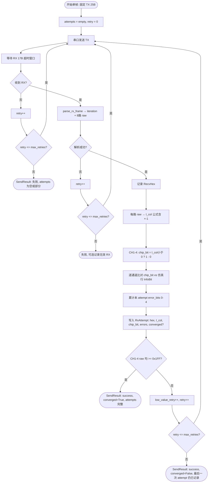
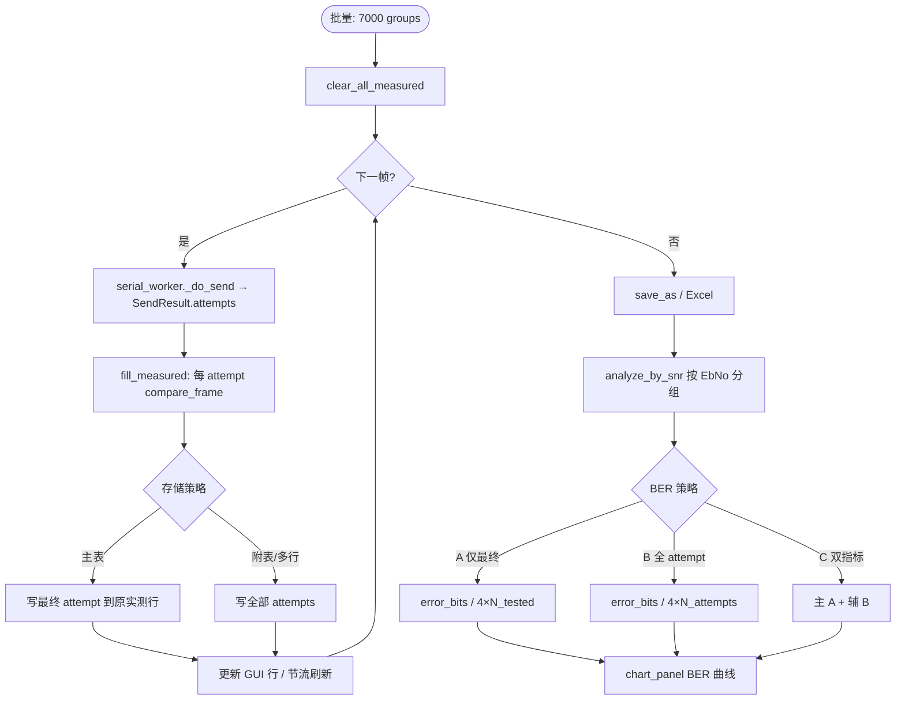

# 重试多实测行 — 可行性分析

> **状态**：仅可行性评估 + 流程图，**尚未决定实现**。  
> **背景**：当前 `serial_worker` 在 CH1–4 raw < 0x1FF 时最多重发 5 次，但 **仅保留最后一次 RX** 写入 `SendResult` / `CaseRecord` / CSV 实测行；中间重试 RX 被丢弃。新需求希望在每次发送/重试收到 RX 后都记录一次完整实测数据，并在 UI / 导出中展示多条实测行。

---

## 1. 可行性分析

### 1.1 当前系统摘要

| 环节 | 现状 |
|------|------|
| 数据集 | `mode1.csv` 7000 仿真行；内存展开为 **交错双行**（仿真 + 1 空白实测）→ 14000 行 |
| 重试 | `_do_send()`：`retries <= _max_retries`（默认 5），CH1–4 任一路 raw < 0x1FF → 重发同一 TX |
| 结果模型 | `SendResult` 仅含 **最后一次** `rx_frame` / `parsed`；`retries` / `low_value_retries` 计数 |
| 写回 | `fill_measured()` → 单条 `CaseRecord` → `TestCsvDataset.update_measured()` 写 **1 条实测行** |
| BER | `error_bits / (4 × N_tested)`；`N_tested` = 已测帧数（每帧 4 bit，**仅最后一次 RX**） |
| 文档 | `docs/SIM_TO_REAL.md` 明确：「重试过程中的中间 RX **不写入**迭代 / BER 聚合」 |

### 1.2 数据模型：N 次尝试 × 4 bit — BER 分母如何变？

**物理含义**：一次「用例 / 帧」对应同一组 TX（同一 `In[]` / DAC），芯片可能返回 1～6 次 RX（首次 + 最多 5 次重发）。每次 RX 均可独立做：

```
RX hex → parse → I_col[0..7] → chip_bit[0..3] → 与仿真行 InfoBit[0..3] 比对 → 0~4 error bits
```

**BER 分母的核心分歧**（必须在实现前定规）：

| 策略 | 分子 | 分母 | 语义 | 与现网兼容性 |
|------|------|------|------|--------------|
| **A. 仅最终 RX**（现状延伸） | 各帧最后一次 RX 的 error bits 之和 | `4 × N_tested`（N_tested ≈ 7000） | 「每帧一次裁决」；中间尝试仅作诊断 | ✅ 与当前 BER 曲线一致 |
| **B. 全部尝试计入 BER** | 每次 RX 的 error bits 之和 | `4 × Σ(每帧尝试次数)` | 「每次收发均为独立 bit 观测」；重试多的帧权重更大 | ❌ BER 数值会系统性低于/高于现定义，不可与历史结果直接对比 |
| **C. 双指标** | 同上两套 | 主曲线用 A，辅曲线/表格用 B | 报告清晰，实现与 UI 成本最高 | ⚠️ 推荐若需全量记录 |

**数量级估算**（7000 帧全量测、max_retries=5）：

- 每帧尝试次数：1～6，期望取决于 SNR（低 SNR 重试更多）。
- 若 **全部尝试入 BER**（策略 B）：  
  - 最坏：`7000 × 6 = 42000` 次 RX → **168000 channel-bits** 分母（现行为 28000）。  
  - 典型（假设平均每帧 2 次 RX）：`14000` 次 RX → **56000** channel-bits。
- 若 **仅最终 RX**（策略 A）：分母仍为 **28000**（7000×4）；额外尝试只增加存储与 UI 行数，不改变 BER 定义。

**建议**：在未明确业务定义前，**默认策略 A 作为主 BER**；全尝试 bit 统计可作为 **辅助指标**（如「尝试级误码率」「重试期间误码分布」），避免破坏现有 `analyze_by_snr()` / 图表语义。

### 1.3 CSV 格式选项

当前标准列（`STANDARD_FIELDNAMES`）：`RowKind, EbNo_dB, FrameIdx, In[], Out[], InfoBit[], IterNum, RecvHex`。

#### 方案 A：每仿真行后挂多条实测行（扩展交错）

```
仿真行, Eb=0, FrameIdx=1, In[], Sim Out[], InfoBit[], ...
实测行, Eb=0, FrameIdx=1, , , , Out[]=I_col, InfoBit[]=chip_bit, IterNum, RecvHex   ← Attempt 1
实测行, Eb=0, FrameIdx=1, , , , ...                                              ← Attempt 2
...
```

| 优点 | 缺点 |
|------|------|
| 与现有「仿真 + 实测」视觉模型一致 | 行数不再固定为 2×N；`load_test_csv` 偶数行校验需改 |
| Excel 按 FrameIdx 筛选仍直观 | 7000 帧 × 最多 6 实测 → **最多 ~49000 行**（7000 仿真 + 42000 实测） |
| 导出逻辑可渐进扩展 | `sim_row_index = case_index * 2` 等硬编码 **全部失效** |

#### 方案 B：单行实测 + `Attempt` 列（仍 1 实测行/尝试 或 1 行多 Attempt？）

两种子变体：

- **B1**：每尝试一行，增加 `Attempt`（1..6）列 — 本质同 A，但显式编号，便于排序。
- **B2**：每帧 **一行** 实测，`RecvHex` / `Out[]` 用 JSON 或分列 `RecvHex_1..6` — 列爆炸或单元格过大，**不推荐**。

| 优点 | 缺点 |
|------|------|
| B1 语义清晰，可兼容「多行」加载器 | 需新增列，旧 CSV 迁移 |
| Attempt 便于过滤「最终尝试」 | GUI / 聚合需约定 `Attempt=last` 规则 |

#### 方案 C：独立 Attempts 表 / Sheet

- 主表：保持 14000 行（仿真 + **最终** 实测，与现网一致）。
- 附表 `Attempts`：`FrameIdx, Attempt, RecvHex, Out[], InfoBit[], IterNum, Converged, ErrorBits`。

| 优点 | 缺点 |
|------|------|
| **对现网破坏性最小**；主 BER 不变 | 双表同步、导出 Excel 多 sheet |
| 全量重试数据可查 | GUI 用例表默认仍只显示 1 实测行；需「展开重试」视图 |
| 适合 phased 实现 | `TestCsvDataset` 需新结构 |

**格式推荐（实现时）**：**方案 C 为主、方案 B1 为辅** — Phase 1 内存 + Excel 附表记录全尝试；Phase 2 若强需求再改交错 CSV（A/B1）。

### 1.4 UI 影响

| 项目 | 当前 | 变更后（最坏） |
|------|------|----------------|
| 用例表行数 | `7000 × 2 = 14000`（`_CASE_ROW_STRIDE = 2`） | 若每尝试一行：`7000 × (1 + A)`，A∈[1,6] → **14000～49000 行** |
| 用户所述「42000 行」 | — | 对应 **7000×6 次纯实测行**，或 **14000 + 28000**（平均每帧 +2 次尝试） |
| 刷新策略 | 每 100 帧节流 `_populate_case_table_rows` | 多行/帧时刷新次数 × 尝试倍数；需 **按 case 折叠显示** 或虚拟滚动 |
| 高亮 | 实测行浅蓝 `_style_measured_table_row` | 需区分「中间尝试 / 最终 / 未收敛」 |
| 图表 | BER / 迭代 vs SNR | 若 BER 用策略 A，**图表可不变**；可选新增「重试次数 vs SNR」 |

**风险**：49000 行 QTableWidget 仍可加载但滚动/全量刷新明显变慢（现有注释已针对 7000 组优化）。建议 UI **默认折叠**（每帧 1 行摘要 + 展开看重试），或 **独立「重试详情」面板**。

### 1.5 `serial_worker` 所需变更

当前 `_do_send()` 在 `needs_retry()` 为真且未超限时 `continue`，**不保存**中间 `parsed` / `rx_frame`。

**最小改动路径**：

1. 新增 `RxAttempt` dataclass：`attempt_index, rx_frame, parsed, converged, needs_retry_flag, timestamp`。
2. `SendResult` 增加 `attempts: list[RxAttempt]`，循环内 **每次成功 parse 后 append**（含最后一次未收敛）。
3. 保留现有字段 `rx_frame` / `parsed` 指向 **最后一次**，保证旧代码路径不崩。
4. `_do_batch` / `batch_frame_done` 信号携带完整 `attempts` 列表。

**边界**：

- 超时 / parse 失败的重试：**是否记录**？需求写「RX 收到后记录」— 建议仅记录 **成功 parse 的 RX**；超时无 hex 可记 `RecvHex=""` 或跳过。
- 超时重试与 low-value 重试共用 `retries` 计数，需在 `RxAttempt` 区分 `retry_reason`（timeout / low_raw / ok）。

### 1.6 `aggregate` / `csv_loader` 所需变更

| 模块 | 变更 |
|------|------|
| `CaseRecord` | 增加 `attempts: list[AttemptRecord]` 或独立 `MeasuredAttempt`；或一帧多 `CaseRecord`（不推荐，破坏 1:1 帧索引） |
| `fill_measured()` | 遍历 `result.attempts`，每 attempt 调用 `compare_frame()` |
| `count_channel_error_bits()` | 按选定的 BER 策略 A/B/C 分支 |
| `TestCsvDataset` | `update_measured()` → `update_measured_attempts()`；索引从固定 `case*2+1` 改为 **可变长度块** 或附表 |
| `load_test_csv()` | 支持多实测行 / Attempt 列 / 双 sheet 导入 |

### 1.7 性能与内存

| 场景 | 估算 |
|------|------|
| 内存 `CaseRecord` | 每 attempt ~17B hex + 8×float + 元数据 ≈ 200B；6×7000 ≈ **8.4MB** 量级，可接受 |
| CSV 镜像 `rows` | 42000 行 × ~30 列字符串 ≈ **数十 MB**；批量 `save_as` 变慢 |
| 批量测试耗时 | **不变**（重试次数由硬件决定，非软件） |
| 聚合 `analyze_by_snr()` | 策略 A：O(N)；策略 B：O(N×attempts)，仍轻量 |

**结论**：性能 **可行**；主要成本在 **UI 行数** 与 **CSV 结构迁移**，非串口吞吐。

### 1.8 关于「取反」的代码现状（实现前必须澄清）

需求步骤 3 写「**取反** → derive InfoBit」。代码中存在 **两层不同含义**：

| 名称 | 位置 | 含义 |
|------|------|------|
| **公式 ×(−1)** | `raw_to_column_current()`：`I_col = ((raw/4096×5)−2.5)×(−1)` | 物理量换算，**不是** bit 取反 |
| **符号 → bit** | `chip_value_to_bit()`：`I_col < 0 → 1`，否则 `0` | 从电流符号 **导出 chip_bit**，再与 CSV **仿真行 InfoBit** 比较 |

当前 **没有** 对 `InfoBit` 做按位 NOT；比对是 `chip_bit == InfoBit[i]`（见 `compare_channel()`）。

若需求「取反」指公式中的 `×(−1)`：**已实现**，无需新逻辑。  
若指 **反转符号判 bit 规则**（正→1，负→0）：将 **改变全部 BER**，与 `docs/SIM_TO_REAL.md` 冲突，需书面确认。  
若指 **对 InfoBit 做 1↔0 翻转再比**：与现有语义不同，一般不采用。

**文档建议**：在 Open Questions 中让用户三选一确认。

### 1.9 利弊总结

| 优点 | 缺点 |
|------|------|
| 可见重试过程中 ADC/电流/bit 演化，利于调芯片与 SNR 边界分析 | BER 定义易混淆；与历史 7000 帧结果 **不可直接对比**（若采用策略 B） |
| 保留「未收敛」各次 RX，而非仅最后一次 | CSV / UI / 加载器 **结构性变更**，工作量大 |
| 与硬件「多次 RX」行为一致，审计轨迹完整 | 导出文件体积与 GUI 行数 **×3～×6** |
| 可分析「第几次尝试才收敛」 | 需明确中间尝试是否参与 PASS/FAIL / 报告 |

---

## 2. Mermaid 流程图

### 2.1 单帧发送 — 多 attempt 记录 + 重试



### 2.2 批量测试 — 写回与 BER 聚合



---

## 3. 实现建议

### 3.1 结论：**分阶段实施（Phased）— 不建议一次性全改**

| 维度 | 判断 |
|------|------|
| 技术可行性 | ✅ **可行** — worker 层 append attempts 为局部改动；比对逻辑可复用 `compare_frame()` |
| 业务清晰度 | ⚠️ **BER 口径与「取反」未定义**，贸然改会破坏现网指标 |
| 工程成本 | ⚠️ **中高** — CSV 双行索引、GUI stride=2、导出、加载器 **联动面广** |
| 用户价值 | ✅ 对调试重试/未收敛帧 **价值高**；对「仅要 SNR-BER 曲线」价值 **有限** |

**不建议** 在未确认 BER 策略前做「多实测行交错 CSV + GUI 全展开 + BER 全 attempt 入分母」的大包实现。

### 3.2 最小范围建议（若进入 Phase 1）

1. **`SendResult.attempts`**：`serial_worker` 每次 parse 成功即记录（含未收敛最后一次）。
2. **内存 + 日志**：批量测试后在日志或调试导出 JSON/CSV 附表列出每帧各 attempt（**不改** 14000 行主 CSV 结构）。
3. **BER / 图表 / 主 GUI 表**：**保持现状**（策略 A，仅最后一次 RX）。
4. **Excel 导出**（`report_export`）：可选 sheet `RetryAttempts`，列：`EbNo_dB, FrameIdx, Attempt, RecvHex, I_col1-4, ChipBit1-4, ErrorBits, Converged`。
5. **文档**：在 `SIM_TO_REAL.md` 增加「重试 attempt 附表」说明。

Phase 2（用户确认格式与 BER 后）：多实测行 UI 折叠视图 + CSV B1/C 择一。

### 3.3 不建议的做法

- 在未定义 BER 时直接把分母改为 `4 × 全部尝试` 并替换现有曲线。
- 将 `_CASE_ROW_STRIDE` 改为动态值却不做虚拟滚动 — 7000×6 行表格体验差。
- 假设「取反 = bit NOT」而改 `compare_channel` — 与现有 sign_compare 语义冲突。

---

## 4. 待用户确认的问题

1. **BER 分母**  
   - 主指标是否仍为 **每帧仅最后一次 RX** 的 `4 × N_tested`？  
   - 是否需要 **第二次指标**：全部 attempt 的 bit 误码率？  
   - 未收敛帧的 **中间 attempt** 是否计入任一 BER？

2. **「取反」精确含义**（三选一）  
   - [ ] A. 仅指 `I_col` 公式中的 `×(−1)`（**当前已实现**）  
   - [ ] B. 反转符号判 bit 规则（正→1，负→0）  
   - [ ] C. 对某字段做按位 NOT 后再比 — 请说明对象

3. **导出格式偏好**  
   - [ ] A. 多条「实测行」紧跟仿真行（交错 CSV 变长）  
   - [ ] B. 增加 `Attempt` 列的多行实测  
   - [ ] C. 主表不变 + 独立 Attempts sheet（**推荐 Phase 1**）  
   - [ ] D. 仅内存/日志，不持久化到 CSV

4. **UI 期望**  
   - 用例表是否需要 **默认展示全部 attempt 行**，还是 **折叠/弹窗** 查看重试详情？  
   - 中间 attempt 是否需要与最终 attempt **区分颜色**（如浅黄=中间，浅蓝=最终）？

5. **失败 attempt**  
   - 超时 / parse 失败的重试是否也要占一行（无 RecvHex）？  
   - 还是 **仅记录成功 parse 的 RX**？

6. **与仿真 Out[] 的关系**  
   - 各 attempt 是否仍需展示 CH5–8 / 仿真 Out 参考列，还是 **仅 CH1–4 + InfoBit 比对**？

---

## 5. 相关代码索引

| 文件 | 相关点 |
|------|--------|
| `comm/serial_worker.py` | `_do_send()` 重试循环；`SendResult` 仅最后一次 RX |
| `protocol/validator.py` | `needs_retry()` — CH1–4 raw < 0x1FF |
| `protocol/codec.py` | `parse_rx_frame()`, `raw_to_column_current()` |
| `analysis/sign_compare.py` | `chip_value_to_bit()`, `compare_frame()` |
| `analysis/aggregate.py` | `CaseRecord`, `fill_measured()`, `count_channel_error_bits()`, `analyze_by_snr()` |
| `csv_loader.py` | `TestCsvDataset` 固定 `case_index*2+1` 实测行 |
| `ui/main_window.py` | `_CASE_ROW_STRIDE = 2` |
| `docs/SIM_TO_REAL.md` | 现行 Sim-to-Real 与 BER 定义 |

---

*文档版本：2026-07-02 · 仅可行性评估，无代码变更。*
