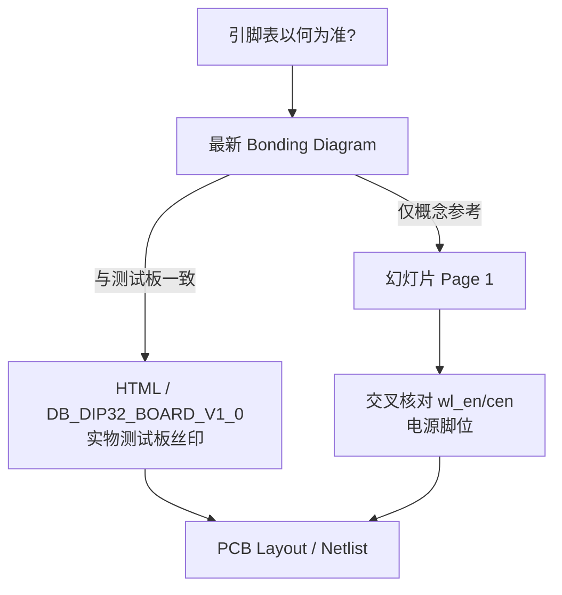
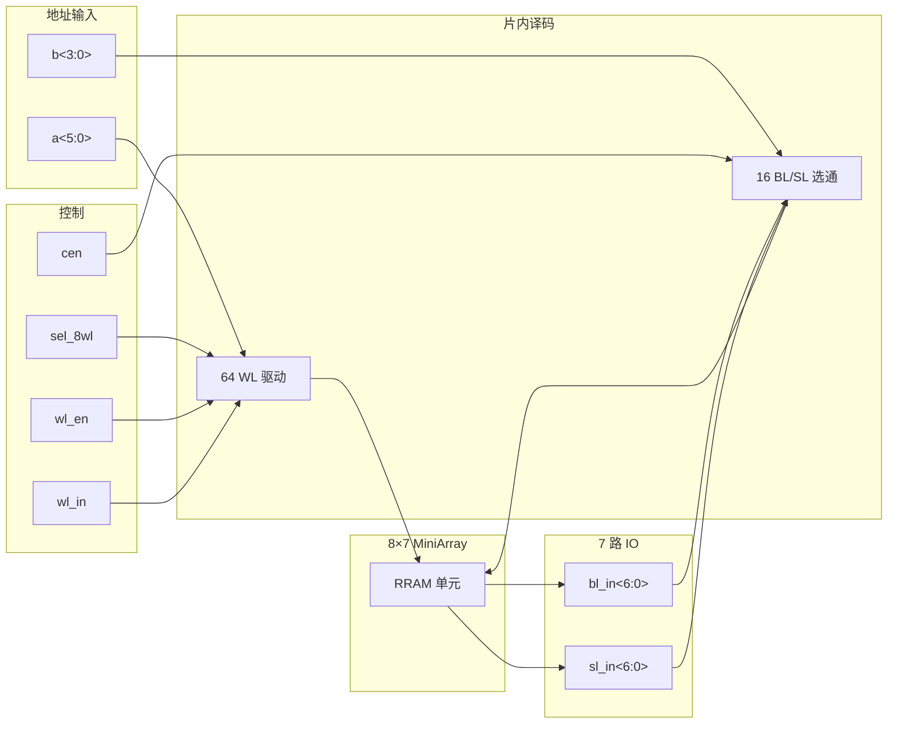
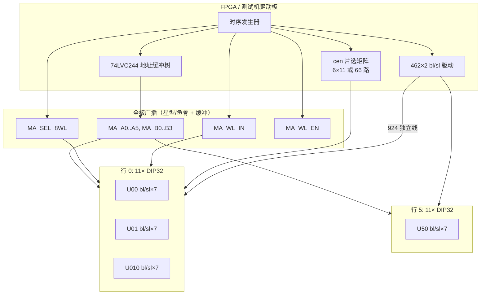
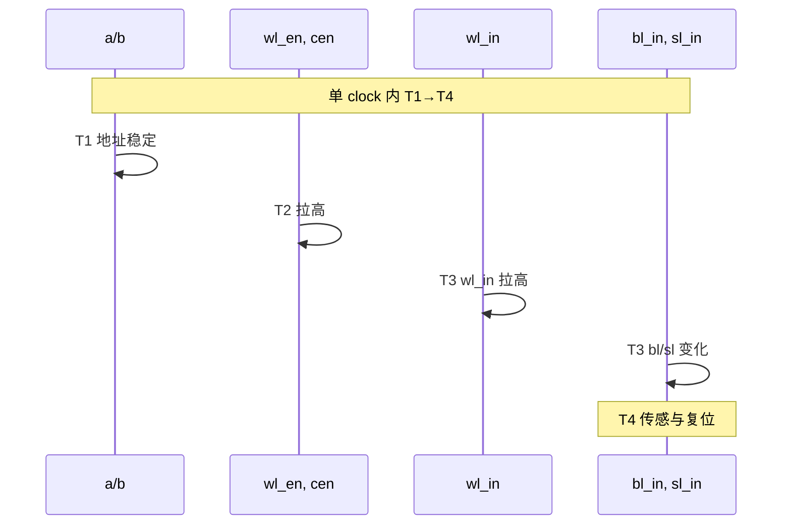
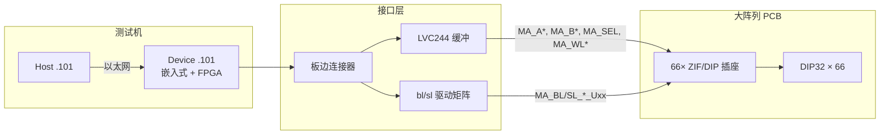
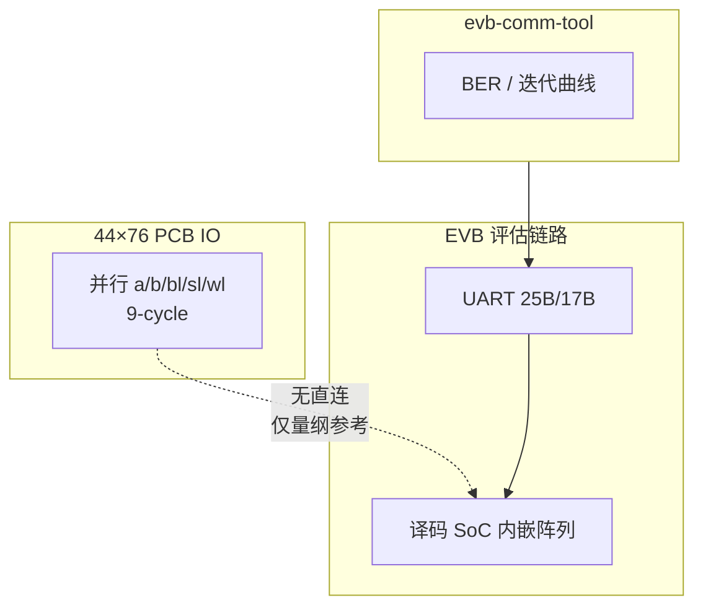

# RRAM 阵列 — 输入/输出信号与 PCB IO 说明

> **文档性质**：DIP32 MiniArray 忆阻子阵 → 66 片 PCB 级联 → 44×76 逻辑大阵列的 **IO/信号专用技术说明**  
> **编制日期**：2026-07-06  
> **关联文档**：[PCB大阵列拼接评估需求说明.md](./PCB大阵列拼接评估需求说明.md)（Layout/SI/PI 评估项）、[44×76阵列物理评估.md](./44x76阵列物理评估.md)（系统集成与协议侧）  
> **主要参考**：`RRAM_阵列项目_物理信息详尽解析_修正版.html`（DB_DIP32_BOARD_V1_0 实物引脚表，Reliance Memory Confidential）  
> **保密声明**：原始资料含 Confidential 水印；本文档仅供项目组内部硬件/PCB 设计，不得对外传播。

---

## 目录

1. [文档范围](#1-文档范围)
2. [信号分类总表](#2-信号分类总表)
3. [DIP32 引脚 ↔ 信号 ↔ PCB 网络名](#3-dip32-引脚--信号--pcb-网络名)
4. [单芯片 IO（8×7 单元）](#4-单芯片-io87-单元)
5. [PCB 级联 IO](#5-pcb-级联-io)
6. [读写时序与 IO 时序关系](#6-读写时序与-io-时序关系)
7. [电气约束](#7-电气约束)
8. [测试机 / 插座接口](#8-测试机--插座接口)
9. [与 EVB / UART 边界](#9-与-evb--uart-边界)
10. [附录](#10-附录)

---

## 1. 文档范围

### 1.1 目的

本文档面向 **PCB 工程师、SI/PI 工程师、测试硬件与 FPGA 驱动设计人员**，集中说明 44×76 RRAM 大阵列项目中 **全部外部 IO 信号** 的：

- 电气方向、电平与驱动能力要求；
- DIP32 封装引脚与 PCB 网络命名；
- 单芯片 8×7 子阵与 66 片级联时的 **共享 vs 独立** 走线策略；
- 读写时序与 IO 断言顺序；
- 测试机 ZIF 插座至 FPGA/缓冲器的接口边界。

### 1.2 在范围内

| 内容 | 说明 |
|------|------|
| DIP32 32 脚 + 底部 VSS4 全部信号 | 地址、数据、控制、电源/地 |
| DB_DIP32_BOARD_V1_0 引脚表（HTML 修正版） | Layout **优先** 依据 |
| 幻灯片版引脚表 | 交叉核对；标注差异 |
| 66 片 PCB 广播/扇出/片选拓扑 | 共享译码 + 462×2 独立 IO |
| 9-cycle / 单周期四阶段 IO 时序 | FPGA 模板与 PCB 延迟预算 |
| ZIF 插座、Pin1、测试机 1:1 对应 | 单芯片 bring-up 接口 |

### 1.3 不在范围内

| 内容 | 参见 |
|------|------|
| MiniArrayQH_pkg GUI、以太网配置、7×8 pattern 编辑 | [44×76阵列物理评估.md §8](./44x76阵列物理评估.md#8-软件接口) |
| evb-comm-tool PyQt6 界面、CSV 加载、图表 | [EVB通信工具_代码需求书.md](./EVB通信工具_代码需求书.md) |
| UART 25 B TX / 17 B RX 帧格式 | [PROTOCOL_UART.md](./PROTOCOL_UART.md) |
| 3344 vs 3696 guard 区 Layout 丝印细节 | [PCB大阵列拼接评估需求说明.md §3.3](./PCB大阵列拼接评估需求说明.md#33-几何拼接模型评估假设-a待硬件-sign-off) |
| 芯片内部 64×16 译码晶体管级实现 | 芯片设计文档 |

### 1.4 术语

| 术语 | 含义 |
|------|------|
| **VAA / VSS** | HTML/测试板命名（VAA1–3、VSS1–4）；幻灯片常写作 VDD/GND，**同指电源/地** |
| **共享译码** | 66 颗芯片并联同一组 `a<5:0>`、`b<3:0>` 及子集控制线 |
| **IO 通道** | 7 路 `bl_in<i>` / `sl_in<i>` 互补对，各对应 MiniArray 一个读出/写入端口 |
| **128 条件** | `sel_8wl=1` 时 8 WL 组 × 16 BL 的快速并行读空间 |

---

## 2. 信号分类总表

### 2.1 按功能分类

| 类别 | 信号 | 位宽 | 方向 | 有效电平 | 驱动能力 / 负载（建议） | 备注 |
|------|------|------|------|----------|-------------------------|------|
| **WL 地址** | `a<5:0>` | 6 | In | CMOS 逻辑 | FPGA → **74LVC244 级缓冲**；66 并联总 C<sub>L</sub> **100–200 pF** | 共享广播 |
| **BL 地址** | `b<3:0>` | 4 | In | CMOS 逻辑 | 同上 | 共享广播 |
| **WL 数据/激励** | `wl_in` | 1 | In | VDD=有效（HTML） | 精密/可能高压；**源端驱动 ≥ 10 mA**；包地走线 | 共享广播；编程时电压更高 |
| **BL 数据** | `bl_in<6:0>` | 7 | In | VDD=1 | **每颗独立驱动**；462 路合计需 DAC/GPIO 矩阵 | 不可共享 |
| **SL 数据** | `sl_in<6:0>` | 7 | In | VSS=0（读时与 bl 互补） | 同上 | 与 bl_in 一一对应 |
| **模式** | `sel_8wl` | 1 | In | VDD=8×读；VSS=1×读 | 共享；关键控制线 | 远离高速/模拟敏感线 |
| **WL 使能** | `wl_en` | 1 | In | **VDD 高有效**（HTML） | 共享或分组；**HTML 表无独立 DIP 脚** | 待 Bonding 确认 |
| **BL/SL 使能** | `cen` | 1 | In | **VDD 高有效**（HTML）；幻灯片待核 | **66 独立或 6/11 分组**（开放） | 待 netlist 确认 |
| **电源** | VAA1, VAA2, VAA3 | — | PWR | 正电源 | 分域供电；单颗 **100 nF + 10 µF** 去耦 | 可能对应数字/WL 高压/IO 模拟 |
| **地** | VSS1, VSS2, VSS3, VSS4 | — | GND | 0 V | 短粗回流；checkboard 地平面 | VSS4 常为封装底部散热焊盘 |

### 2.2 输入 / 输出 / 电源汇总

| 类型 | 信号列表 | 单芯片脚数 | 66 片 PCB 网络数（估算） |
|------|----------|------------|--------------------------|
| **输入（逻辑）** | `a<5:0>`, `b<3:0>`, `wl_in`, `bl_in<6:0>`, `sl_in<6:0>`, `sel_8wl`, `wl_en`, `cen` | 25（若 wl_en/cen 有脚） | **10 共享 + 924 独立 + 片选** |
| **输出** | 无独立数字输出脚；读结果经 **片内传感 → IO 通道电流/电压** 在 `bl_in/sl_in` 路径体现 | — | 由测试机 ADC/传感前端采集 |
| **电源** | VAA1–3 | 3 | 3 域树状分配 |
| **地** | VSS1–4 | 4（含底部） | 统一地平面 |
| **合计** | — | 32 + 底部 | **~944** 量级（见 [PCB大阵列拼接评估需求说明 §3.2](./PCB大阵列拼接评估需求说明.md#32-信号规模与复用)） |

### 2.3 电平约定

| 域 | 建议电平 | 来源 |
|----|----------|------|
| 数字地址/控制 | CMOS **1.8 V 或 3.3 V**（与 FPGA I/O bank 一致） | 推断；待芯片手册 sign-off |
| `sel_8wl`, `wl_en`, `cen` | VDD = 逻辑高；VSS = 逻辑低 | HTML 信号描述 |
| `wl_in` 读 | **1–3 V** 典型（RRAM 类型相关） | HTML 推断 |
| `wl_in` 编程 Forming/Set/Reset | **3–5 V+** | HTML 推断 |
| VAA1/2/3 | **待手册确认**；Layout 默认 **分域隔离** | 开放项 |

---

## 3. DIP32 引脚 ↔ 信号 ↔ PCB 网络名

### 3.1 命名规则

PCB 网络名建议采用 **`MA_<信号>_<可选后缀>`** 前缀（MiniArray），级联板加 **`_R<row>C<col>`** 或 **`_U<chip_id>`**（chip_id 0–65）区分独立 IO：

| 信号 | 共享网络名（66 片并联） | 独立网络名（每颗） |
|------|-------------------------|-------------------|
| `a<5:0>` | `MA_A0` … `MA_A5` | — |
| `b<3:0>` | `MA_B0` … `MA_B3` | — |
| `sel_8wl` | `MA_SEL_8WL` | — |
| `wl_in` | `MA_WL_IN` | — |
| `wl_en` | `MA_WL_EN` 或分组 | 待 Bonding |
| `cen` | `MA_CEN_R0` … 或 `MA_CEN_U00` … | 66 路或分组 |
| `bl_in<i>` | — | `MA_BL_IN0_U00` … |
| `sl_in<i>` | — | `MA_SL_IN0_U00` … |
| VAA1 | `MA_VAA1` | 可分区：`MA_VAA1_Z0` … |
| VSS* | `MA_VSS` / `MA_VSS1` … | 统一地 |

### 3.2 完整对照表 — HTML 修正版（DB_DIP32_BOARD_V1_0，**Layout 优先**）

| Pin | 信号 | 方向 | PCB 共享/独立 | 建议 PCB 网络名 | HTML vs 幻灯片 |
|-----|------|------|---------------|-----------------|----------------|
| 1 | `sl_in<3>` | In | 独立 | `MA_SL_IN3_Uxx` | ⚠ 幻灯片 Pin1=`sl_in[0]` |
| 2 | `sl_in<4>` | In | 独立 | `MA_SL_IN4_Uxx` | ⚠ 幻灯片 Pin2=`sl_in[1]` |
| 3 | `sl_in<5>` | In | 独立 | `MA_SL_IN5_Uxx` | ⚠ 幻灯片 Pin3=`sl_in[2]` |
| 4 | `sl_in<6>` | In | 独立 | `MA_SL_IN6_Uxx` | ⚠ 幻灯片 Pin4=`sl_in[3]` |
| 5 | **VSS1** | GND | 电源 | `MA_VSS1` | ⚠ 幻灯片 Pin5=`sl_in[4]` |
| 6 | `b<3>` | In | 共享 | `MA_B3` | ⚠ 幻灯片 Pin8=`b[0]` |
| 7 | `b<2>` | In | 共享 | `MA_B2` | ⚠ 幻灯片 Pin9=`b[1]` |
| 8 | `b<1>` | In | 共享 | `MA_B1` | ⚠ 幻灯片 Pin10=`b[2]` |
| 9 | `b<0>` | In | 共享 | `MA_B0` | ⚠ 幻灯片 Pin11=`b[3]` |
| 10 | **VAA1** | PWR | 电源 | `MA_VAA1` | ⚠ 幻灯片 Pin10=`b[2]`（无 VAA 在此脚） |
| 11 | `sel_8wl` | In | 共享 | `MA_SEL_8WL` | ⚠ 幻灯片 Pin26=`sel_8wl` |
| 12 | **VAA2** | PWR | 电源 | `MA_VAA2` | ⚠ 幻灯片 Pin12=`a[0]` |
| 13 | **VSS2** | GND | 电源 | `MA_VSS2` | ⚠ 幻灯片 Pin13=`a[1]` |
| 14 | `a<0>` | In | 共享 | `MA_A0` | ⚠ 幻灯片 Pin14=`a[2]` |
| 15 | `a<1>` | In | 共享 | `MA_A1` | ⚠ 幻灯片 Pin15=`a[3]` |
| 16 | `a<2>` | In | 共享 | `MA_A2` | ⚠ 幻灯片 Pin16=`a[4]` |
| 17 | `a<3>` | In | 共享 | `MA_A3` | ⚠ 幻灯片 Pin17=`a[5]` |
| 18 | `a<4>` | In | 共享 | `MA_A4` | ⚠ 幻灯片 Pin18=`bl_in[0]` |
| 19 | `a<5>` | In | 共享 | `MA_A5` | ⚠ 幻灯片 Pin19=`bl_in[1]` |
| 20 | **VAA3** | PWR | 电源 | `MA_VAA3` | ⚠ 幻灯片 Pin20=`bl_in[2]` |
| 21 | `wl_in` | In | 共享 | `MA_WL_IN` | ⚠ 幻灯片 Pin25=`wl_in` |
| 22 | `bl_in<0>` | In | 独立 | `MA_BL_IN0_Uxx` | ⚠ 幻灯片 Pin18=`bl_in[0]`（脚位不同） |
| 23 | `bl_in<1>` | In | 独立 | `MA_BL_IN1_Uxx` | ⚠ 幻灯片 Pin19 |
| 24 | `bl_in<2>` | In | 独立 | `MA_BL_IN2_Uxx` | ⚠ 幻灯片 Pin20 |
| 25 | `bl_in<3>` | In | 独立 | `MA_BL_IN3_Uxx` | ⚠ 幻灯片 Pin21 |
| 26 | `bl_in<4>` | In | 独立 | `MA_BL_IN4_Uxx` | ⚠ 幻灯片 Pin22 |
| 27 | `bl_in<5>` | In | 独立 | `MA_BL_IN5_Uxx` | ⚠ 幻灯片 Pin23 |
| 28 | `bl_in<6>` | In | 独立 | `MA_BL_IN6_Uxx` | ⚠ 幻灯片 Pin24 |
| 29 | `sl_in<0>` | In | 独立 | `MA_SL_IN0_Uxx` | ⚠ 幻灯片 Pin1=`sl_in[0]`（脚位不同） |
| 30 | **VSS3** | GND | 电源 | `MA_VSS3` | ⚠ 幻灯片 Pin30=`GND` |
| 31 | `sl_in<1>` | In | 独立 | `MA_SL_IN1_Uxx` | ⚠ 幻灯片 Pin31=`VDD` 或 NC |
| 32 | `sl_in<2>` | In | 独立 | `MA_SL_IN2_Uxx` | ⚠ 幻灯片 Pin32=`GND` 或 NC |
| 底 | **VSS4** | GND | 电源 | `MA_VSS4` / 散热焊盘 | 幻灯片未单独列出 |

> **`wl_en`、`cen`**：HTML 信号描述定义为 **VDD 高有效**，但 **DB_DIP32 V1_0 的 32 脚表未分配独立 pin**（32 脚已占满）。幻灯片版在 **Pin27=`wl_en`、Pin28=`cen`**。**实施前必须以最新 Bonding Diagram + 实物丝印 sign-off**（风险 R7/R8，见 [PCB大阵列拼接评估需求说明 §8](./PCB大阵列拼接评估需求说明.md#81-风险清单)）。

### 3.3 幻灯片版引脚速查（交叉参考）

详见 [44×76阵列物理评估.md §2.2](./44x76阵列物理评估.md#22-完整引脚功能表据幻灯片-page-1-整理)。与 HTML 版 **引脚顺序完全不同**：幻灯片将 `sl_in<6:0>` 集中在 Pin1–7，`a/b` 居中，`wl_en/cen` 有脚；HTML 将 **VAA/VSS 分散嵌入**，`sl_in` 分置 Pin1–4 与 29–32。

### 3.4 版本差异决策树



---

## 4. 单芯片 IO（8×7 单元）

### 4.1 片内寻址空间 vs 对外 MiniArray

| 维度 | 片内 | 对外 DIP |
|------|------|----------|
| WL | 64（`a<5:0>`） | 映射至 8 行有效区 |
| BL/SL | 16（`b<3:0>`） | 映射至 7 列有效区 |
| 交叉点 | 1024 | **8×7 = 56** 有效单元 |
| IO 通道 | 7 路独立 | `bl_in<6:0>` / `sl_in<6:0>` |

### 4.2 七路 IO 与 BL/SL 关系

每路 IO **独立**，各控制 16 条 BL 中的子集（通过 `b<3:0>` 列译码选通）。读写路径：



### 4.3 IO 互补规则（读）

| 条件 | `bl_in<i>` | `sl_in<i>` | 说明 |
|------|------------|------------|------|
| 读 IO*i* | **1** | **0**（接 VSS 逻辑） | 电流经 RRAM → BL → IO |
| 非选中 IO | **0** | **0** | 不参与 |
| **禁止** | 1 | 1 | 无完整回路，读失败 |
| **禁止** | 0 | 1 | 违反互补，读失败 |

### 4.4 WL/BL 寻址与 1× / 8× 模式

| `sel_8wl` | WL 行为 | `a<5:0>` 用法 |
|-----------|---------|---------------|
| **VSS（0）** | **1× 读**：仅 1 条 WL | 6 bit 精确 |
| **VDD（1）** | **8× 读**：8 条 WL 并行 | `a<5:3>` 定组；`a<2:0>` 通配（×） |

| `b<3:0>` | 作用 |
|----------|------|
| 4 bit 精确 | 16 条 BL/SL 中选 1 列 |

**128 条件** = 8 WL 组 × 16 BL（`sel_8wl=1`，`b` 扫 0–15，`a<5:3>` 扫 0–7）。

---

## 5. PCB 级联 IO

### 5.1 66 片网格

6 行 × 11 列 = **66** 颗 DIP32；每颗 8×7 = 56 单元；逻辑大阵 **44×76 = 3344**（物理粗算 3696，差额 352，见关联文档）。

### 5.2 共享 vs 独立 — 总线拓扑



### 5.3 广播、扇出与片选

| 信号 | 66 片连接方式 | 驱动策略 | PCB 要求 |
|------|---------------|----------|----------|
| `a<5:0>`, `b<3:0>` | **66 并联广播** | FPGA → 缓冲树（多级 74LVC244）→ 各 DIP | skew **< 1–2 ns**；勿 66 负载直连 FPGA |
| `sel_8wl` | **广播** | 单驱动 + 缓冲 | 远离模拟/高速线；串扰受控 |
| `wl_in` | **广播** | 单路精密/高压驱动 | 包地；与 bl 线隔离 |
| `wl_en` | **广播或分组** | 待 Bonding | PCB 延迟 **≥ wl_en + 5 ns** 后再 assert wl_in |
| `cen` | **66 独立或 6/11 分组** | 片选矩阵 | **避免多片同时导通** → BL 冲突 |
| `bl_in<6:0>` | **每颗独立** | 462 路 DAC/GPIO | **不可共享**；组内等长 |
| `sl_in<6:0>` | **每颗独立** | 462 路 | 与 bl_in 成对布线 |
| VAA1–3 | **分区树状** | LDO/DC-DC 多路 | IR drop **< 3%**；分域去耦 |
| VSS1–4 | **统一地平面** | 星形/网格地 | 低阻抗回流 |

### 5.4 共享译码限制（系统约束）

66 颗共享 `a/b` 时，**同一时刻全板仅同一 WL/BL 地址**；无法对不同芯片施加不同 WL 组。多 tile 并行读须依赖：

1. **各 chip 不同 `bl_in/sl_in` 数据**（同一地址、不同 IO 通道）；或  
2. **`cen` 分时片选**；或  
3. **地址分时**（降低吞吐）。

### 5.5 网络规模

| 类别 | 数量 |
|------|------|
| 共享地址 | 10 |
| 共享控制 | 2–4（sel_8wl, wl_in, ± wl_en, ± cen 分组） |
| 独立 bl_in | 462 |
| 独立 sl_in | 462 |
| 电源域 | 7 |
| **估算合计** | **~944** |

---

## 6. 读写时序与 IO 时序关系

### 6.1 双模型对齐

项目存在 **两套互补描述**，FPGA 模板须统一：

| 模型 | 来源 | 粒度 |
|------|------|------|
| **单 clock 四阶段** | HTML Timing | T1→T4 于 **1 个 clock** 内完成 |
| **9-cycle 嵌套** | 幻灯片 / [44×76阵列物理评估 §6](./44x76阵列物理评估.md#6-时序要求) | 宏观原子读写 **9 个 clock** |

### 6.2 HTML 单周期四阶段（芯片 pin 级顺序）

**严格顺序**（不可逆）：

| 阶段 | 信号动作 | 说明 |
|------|----------|------|
| **T1** | `a<5:0>`, `b<3:0>` 建立稳定 | 地址 setup |
| **T2** | `wl_en`, `cen` → **VDD（高）** | 使能 WL/BL 驱动 |
| **T3** | `wl_in` → 高；随后 `bl_in/sl_in` 变化 | 电压施加；**wl_in 先于 bl/sl** |
| **T4** | 传感完成；信号复位 | 准备下一周期 |



### 6.3 9-cycle 嵌套窗口（FPGA / MiniArrayQH）

| 信号 | 有效 cycle 数 | 典型窗口 |
|------|---------------|----------|
| `a<5:0>`, `b<3:0>` | **9** | cycle 1–9 |
| `wl_en` | **7** | cycle 2–8 |
| `cen` | **5** | cycle 3–7 |
| `wl_in` | **3** | cycle 4–6 |
| `bl_in/sl_in` | **1** | **cycle 5** |

```
Cycle:     1    2    3    4    5    6    7    8    9
           ─────────────────────────────────────────►
a/b        ████████████████████████████████████████  (9)
wl_en          ████████████████████████████            (7)
cen                 ██████████████████                 (5)
wl_in                      ███████                      (3)
bl/sl_in                     █                           (1)
```

**解读**：先地址、后使能、再 WL 数据、最后 **1-cycle** bl/sl 脉冲；对 PCB **传播延迟** 与 **66 片 skew** 要求最严的是 **cycle 5**。

### 6.4 IO 时序与 PCB 延迟预算

| 参数 | 建议预算 | 说明 |
|------|----------|------|
| Tclk | **200 ns / 5 MHz**（首版） | 66 负载宜降频 |
| 地址 Tsu | 10–20 ns | FPGA 至最远 chip pin |
| 66 片 skew | **< 2 ns** | 地址/时钟缓冲树 |
| wl_en → wl_in | PCB **不得颠倒**；wl_in 延迟 **≥ wl_en + 5 ns** | 防误冲击 |
| bl/sl 1-cycle 窗 | ≥ **2×(max_skew + Tr) + Tsense** | cycle 5 margin ≥ **20% Tclk** |

---

## 7. 电气约束

### 7.1 电压与电流

| 项目 | 约束 | 备注 |
|------|------|------|
| VAA 域 IR drop | **< 3%**（8× 读全板 simultaneous） | [PCB需求 §7.1](./PCB大阵列拼接评估需求说明.md#71-可测量-passfail-指标) |
| VAA 纹波 | **< 50 mVpp**（pulse 期间） | 建议值 |
| 单颗读功耗 | ~**10 mW** | HTML 推断 |
| 66 颗读 | ~**660 mW** | 估算 |
| Forming 峰值 | **198 mA+**（3 V × 1 mA/颗 × 66）；Set/Reset 更高 | 须 PI 仿真 |
| IO 读电流 | 视 RRAM 状态 **µA–mA/通道** | 462 路合计需电源容量评估 |

### 7.2 负载电容与驱动

| 网络 | C<sub>L</sub>（估算） | 驱动要求 |
|------|----------------------|----------|
| 共享 a/b（66 片） | **100–200 pF** | 74LVC244 级缓冲；上升沿单调 |
| 单颗 bl_in/sl_in | **~5–15 pF** | 独立 DAC/GPIO；源端串阻 **22–47 Ω** 防过冲 |
| wl_in | 较高（WL 驱动负载） | 包地；可能高压间距 **≥ 0.2 mm**（待电压 sign-off） |

### 7.3 布线 — 线宽、等长、串扰

| 信号类 | 线宽/阻抗 | 等长 | 串扰 |
|--------|-----------|------|------|
| 共享地址 a/b | 50 Ω ±10% 单端 | 66 颗 **skew < 1 ns** | 与 wl_in/bl 隔离 |
| bl_in / sl_in 对 | 可选 **100 Ω 差分** | **同 chip 7 路组内等长**；chip 间同时读 **< 5 mm** | bl/sl 紧耦合 |
| sel_8wl | 50 Ω | 与地址等长组 | **远离** 模拟敏感线 |
| wl_in | 加宽或包地 | 与 wl_en 顺序走线 | 与 bl 线 **≥ 3× 线宽间距** |
| 电源 VAA | **≥ 2 oz** 铜；分区 | — | 密集过孔围栏 |

### 7.4 层叠建议

- **≥ 8 层**：信号-地-电源-信号交替（944 网络量级）  
- 电源层与地平面 **相邻**；各 DIP 旁 **100 nF（0402，禁止 > 2 mm）+ 10 µF**  
- 66 颗分区 bulk：**每 11 颗 100 µF** 量级  

---

## 8. 测试机 / 插座接口

### 8.1 单芯片阶段（DB_DIP32_BOARD_V1_0）

| 项目 | 要求 |
|------|------|
| 插座 | **ZIF**（Zero Insertion Force）；镀金触点 **R_contact < 10 mΩ** |
| Pin1 | 三角 + "PIN 1" 丝印；**防呆**；错插 **电源反接烧毁** |
| 对应关系 | 测试机通道与封装 **"matched and connected one by one"**（HTML 原文） |
| 板尺寸 | ~**20 mm × 52 mm**（2.54 mm 间距 DIP32，推断） |
| ESD | 板边 **TVS**；防静电手环 |

### 8.2 大阵列阶段

| 项目 | 要求 |
|------|------|
| 插座 | 66 套精密 DIP 插座；**共面度** 可控；bring-up 用 ZIF，量产可焊 |
| 连接器 | 测试机 ↔ 大板：**以太网** 192.168.100.100（Device）/ .101（Host）+ 本地 FPGA 并行 IO |
| 缓冲 | 地址 **74LVC244** 树；462×2 bl/sl **DAC 或 GPIO 矩阵**（架构开放） |
| 观测 | TP 编号与 **chip_id (0–65)** 一致 |

### 8.3 信号接入框图



---

## 9. 与 EVB / UART 边界

### 9.1 无直接引脚连接

**本 PCB IO 与 `evb-comm-tool` 无直接电气连接。**

| 维度 | 44×76 DIP PCB | evb-comm-tool / EVB |
|------|---------------|---------------------|
| 被测对象 | 66× DIP32 MiniArray + PCB 互连 | EVB 上 **Turbo 译码 SoC** |
| 主机接口 | 并行 a/b/bl/sl/wl + 以太网 → 测试机 | **UART 9600**，AA 帧 |
| 激励抽象 | `wl_in`, `bl_in`, `a`, `b` 并行时序 | TX `In[]` → **V_row**（DAC） |
| 读出抽象 | IO 通道电流/电压 | RX ADC → **I_col** |
| 软件 | MiniArrayQH_pkg | PyQt6 + `protocol/codec.py` |

### 9.2 概念对齐（非引脚等价）

若未来译码 SoC 驱动该 PCB，仅 **V_row / I_col 量纲** 可作系统级指标对齐参考（见 [SIM_TO_REAL.md](./SIM_TO_REAL.md)、[44×76阵列物理评估 §9](./44x76阵列物理评估.md#9-与-mode123-测试的关联)）。**引脚映射、时序、帧格式均不等价**。



---

## 10. 附录

### 附录 A：1× 读 / 8× 读地址示例

#### A.1 1× 读 — 单点 (WL=i, BL=j)

```
sel_8wl = 0 (VSS)
a<5:0> = i          （6 bit 精确，例 i=5 → 000101）
b<3:0> = j          （4 bit 精确，例 j=3 → 0011）
wl_en = 1, cen = 1, wl_in = 1
读 IOk: bl_in<k> = 1, sl_in<k> = 0；其余 IO 为 0
```

#### A.2 8× 读 — IO6，BL15，8 WL 并行（HTML 事实）

```
bl_in<6:0> = 1000000
sl_in<6:0> = 0000000
b<3:0>     = 1111
a<5:0>     = 000xxx    （xxx = 000~111，8 路 WL 通配）
sel_8wl    = 1 (VDD)
wl_en = 1, cen = 1, wl_in = 1
```

#### A.3 8× 读 — IO0，BL2（HTML 示例变体）

```
bl_in<0> = 1, sl_in<0> = 0；bl_in<6:1> = 0, sl_in<6:1> = 0
b<3:0> = 0010
a<5:0> = 000xxx
sel_8wl = 1, wl_in = 1
```

### 附录 B：IO 真值表（读操作）

#### B.1 `sel_8wl` 模式

| sel_8wl | 电平 | WL 数量 | a<5:0> |
|---------|------|---------|--------|
| 1× 读 | VSS | 1 | 全 6 bit 精确 |
| 8× 读 | VDD | 8 | a<5:3> 精确；a<2:0> 通配 |

#### B.2 使能链（HTML）

| 信号 | 有效 | 作用 |
|------|------|------|
| wl_en | VDD | 对选中 WL 施加 Vwl |
| cen | VDD | 对选中 BL/SL 施加 Vbl/Vsl |
| wl_in | VDD | WL 电压激励 assert |

#### B.3 七路 IO 读选通（单 IO*k* 读）

| IO 索引 | bl_in<6:0> | sl_in<6:0> |
|---------|------------|------------|
| 读 IO0 | `000000**1**` | `0000000` |
| 读 IO1 | `00000**1**0` | `0000000` |
| 读 IO2 | `0000**1**00` | `0000000` |
| 读 IO3 | `000**1**000` | `0000000` |
| 读 IO4 | `00**1**0000` | `0000000` |
| 读 IO5 | `0**1**00000` | `0000000` |
| 读 IO6 | `**1**000000` | `0000000` |
| 未选中 IO | 对应位 **0** | **0** |

> 选中位 bl=**1**、sl=**0**；违反互补则读失败。

#### B.4 9-cycle 各信号有效（汇总）

| Cycle | 1 | 2 | 3 | 4 | 5 | 6 | 7 | 8 | 9 |
|-------|---|---|---|---|---|---|---|---|---|
| a/b | ✓ | ✓ | ✓ | ✓ | ✓ | ✓ | ✓ | ✓ | ✓ |
| wl_en | | ✓ | ✓ | ✓ | ✓ | ✓ | ✓ | ✓ | |
| cen | | | ✓ | ✓ | ✓ | ✓ | ✓ | | |
| wl_in | | | | ✓ | ✓ | ✓ | | | |
| bl/sl | | | | | ✓ | | | | |

### 附录 C：开放项（IO 相关）

| # | 问题 | 状态 |
|---|------|------|
| 1 | HTML vs 幻灯片 **DIP32 引脚** 以 Bonding 为准 | 开放 |
| 2 | `wl_en`/`cen` **是否有 DIP 脚** | 开放 |
| 3 | `cen`：**66 独立** vs **6/11 分组** | 开放 |
| 4 | VAA1/2/3 **电压值与域划分** | 开放 |
| 5 | 9-cycle vs HTML **四阶段** FPGA 模板统一 | 开放 |

### 附录 D：参考文献

- [PCB大阵列拼接评估需求说明.md](./PCB大阵列拼接评估需求说明.md)
- [44×76阵列物理评估.md](./44x76阵列物理评估.md)
- [EVB通信工具_代码需求书.md](./EVB通信工具_代码需求书.md)
- [PROTOCOL_UART.md](./PROTOCOL_UART.md)
- [SIM_TO_REAL.md](./SIM_TO_REAL.md)
- `RRAM_阵列项目_物理信息详尽解析_修正版.html`（外部 Confidential）

---

*本文档专述 IO/信号；Layout 验收、guard map、软件 pattern 见关联文档。引脚、电压、Tclk 以最新硬件 sign-off 为准。*
