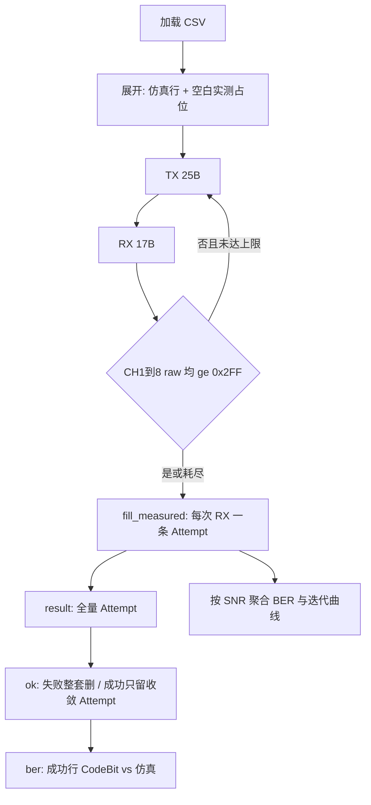

# 仿真-实测比对（Sim-to-Real）

MATLAB 仿真输出与芯片实测 RX 的比对流程、物理量公式与 Mode 1/2/3 BER 通道。

架构与导出契约（result→ok→ber）见 [软件工程视角与VibeCoding重建实验.md](软件工程视角与VibeCoding重建实验.md)。  
操作步骤见 [软件使用手册.md](软件使用手册.md)。  
UART 帧格式见 [PROTOCOL_UART.md](PROTOCOL_UART.md)。

---

## 1. 端到端流程



| 步骤 | 输入 | 输出 | 代码 |
|------|------|------|------|
| 加载 | 单行或交错 CSV | `CaseRecord` 列表 + 双行镜像 | `csv_loader.load_test_csv` |
| TX | `In[i]` | 12-bit DAC → 行电压 | `in_value_to_row_voltage` |
| RX | 8 路 ADC raw | `I_col` | `raw_to_column_current` |
| 收敛 | raw | 是否重发 | `needs_retry` |
| 比对 | 实测 vs 仿真 CodeBit | 误码 bit | `compare_frame` / `ber_out_indices_for_mode` |
| 导出 | `CaseRecord` | 三份 xlsx | `build_export_rows`、`filter_ber_error_rows` |

**重试要点**

- CH1–8 任一路 raw &lt; **0x2FF** → 重发同一 TX（最多 5 次重发，共 6 次机会）
- 中间 RX **写入** result 的 Attempt 行；**不计入** BER / 不进 ok（未收敛行）
- 最终仍未收敛：result 保留整套；**ok/ber 整套删除**（仿真 + 全部 Attempt）
- Out≈+2.5 ≈ raw≈0，表示该次未收敛

---

## 2. 物理量换算

### TX — 行电压

| 项目 | 公式 |
|------|------|
| DAC raw → 行电压 | `V_row = (raw / 4096) × 4.096` V |
| CSV `In[i]` → 行电压 | `V_row = clamp(In[i] + 2.5, 0, 4.096)` |

### RX — 列电流（权威）

| 项目 | 公式 |
|------|------|
| **I_col** | `I_col = ((raw/4096×5) − 2.5) × (−1)` = `2.5 − raw×5/4096` |
| 示例 | raw=0 → **+2.5**；raw=2048 → **0**；raw=0x2FF(767) → ≈**+1.564** |

代码：`protocol.codec.raw_to_column_current` / `column_current_to_raw`。

> 需求书曾出现的 `(raw/4096×5)×(−1.25)` **不能**用于 bit 提取（恒为负），现码不采用。

### 硬判 bit

`I_col < 0 → 1`；`I_col ≥ 0 → 0`（`chip_value_to_bit`）。

---

## 3. Mode 1 / 2 / 3 BER

| 模式 | BER 用 CodeBit 下标 | 分母 | TX CH1 高 4 bit |
|------|---------------------|------|-----------------|
| 1 | `[0,1,2,3]` | 4×N_converged | 1 |
| 2 | `[3,5,6,7]` | 4×N_converged | 2 |
| 3 | `[0,1]` | 2×N_converged | 3 |

- **实测 BER** = 实测行 CodeBit vs **仿真行 CodeBit**（同下标）
- Mode2：CSV InfoBit 列可保留，**不参与 BER**
- 未收敛帧 / 未收敛 Attempt：**不进** BER 分子分母
- 图表：按 `EbNo_dB` 聚合（`analyze_by_snr`）

代码：`analysis/sign_compare.py`（`ber_out_indices_for_mode`）。

---

## 4. 测试数据格式

### 单行仿真 CSV（常见）

例：`data/测试集/mode1.csv` — 7 个 Eb/N0 × 每点 1000 帧 = 7000 行。

```
EbNo_dB,FrameIdx,In[0],...,Out[7],InfoBit[0..],CodedBit[0..]?,IterNum
```

加载后内存展开为交错双行（仿真 + 空白实测）；**不覆盖源文件**。

### 交错双行（测后 / 旧格式）

| `RowKind` | 内容 |
|-----------|------|
| 仿真行 | In / Out（MATLAB）/ CodeBit 真值 / IterNum 参考 |
| 实测行 | Out（芯片 I_col）/ RecvHex / Attempt / HardwareConverged |

有重发时：同一帧下多条实测行，`Attempt=1,2,…`。

---

## 5. 测后三份 Excel（产品主路径）

| 文件 | 口径 |
|------|------|
| `*_result_*.xlsx` | 全量 Attempt（含 Out≈2.5） |
| `*_ok.xlsx` | 最终失败整套删；最终成功只留收敛 Attempt |
| `*_ber.xlsx` | 在 ok 上只留 CodeBit 不一致行 + 高亮 |

细节与流程图：[软件工程视角 §4](软件工程视角与VibeCoding重建实验.md)、[软件使用手册 §4](软件使用手册.md)。

> 代码中仍有 `build_error_rx_export_rows`（仅未收敛 Attempt），**不是**当前 GUI 默认三份产物。

---

## 6. 可视化

| 图 | 含义 |
|----|------|
| BER vs SNR | 已收敛帧的实测 CodeBit BER（按模式通道） |
| 平均迭代 vs SNR | **芯片**：RX byte0+1 均值；**参考**：同 SNR 下仿真行 `IterNum` 均值 |
| 电压解码表 | 单帧 TX 行电压 / RX 列电流柱状图 |

---

## 7. 代码入口

| 模块 | 职责 |
|------|------|
| `csv_loader.py` | 加载、展开、`build_export_rows` |
| `protocol/codec.py` | 编解码、I_col |
| `protocol/validator.py` | 0x2FF |
| `comm/serial_worker.py` | 收发与重试 |
| `analysis/sign_compare.py` | 硬判、模式通道 |
| `analysis/aggregate.py` | `CaseRecord`、`fill_measured`、SNR 聚合 |
| `analysis/report_export.py` | 样式 Excel、`filter_ber_error_rows` |
| `analysis/dataset_accuracy.py` | 仿真 CodeBit 监测 |

---

*与现码对齐：2026-07-09。*
