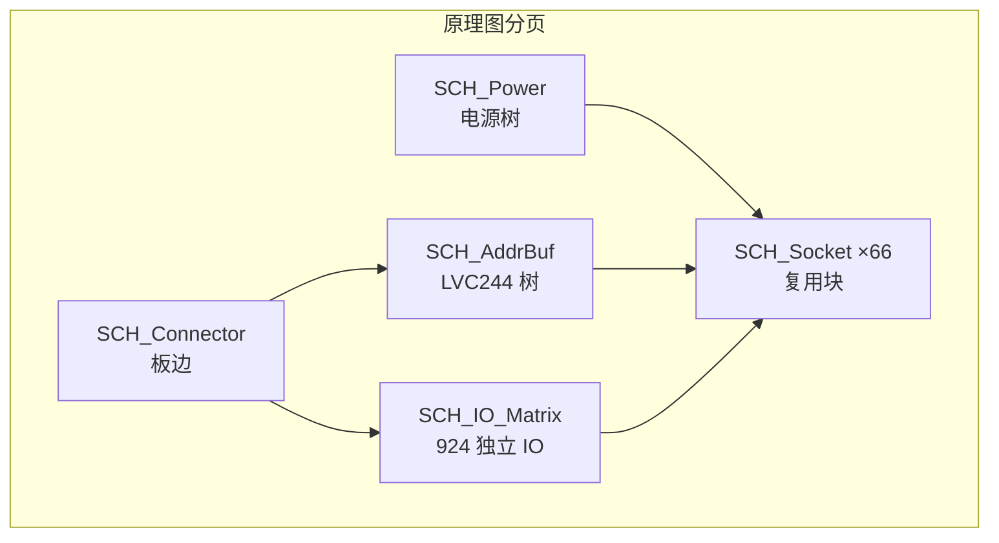

# 嘉立创原理图与 PCB 设计指导书 — RRAM 44×76 大阵列项目

> **文档性质**：面向硬件工程师的 **手把手操作指导书**（立创 EDA + 嘉立创 PCB 制造）  
> **适用范围**：66 颗 DIP32 MiniArray（6×11）→ 44×76 逻辑大阵列 PCB  
> **编制日期**：2026-07-06  
> **关联文档**：[RRAM阵列_PCB_IO信号说明.md](./RRAM阵列_PCB_IO信号说明.md)、[PCB大阵列拼接评估需求说明.md](./PCB大阵列拼接评估需求说明.md)、[44×76阵列物理评估.md](./44x76阵列物理评估.md)  
> **保密声明**：本项目资料含 Confidential 内容；本文档仅供项目组内部使用。

---

## 目录

1. [工具与环境](#1-工具与环境)
2. [工程立项](#2-工程立项)
3. [原理图设计流程](#3-原理图设计流程)
4. [PCB 布局指导](#4-pcb-布局指导)
5. [PCB 布线指导](#5-pcb-布线指导)
6. [设计规则（DRC）](#6-设计规则drc)
7. [制造输出与嘉立创下单](#7-制造输出与嘉立创下单)
8. [与本项目检查清单](#8-与本项目检查清单)
9. [常见问题](#9-常见问题)
10. [参考链接](#10-参考链接)

---

## 1. 工具与环境

### 1.1 推荐工具链

| 环节 | 推荐工具 | 说明 |
|------|----------|------|
| 原理图 / PCB | **嘉立创 EDA 专业版**（首选） | 大板（~944 网络、>360 mm）性能与 DRC 优于标准版；官方主推，持续更新 |
| 备选 | 嘉立创 EDA 标准版 | 仅小改版或历史工程维护；**不建议**用于本 66 片大阵列首版 |
| PCB 打样 / 量产 | **嘉立创 PCB**（jlc.com） | 与 EDA 一键下单、阻抗计算器、层叠库对接 |
| 阻抗预计算 | [嘉立创阻抗计算神器](https://tools.jlc.com/jlcTools/index.html#/impedanceCalculatenew) | 8 层板 50 Ω 单端 / 100 Ω 差分预研 |
| Gerber 预览 | 嘉立创 Gerber 查看器 / CAM350 | 下单前必查钻孔对齐、阻焊开窗 |

### 1.2 版本建议

| 项目 | 建议 |
|------|------|
| 嘉立创 EDA 专业版 | **≥ v2.x 最新稳定版**（客户端或浏览器）；大板优先 **桌面客户端** 减少浏览器内存压力 |
| 嘉立创 EDA 标准版 | 若自标准版迁移：专业版开始页 → **数据迁移**；两版数据不互通 |
| 操作系统 | Windows 10/11（本项目主环境）；macOS / Linux 可用专业版客户端 |
| 协作 | 专业版支持工程分享；原理图/PCB 分文件（`.esch` / `.epcb`），**纳入 Git 时打包 `.zip` 或仅归档 release** |

### 1.3 安装与账号（首日前置）

1. 注册 [嘉立创 EDA 专业版](https://pro.lceda.cn/) 账号（与 jlc.com PCB 账号可互通登录）。
2. 安装 **专业版客户端**（可选但推荐）：[专业版用户指南 — 安装客户端](https://prodocs.lceda.cn/cn/quick-start.html)。
3. 浏览 [专业版快速入门](https://prodocs.lceda.cn/cn/quick-start.html)（约 2 小时走完示例工程）。
4. 在本项目仓库 `docs/` 下备好三份对齐文档（IO 信号、拼接需求、物理评估），设计全程 **以 [RRAM阵列_PCB_IO信号说明.md](./RRAM阵列_PCB_IO信号说明.md) 的 `MA_*` 网络名为准**。

### 1.4 与本项目的关系

本指导书 **不替代** 信号/时序规格书，而是把规格落到 **立创 EDA 操作步骤 + 嘉立创工艺参数**。软件侧 MiniArrayQH_pkg、测试机 FPGA 不在本文展开，见关联文档 §6。

---

## 2. 工程立项

### 2.1 新建工程

1. 专业版首页 → **新建工程** → 命名建议：`RRAM_44x76_Array_V1`。
2. 工程描述中写明：66× DIP32、6×11、DB_DIP32_BOARD_V1_0 引脚表优先、目标 44×76 逻辑阵。
3. 创建 **原理图**（`SCH_Main`）与 **PCB**（`PCB_Array`），立即 **关联原理图与 PCB**（设计 → 原理图/PCB 相互关联）。
4. 建议分页原理图：
   - `SCH_Power` — 电源树、入口、Bulk
   - `SCH_AddrBuf` — 74LVC244 地址缓冲树
   - `SCH_IO_Matrix` — bl/sl 扇出（可再按行分页）
   - `SCH_Socket` — 单颗 ZIF/DIP 插座单元（复用块）
   - `SCH_Connector` — 板边接测试机/FPGA

### 2.2 层数与板厚

| 参数 | 首版建议 | 依据 |
|------|----------|------|
| 层数 | **8 层**（最低）；布线紧张时 **10 层** | ~944 网络；924 根独立 bl/sl + 共享总线 |
| 板厚 | **1.6 mm**（默认）；若需更稳机械强度可 **2.0 mm** | 大板翘曲与插座共面度 |
| 铜厚 | 外层 **1 oz**；**电源层 2 oz**（见 §6） | VAA IR drop、峰值 forming 电流 |
| 表面处理 | **沉金（ENIG）** | 精密插座、低接触电阻、多次插拔 |

**推荐 8 层叠构（起点，须用阻抗计算器复核）**：

```
L1  信号（元件面 — 插座、去耦）
L2  GND 平面
L3  信号（地址广播、局部扇出）
L4  PWR（VAA1/2/3 分区）
L5  信号（bl/sl 中段）
L6  GND 平面
L7  信号（bl/sl 远端）
L8  信号 / 次要电源（焊接面）
```

原则：**完整地平面相邻信号层**；VAA 与 GND 相邻；`wl_in` 等敏感线优先 L3/L5 并包地。

### 2.3 板尺寸估算

| 项目 | 数值 | 备注 |
|------|------|------|
| 单颗 DIP32 占位 | ~20 mm × 52 mm（2.54 mm 间距） | 含两侧行针 |
| 芯片中心节距（含走线区） | **~60 mm**（待 Layout 锁定） | 热间距 ≥ 5 mm |
| 66 颗网格 | **6 行 × 11 列** | chip_id：`U_R{r}C{c}`，r=0..5，c=0..10 |
| PCB 外形（估算） | **~360 mm × 660 mm** | 不含工艺边；**超大板**需确认嘉立创最大加工尺寸 |
| 工艺边 | 建议 **10 mm** 双侧或四侧 | 贴片/测试夹具；V 槽拼板见 §9 |

**立项时操作**：PCB 编辑器 → 板框 → 按估算值画矩形 → 留 **板边接插件区**（建议短边一侧 80–120 mm 宽条放 FPGA 连接器、电源入口）。

### 2.4 设计规则模板

1. PCB → **设计规则** → 从嘉立创 **8 层 1.6 mm 默认模板** 导入。
2. 将最小线宽/线距设为 **5 mil / 5 mil**（0.127 mm）作为首版基线；电源/地例外见 §6。
3. 过孔：外径 **0.45 mm / 孔 0.2 mm**（信号）；电源地 **0.6 mm / 0.3 mm** 或更大。
4. 保存为团队模板：`DRC_RRAM_44x76_8L`。

---

## 3. 原理图设计流程

### 3.1 库管理

#### 3.1.1 DIP32 / ZIF 插座

| 任务 | 操作步骤 |
|------|----------|
| DIP32 封装 | 库管理 → 封装 → 新建 **DIP-32**，2.54 mm 间距，跨距 15.24 mm（300 mil）；**Pin1 方焊盘 + 丝印三角** |
| ZIF 插座 | 选用实物型号（如 3M / 广濑 2×16 ZIF）；按 **数据手册** 建封装；**机械高度** 写入 3D 模型防干涉 |
| 底部 VSS4 | HTML 表：封装 **散热焊盘/地焊盘** 在芯片腹部投影区；原理图 Pin 命名为 `MA_VSS4` |
| 复用 | 将「ZIF + 去耦 + 丝印」做成 **复用模块 Block** `BLK_DIP32_UNIT`，实例 66 次 |

**关键**：引脚编号 **必须以 DB_DIP32_BOARD_V1_0（HTML 修正版）为准** 录入符号，勿直接套用通用 DIP32 顺序。对照 [RRAM阵列_PCB_IO信号说明 §3.2](./RRAM阵列_PCB_IO信号说明.md#32-完整对照表--html-修正版db_dip32_board_v1_0layout-优先)。

#### 3.1.2 74LVC244（地址缓冲）

- 符号：2× 4 位或 1× 8 位缓冲，按扇出分区使用。
- 每颗 244 驱动不超过 **~15–20 颗 DIP 等效负载**；66 颗至少 **2–3 级树**（入口 → 行缓冲 → 列缓冲）。
- 电源：`VCC` 接数字域（与 FPGA I/O bank 同压，1.8 V 或 3.3 V）；**每颗 100 nF** 贴脚。

#### 3.1.3 去耦与电源入口

| 位置 | 元件 | 网络 |
|------|------|------|
| 每颗 DIP 各 VAA 脚 | 100 nF（0402）+ 10 µF（0805） | `MA_VAA1/2/3` |
| 每 11 颗一行 | 100 µF Bulk + 可选磁珠 | 分区 `MA_VAAx_Zn` |
| 板边入口 | 保险丝 / TVS / 共模扼流（按电源架构） | 入口 `PWR_VAAx_IN` |

#### 3.1.4 其它常用库

- 0 Ω 跳线（电源/片选旁路）
- 测试点符号（TP_xxx）
- 板边连接器（按测试机机械图）

### 3.2 模块化划分



**单芯片座模块 `BLK_DIP32_UNIT` 应包含**：

- ZIF/DIP 插座 32+1 脚
- 三路 VAA 去耦、三路 VSS 短接至地
- 至行的网络端口：`MA_BL_IN0..6`、`MA_SL_IN0..6`（导出为端口名加 `_Uxx` 后缀）
- 共享总线：`MA_A0..5`、`MA_B0..3`、`MA_SEL_8WL`、`MA_WL_IN`（块内仅显示端口，不重复画缓冲）

**电源树**：

- `MA_VAA1/2/3` **分域**树状分配（数字 / WL 高压 / IO 模拟 — 电压值待 sign-off）
- 统一 `MA_VSS` / `MA_GND` 平面网络；原理图用 **电源标志** 与地符号，避免网状飞线

**地址总线**：

- FPGA 入口 → 一级 244 → 6 行（或 11 列）→ 二级 244 → 各插座
- 网络名：`MA_A0` … `MA_A5`、`MA_B0` … `MA_B3`（全板同名）

**IO 扇出**：

- 462×2 路不进入插座模块内部，由 `SCH_IO_Matrix` 用 **总线 + 网络标签** 接到各 `BLK_DIP32_UNIT` 端口
- 源端：DAC/GPIO 矩阵（架构开放）→ 可选串阻 22–47 Ω

### 3.3 网络命名（对齐 `MA_*`）

**强制规则**（与 [IO 信号说明 §3.1](./RRAM阵列_PCB_IO信号说明.md#31-命名规则) 一致）：

| 类型 | 格式 | 示例 |
|------|------|------|
| 共享地址/控制 | `MA_<信号>` | `MA_A0`、`MA_SEL_8WL`、`MA_WL_IN` |
| 独立 bl/sl | `MA_BL_IN<i>_U<id>` | `MA_BL_IN3_U42`（U42 = row4 col2） |
| 独立 sl | `MA_SL_IN<i>_U<id>` | `MA_SL_IN3_U42` |
| chip_id 编码 | `U_id = row×11 + col` | U00=行0列0 … U65=行5列10 |
| 片选 cen | `MA_CEN_U<id>` 或 `MA_CEN_R<r>` | 待架构 sign-off |
| 电源 | `MA_VAA1`、`MA_VSS1` … | 分区可加 `_Z0` |

**立创 EDA 操作**：

1. 放置导线前在 **网络标签** 使用上表名称；禁止 `Net1`、`网络2`。
2. 原理图 → **设计检查器** → 确认无未命名网络。
3. 导出 **网表** 后，用脚本或 Excel 核对 **924 路 bl/sl** 是否覆盖 U00–U65 × 7 路。

**`wl_en` / `cen` 特别说明**：HTML V1_0 表 **32 脚无独立脚位**；原理图须：

- 在评审通过前，用 **测试点 + 0 Ω 预留** 或 **Bonding 确认后的正式脚位** 表示；
- 幻灯片版 Pin27/28 仅作 **交叉参考**，勿未经 sign-off 直接 Layout。

### 3.4 原理图检查与 ERC

| 步骤 | 菜单 / 操作 | 本项目要点 |
|------|-------------|------------|
| 1 | 设计 → **设计规则检查（ERC）** | 无悬空输入；电源脚已接；缓冲器 OE 默认有效 |
| 2 | 设计 → **电气规则** | 同一 `MA_VAAx` 不得与 `MA_VSS` 短接 |
| 3 | 物料 BOM 预检 | 66× 插座、66×3 组去耦、244 数量、串阻 |
| 4 | 引脚对照 | 打印 [IO 说明 §3.2 表](./RRAM阵列_PCB_IO信号说明.md#32-完整对照表--html-修正版db_dip32_board_v1_0layout-优先) 逐项打勾 |
| 5 | 设计评审 | wl_en/cen、cen 66 路 vs 分组、VAA 电压 |

ERC 清零后 → **更新 PCB**（从原理图同步封装与网络）。

---

## 4. PCB 布局指导

### 4.1 6×11 阵列摆放

**坐标约定**（与软件 map 对齐前锁定一种）：

- **行 r = 0..5**（自上而下或自下而上，全板统一）
- **列 c = 0..10**（自左而右）
- `chip_id = r × 11 + c`

**摆放步骤**：

1. 在 PCB 放置 **板框** 与 **安装孔**（M3，四角 + 长边中点，降低翘曲）。
2. 放置 **板边连接器 / 电源入口**（固定后再摆阵列，避免后期挪动）。
3. 从 `U_R0C0` 起，按 **60 mm 节距网格** 放置 `BLK_DIP32_UNIT` 封装；复制阵列 6×11。
4. **全板 Pin1 同向**（建议：所有插座 Pin1 朝板边同一侧，例如均朝左或均朝下）。
5. 丝印：**三角 + "PIN1" + `U_RrCc` / `Uxx`**，字号可读。

```
        C0    C1    C2   ...   C10
R0    [U00] [U01] [U02] ... [U10]
R1    [U11] [U12] ...         [U21]
 ...
R5    [U55] ...               [U65]
      ↑
   板边接插件区（地址缓冲、FPGA、电源）
```

### 4.2 Pin1 方向与防呆

| 要求 | 实施 |
|------|------|
| 机械防呆 | ZIF 插座自身卡扣方向一致；丝印三角与插座实物 Pin1 对齐 |
| 电气防呆 | Pin1 远离批量 VAA 汇聚点，降低反插误上电风险 |
| 首件检验 | 空板用已知良好 DIP 芯片试插，万用表测 VAA–VSS |

### 4.3 热间距与散热

| 项目 | 建议 |
|------|------|
| 芯片中心间距 | **≥ 5 mm**（含走线）；读功耗 ~660 mW 全板，forming 远高于此 |
| Thermal via | 每颗插座 **腹部投影区** 打密集地过孔至背面铜皮 |
| 背面 | 可选 **裸露铜皮 + 绝缘涂层** 或安装散热底板（评估项） |
| 气流 | 机架安装时 **列向通风** 优于密闭叠板 |

### 4.4 插座朝向与走线出口

- **推荐**：插座 **行针方向垂直于板边接插件**，共享地址从 **行中心鱼骨** 馈入，bl/sl 从 **列方向** 扇入/扇出，减少交叉。
- **bring-up**：66 套 **ZIF** 便于换片；量产可改焊 DIP，须 **控温 < 芯片手册极限**。
- **测试点**：每行电源 TP、最远端 U65 的 `MA_A0`、`MA_WL_IN` 各 1。

### 4.5 有效区与 Guard 丝印

- 在 PCB 层绘制 **44×76 有效区框线**；guard 352 单元区域丝印 **"NON-PROGRAMMABLE"** 或 **"GUARD"**。
- 与 [PCB需求 §3.3 / 附录 B](./PCB大阵列拼接评估需求说明.md#33-几何拼接模型评估假设-a待硬件-sign-off) 一致：列裁 −1、行裁 −4（假设 A）。

---

## 5. PCB 布线指导

### 5.1 总体策略

| 优先级 | 信号类 | 层 / 方式 |
|--------|--------|-----------|
| P0 | `MA_VSS`、`MA_VAA*` | 平面 + 加粗 + 密集过孔 |
| P1 | `MA_A*`、`MA_B*`、`MA_SEL_8WL` | 等长组；244 后鱼骨 |
| P2 | `MA_WL_EN` → `MA_WL_IN` | 顺序不可颠倒；包地 |
| P3 | `MA_BL_*` / `MA_SL_*` | 占线量最大；分区多层 |
| P4 | `MA_CEN_*` | 片选；避免多片同时导通 |

### 5.2 电源平面

1. **L2 / L6 完整地**；插座旁 **≥ 4 过孔/ VSS 脚** 就近下地。
2. **L4 电源分区**：VAA1/2/3 可用 **铺铜分割** 或不同网络分区；跨区单点连接须经 PI 批准。
3. **IR drop 目标**：8× 读全板 simultaneous，ΔV/VAA **< 3%**。
4. **去耦电容**：0402 **距 DIP 电源脚 < 2 mm**；先布电容再布密线。

### 5.3 广播信号 vs 独立 bl/sl 扇出

#### 广播信号（共享译码）

| 网络 | 策略 |
|------|------|
| `MA_A0..5`、`MA_B0..3` | 从板边 **星型/鱼骨**；每经过一级 244 **短线等长**；66 片 pin **skew < 1–2 ns** |
| `MA_SEL_8WL` | 与地址同组等长；**远离** 大量 bl 平行线 |
| `MA_WL_IN` | **包地** 微带或 stripline；与 bl 间距 **≥ 3× 线宽** |
| `MA_WL_EN` | 走线路径 **短于 wl_in 逻辑长度**；FPGA 侧保证 T2→T3 顺序 |

**勿**：66 颗 DIP 地址脚直连 FPGA（负载 C<sub>L</sub> 100–200 pF，边沿变缓）。

#### 独立 bl/sl（924 线）

| 规则 | 说明 |
|------|------|
| 不可共享 | 每颗 `MA_BL_IN<i>_Uxx` 独立一根，至 DAC/GPIO |
| 成对 | `bl_in<i>` 与 `sl_in<i>` **相邻平行走线**（可选 100 Ω 差分对） |
| 组内等长 | **同一 Uxx 的 7 路 bl** 等长；**7 路 sl** 等长 |
| 组间 | 芯片间 **不要求** bl 全局等长；8× 并行同时读时 **同时到达容差 < 5 mm** |
| 端接 | 源端 **22–47 Ω** 串阻；避免长 stub |

**扇出布局技巧**：

- 将 IO 矩阵驱动放在 **板边接插件同侧**，按列 **蛇形** 进入各 Uxx，减少跨区穿孔。
- 使用 **L1/L3/L5/L7** 交替，过孔 **成对地回流**。
- 布线完成率目标：先 **100% 连通**，再 **调等长**，最后 **优化串扰**。

### 5.4 等长组设置（专业版）

1. 选中 `MA_A0..MA_A5` → 右键 → **差分/等长组**（单端等长组）。
2. 设置 **最大 skew**：地址组 **≤ 5 mm**（~25 ps 量级 FR4，保守）；或按 Tclk 反算。
3. `MA_BL_IN0..6_Uxx` 每组单独等长；**sl 组同理**。
4. 打开 **等长_tune 模式**，用蛇形在组内补偿。

### 5.5 时序关键路径与延迟预算

与 [IO 说明 §6](./RRAM阵列_PCB_IO信号说明.md#6-读写时序与-io-时序关系) 对齐：

| 参数 | 首版预算 | PCB 动作 |
|------|----------|----------|
| Tclk | **200 ns（5 MHz）** | 首版降频扫通后再提频 |
| 地址 Tsu | 10–20 ns | 缩短 FPGA→最远 U65 路径；244 靠近负载 |
| 66 片 skew | **< 2 ns** | 地址等长 + 缓冲树对称 |
| wl_en → wl_in | **wl_in 延迟 ≥ wl_en + 5 ns** | 走线长度 wl_in **长于** wl_en；禁止过孔让 wl_in 更短 |
| bl/sl 1-cycle 窗 | margin ≥ **20% Tclk** | cycle 5 前后留足；示波器实测 |

**9-cycle 最严时刻**：**cycle 5** `bl_in/sl_in` 单周期有效 — Layout 完成后在 **最远芯片** 测各信号到达时刻。

### 5.6 过孔与串扰

- 信号换层：**就近地过孔**（地过孔与信号过孔间距 < 3 mm）。
- 避免 **长 stub**（残桩）；背钻若工艺允许可评估。
- bl/sl 平行线：**3W** 间距规则；交叉时 **垂直**。
- `sel_8wl` 与模拟敏感线：**不同层 + 地隔离**。

---

## 6. 设计规则（DRC）

### 6.1 线宽线距（首版基线）

| 对象 | 线宽 | 线距 | 备注 |
|------|------|------|------|
| 信号（单端 50 Ω） | **按阻抗计算器**（常 5–6 mil） | ≥ 5 mil | 8 层 1.6 mm 须先算叠构 |
| bl/sl 对（100 Ω 差分） | 成对 **5/5 mil 或计算器输出** | 对内 / 对间按计算器 | 可选优化 |
| `MA_VAA*` 电源 | **≥ 20 mil**（局部更宽） | — | 2 oz 层优先 |
| `MA_WL_IN`（高压） | 加宽 + 包地 | 与 bl **≥ 0.2 mm** | 电压 sign-off 后复核 |
| 共面地 | 地铜皮 **≥ 3× 线宽** | — | wl_in、sel_8wl |

### 6.2 过孔

| 类型 | 外径 / 孔径 | 用途 |
|------|-------------|------|
| 信号 | 0.45 / 0.2 mm | 默认 |
| 电源/地 | 0.6 / 0.3 mm 或更大 | VAA、VSS 围栏 |
| 密集地阵列 | 0.45 / 0.2 mm，间距 1–2 mm | 插座腹部、板边 |

### 6.3 铜厚

| 层 | 铜厚 |
|----|------|
| 信号层 | 1 oz（35 µm） |
| 电源层 L4 | **2 oz（70 µm）** 若嘉立创工艺可选 |
| 地平面 | 1 oz 即可；大电流区域 **开窗加粗** |

### 6.4 阻抗（若需要）

1. 打开 [阻抗计算神器](https://tools.jlc.com/jlcTools/index.html#/impedanceCalculatenew)，选 **8 层、1.6 mm、目标 50 Ω 单端 / 100 Ω 差分**。
2. 记录 **线宽、线距、参考层**；在 PCB **阻抗配置** 中填写。
3. 下单时选 **阻抗公差 ±10%** 并附 **阻抗说明**（层叠截图 + 线宽表）。
4. 地址 / bl 首版 **可不强制阻抗管控**（5 MHz CMOS）；若提频至 10–50 MHz，**必须**管控。

### 6.5 DRC 执行

1. PCB → **设计检查器（DRC）** → 运行全部规则。
2. 制造前 DRC **0 错误**（警告逐项评审：丝印、阻焊桥）。
3. **网络连通性**：未连接网络、孤立铜皮处理完毕。

---

## 7. 制造输出与嘉立创下单

### 7.1 输出文件清单

| 文件 | 生成方式 | 用途 |
|------|----------|------|
| **Gerber + 钻孔** | 制造 → 生成 PCB 制板文件 | 嘉立创 PCB 生产 |
| **钻孔表** | 同上（`.DRL`） | PTH / NPTH / Via |
| **BOM** | 导出 BOM（含位号、值、封装） | SMT / 手工焊 |
| **坐标文件** | 组装 → 坐标导出（Pick&Place） | 贴片机（若 SMT 244 等） |
| **装配图** | PDF 打印 Top/Bottom + 丝印 | 手工焊 66 插座 |
| **阻抗说明** | PDF（层叠 + 线宽） | 阻抗管控订单附件 |

**专业版操作**（推荐流程）：

1. 制造 → **生成 PCB 制板文件（Gerber）** → 运行 DRC/网络检查。
2. 预览照片模式 + **Gerber 查看器** 核对钻孔与阻焊。
3. 可选：**在嘉立创下单** 一键上传；或下载 ZIP 手动上传 [jlc.com](https://www.jlc.com)。

### 7.2 Gerber 自检要点

- [ ] 板框层完整，工艺边含在内或单独说明
- [ ] 顶层/底层阻焊无大面积意外开窗
- [ ] 插座 PTH 孔径 ≥ 实物脚径 + 0.1 mm
- [ ] 钻孔未偏移（3:3 / 4:2 格式与厂家一致）
- [ ] 大铜皮 **泪滴** 已添加（嘉立创 DRC 建议）

### 7.3 嘉立创 PCB 下单参数（首版建议）

| 参数 | 建议值 |
|------|--------|
| 层数 | 8 |
| 板厚 | 1.6 mm |
| 铜厚 | 外层 1 oz；内层 1 oz；**电源层 2 oz 若可选** |
| 表面处理 | 沉金 |
| 阻焊颜色 | 绿色（量产）；**黑色** 与单芯片测试板一致（便于光学检查） |
| 字符颜色 | 白色 |
| 最小线宽/线距 | 5/5 mil（与 DRC 一致） |
| 阻抗 | 若需：±10%，附说明 |
| 测试 | **飞针测试**（建议）；大板选 **四线低阻测试** 评估报价 |
| 拼板 | 单板发货；或 **工艺边 + V 槽**（见 §9） |
| 交期 | 首版选 **加急** 缩短迭代；量产再优化成本 |

### 7.4 装配与 bring-up 顺序

与 [PCB需求 §6.3](./PCB大阵列拼接评估需求说明.md#63-pcb-bring-up-测试阶段) 一致：

1. **Phase 0**：单颗 DB_DIP32 小板验证（非本大板，但插座型号一致）。
2. **Phase 1**：大板 **只焊 1 行 × 11 颗** 插座 + 电源 + 缓冲 → 测 skew / IR drop。
3. **Phase 2**：全 66 颗 → 924 IO 连通、128 条件、3344 map。
4. 上电顺序：**GND → IO 安全态 → VAA 软启动 → 释放时序**。

---

## 8. 与本项目检查清单

设计冻结前 **逐项签核**（打印本表存档）：

### 8.1 引脚表签核

- [ ] 已采用 **DB_DIP32_BOARD_V1_0（HTML）** 作为 Layout 依据
- [ ] 已与幻灯片版 **逐 pin 交叉核对** 差异项
- [ ] **Bonding Diagram** 最新版已归档（含 wl_en/cen）
- [ ] 符号 Pin1–32 与实物 ZIF **一一对应**（"matched one by one"）
- [ ] VSS4 底部焊盘已纳入封装与网表

### 8.2 wl_en / cen

- [ ] 已确认：**是否有独立 DIP 脚** 或内建常使能
- [ ] 若无脚：评审记录 **测试点 / 飞线 / 下版芯片** 方案
- [ ] T2 使能顺序：`wl_en`、`cen` **先于** `wl_in`（HTML 四阶段）
- [ ] `cen` 架构：**66 独立** vs **6/11 分组** 已书面确认
- [ ] 多片 **不得** 同时 cen 有效导致 BL 冲突（netlist 审查）

### 8.3 3696 / 3344 边界

- [ ] 网表 / 丝印标注 **352 guard 单元**（NON-PROGRAMMABLE）
- [ ] 有效区 **44×76** 与 MiniArrayQH **坐标原点** 文档一致（7×8 vs 8×7 转置）
- [ ] 提供 **chip_id ↔ 逻辑 (row,col) map** 表（待官方 map 发布前用假设 A）
- [ ] guard 区 **无** 与有效 bl/wl 短接

### 8.4 信号与规模

- [ ] 共享网络 10 路 + 控制 2–4 路命名符合 `MA_*`
- [ ] 独立 bl/sl **924** 路齐全（462×2）
- [ ] 电源 **VAA×3、VSS×4** 分域与去耦按 §3.1.3
- [ ] 测试点 **TP-xxx ↔ chip_id** 对照表已输出

### 8.5 时序与验收（与 PCB 需求 §7 对齐）

- [ ] 首版 Tclk = 200 ns 已在 FPGA 模板注明
- [ ] 最远 chip **cycle 5** margin ≥ 20% Tclk（实测待填）
- [ ] 66 片 skew < 2 ns（实测待填）
- [ ] 8× 读 IR drop < 3%（实测待填）

---

## 9. 常见问题

### 9.1 嘉立创 EDA 导入导出

| 问题 | 处理 |
|------|------|
| 标准版 → 专业版 | 专业版开始页 **迁移工具**；或导入标准版 `.json` 工程 |
| 导入 Altium / PADS | 专业版支持部分格式导入；大工程建议 **分模块导入** 后重建规则 |
| Gerber 导出钻孔偏移 | 钻孔格式改 **3:3 或 4:2** 与厂家一致；用 Gerber 查看器复核 |
| 大板卡顿 | 用 **客户端**；关闭实时 3D；按区域 **铺铜冻结** 后操作 |

### 9.2 拼板

- 本板 **~360×660 mm** 可能接近或超过常规拼板尺寸上限 → 下单前在嘉立创 **计价页** 确认最大单板尺寸。
- 若需拼板：**工艺边 10 mm**、**V 槽** 或 **邮票孔**；**插座机械高度** 方向勿对着 V 槽应力集中侧。
- 66 ZIF 重量大 → 评估 **加固筋** 或 **金属托板**，不单靠 PCB 刚度。

### 9.3 大板变形与翘曲

| 现象 | 缓解 |
|------|------|
| 翘曲导致插座共面度差 | 选 **2.0 mm 板厚**；对称叠层；背面 **平衡铜皮** |
| 高温焊接变形 | 插座 **分批焊接**；温度曲线按元件手册 |
| 长期插拔松动 | 沉金 + 优质 ZIF；定位柱/导向销 |

### 9.4 布线塞不下

1. 升到 **10 层**；2. bl/sl **排线密集区改用更细线宽**（仍满足 DRC）；3. 评估 **排线转接子卡**（仅 IO 矩阵外置）— 架构变更须评审。

### 9.5 引脚表版本冲突

**停止 Layout**，先完成 [IO 说明 §3.4 决策树](./RRAM阵列_PCB_IO信号说明.md#34-版本差异决策树)：Bonding → HTML 测试板 → 再出 Gerber。

---

## 10. 参考链接

### 10.1 嘉立创 EDA 官方（2026）

| 资源 | URL |
|------|-----|
| 专业版用户指南（首页） | https://prodocs.lceda.cn/cn/ |
| 专业版快速入门 | https://prodocs.lceda.cn/cn/quick-start.html |
| 简介（专业版 vs 标准版） | https://prodocs.lceda.cn/cn/introduction/introduction/index.html |
| 常见问题 FAQ | https://prodocs.lceda.cn/cn/faq/index/ |
| 视频教程 | https://prodocs.lceda.cn/cn/faq/video-tutorial/ |
| 在线使用专业版 | https://pro.lceda.cn/ |

### 10.2 标准版文档（Gerber / 下单流程仍适用）

| 资源 | URL |
|------|-----|
| 生成 Gerber | https://docs.lceda.cn/cn/PCB/Gerber-Generate/ |
| PCB 下单流程 | https://docs.lceda.cn/cn/PCB/Order-PCB/ |

### 10.3 嘉立创 PCB 制造

| 资源 | URL |
|------|-----|
| 嘉立创 PCB 下单 | https://www.jlc.com/ |
| 阻抗计算神器 | https://tools.jlc.com/jlcTools/index.html#/impedanceCalculatenew |
| 阻抗管控说明 | https://www.jlc.com/portal/server_guide_42972.html |
| 阻抗设计说明 | https://www.jlc.com/portal/server_guide_38565.html |

### 10.4 本项目仓库文档

| 文档 | 说明 |
|------|------|
| [RRAM阵列_PCB_IO信号说明.md](./RRAM阵列_PCB_IO信号说明.md) | **网络名、引脚表、时序、电气约束（设计主依据）** |
| [PCB大阵列拼接评估需求说明.md](./PCB大阵列拼接评估需求说明.md) | Layout/SI/PI 评估项与 pass/fail |
| [44×76阵列物理评估.md](./44x76阵列物理评估.md) | 系统集成、9-cycle、软件边界 |
| [SIM_TO_REAL.md](./SIM_TO_REAL.md) | EVB 量纲对齐（非引脚等价） |

---

## 附录：首版工作日建议（参考）

| 阶段 | 工作日 | 产出 |
|------|--------|------|
| 库 + 单芯片模块 | 2–3 | Block、引脚表签核记录 |
| 电源 + 地址缓冲原理图 | 2 | ERC 通过 |
| IO 矩阵原理图 | 3–5 | 924 网络清单 |
| PCB 布局 6×11 | 3–4 | 装配图草案 |
| 广播线布线 + 等长 | 3–5 | skew 仿真/初测 |
| bl/sl 扇出 | 10–15 | 连通 DRC |
| PI/SI 评审 + Gerber | 2–3 | 下单包 |

*周期随 cen 架构、层数、是否阻抗管控而变化；首版建议 **留 30% 布线余量**。*

---

*本文档为 RRAM 44×76 大阵列项目在嘉立创工具链上的实施指导；引脚、电压、Tclk 以最新硬件 sign-off 为准。*
