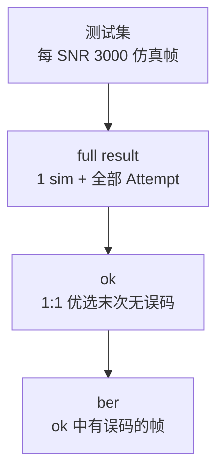

# 批量测试可视化分析 — 坐标轴与图表规范

> **最后更新**：2026-07-13（移除 okok 表；测后三表 + 图表内存裁剪）

本文档汇总「批量测试可视化分析」标签页的**测前/测后数据集口径、坐标轴物理量、图例命名、柱状图口径、图表 BER 基数裁剪与刷新行为**。实现以 `ui/chart_axis_spec.py` 为单一文案源，`ui/chart_panel.py` 负责绘制。

---

## 1. 页面布局（自上而下）

| 区域 | 内容 |
|------|------|
| 工具栏 | 计算 BER / 刷新图表、导出图表 |
| 说明行 | 坐标轴含义 + 动态刷新提示（灰色小字） |
| 左列 | BER 折线图 + BER 分子/分母柱状图 |
| 右列 | 迭代折线图 + 迭代分子/分母柱状图 |
| 底栏（窄） | ok 实测一条：TX/RX hex 一行 + AA 协议解析（各约 3 行，可滚动） |

折线/柱状高度比 **1.9 : 1.95**；副图区顶天立地，柱图脚注贴 figure 底边窄条。

---

## 2. 测前测试集与测后三套表（核心）

批量测后导出三张 Excel + 一份 CSV（同一 `*_result_{时间戳}`  stem）。以下口径与 `csv_loader.py`、`analysis/report_export.py`、`analysis/aggregate.py` 一致。

### 2.1 测试集（测前）

| 项目 | 规定 |
|------|------|
| 每 SNR 帧数 | 通常 **3000 帧/SNR**（如 `mode1_711.csv`、`*_0706.csv`） |
| 文件形态 | **单行**：每帧 1 行，仅含仿真字段（EbNo_dB、In[]、Out[]、CodeBit[]、IterNum 等） |
| 加载到 UI | 展开为 **1 仿真行 + 1 实测占位行**；例如 7000 组 ≈ **14000 行**（实测行为空，待测后填入） |
| Attempt | 测前无 Attempt；每 SNR **3000 条仿真记录** |

### 2.2 full（result）— 完整表

**代码：** `build_export_rows(cases, exclude_comm_errors=False)`

```
每帧：1 仿真行 + 全部 Attempt 实测行（含未收敛、有误码）
```

| 每 SNR | 数量 |
|--------|------|
| 仿真行 | = 已测帧数（通常 3000） |
| 实测行 | **≥ 已测帧数**（有重试则更多） |

用途：保留测后原始全貌，便于审计每次 Attempt。

### 2.3 ok — 1 仿真 + 1 实测（ber 输入）

**代码：** `build_export_rows(cases, exclude_comm_errors=True)` → `ok_frame_attempt_record()`

```
每帧：1 仿真行 + 1 实测行（严格 1:1）
```

| 规则 | 行为 |
|------|------|
| 最终通信失败 | **整帧删除**（仿真 + 全部 Attempt） |
| 保留哪条 Attempt | **① 末次「收敛且无误码」**；**② 若无则末次收敛**（可有误码） |
| 中间未收敛 / 误码 Attempt | 不写入 ok（仅在 result 全量表保留） |

**ber 表**直接以 ok 为输入：`filter_ber_error_rows(ok_rows)`，只保留 ok 中实测仍误码的帧。

### 2.4 ber — ok 中有误码的帧

**代码：** `filter_ber_error_rows(ok_rows)`

- 输入：**ok 表**（已 1:1）
- 只留 ok 中 **收敛且 CodeBit 有误码** 的帧
- 每帧仍为 1 仿真 + 1 实测
- **最终无误码的帧整帧不要**

### 2.5 三表关系一览

| 表 | 每帧结构 | 通信失败帧 | Attempt 策略 |
|----|----------|------------|--------------|
| **full (result)** | 1 sim + 全部 Attempt | 保留 | 全部保留 |
| **ok** | 1 sim + 1 meas | 删除 | 末次无误码 → 否则末次收敛 |
| **ber** | 1 sim + 1 meas（误码） | 删除 | ok 子集（有误码） |



**代码入口：**

| 文件 | 函数 |
|------|------|
| `analysis/aggregate.py` | `ok_frame_attempt_record`、`ok_frame_attempts`、`ok_chart_frame_attempts` |
| `csv_loader.py` | `build_export_rows`、`validate_ok_export_rows`、`trim_ok_rows_for_chart` |
| `analysis/report_export.py` | `filter_ber_error_rows` |

### 2.6 图表 BER 基数（每 SNR 帧数上限，可调）

**默认 1000 帧/SNR**；可在 UI 调整（100–10000，如 1300）：

| 位置 | 控件 |
|------|------|
| 测试执行 → 批量测试区 | `BER基数(每SNR)` + `达基数自动下一 SNR` |
| 批量测试可视化分析 → 工具栏 | `BER基数/ SNR`（与上同步） |

**规则（Mode1/2/3 相同）：**

1. 先按 ok 口径生成帧对（1 仿真行 + 1 实测行 / 帧）。
2. 按 **EbNo_dB** 分组，组内按 **FrameIdx** 升序。
3. **图表聚合/验算** 只保留前 N 帧（N = 当前 BER 基数；默认 FrameIdx 1 … 1000）；超出不计入折线/柱图。
4. **ok 导出** 保留全部已测帧，不裁剪。

**批量测试自动切 SNR（勾选「达基数自动下一 SNR」时）：**

- 后台跑批量、写 `*_result_*` 时，worker 按 **ok 收敛帧数** 计数；
- 当前 Eb/N0 的 ok 帧数 **≥ N** 后，**不再向芯片发送** 该 SNR 剩余帧，直接处理下一 SNR；
- 日志示例：`Eb/N0=0 dB 已达 BER 基数 1000，自动切换下一 SNR`。

环境变量：`EVB_FRAMES_PER_SNR=1300`（启动时默认基数）。

**代码入口：**

| 文件 | 函数 |
|------|------|
| `ui/chart_settings.py` | `get_frames_per_snr()` / `set_frames_per_snr()` |
| `comm/batch_snr_cap.py` | `BatchSnrCapGuard` |
| `comm/serial_worker.py` | `configure_batch_snr_cap()`、批量跳过逻辑 |
| `csv_loader.py` | `trim_ok_rows_for_chart()` |
| `analysis/aggregate.py` | `analyze_by_snr(..., max_per_snr=)` |
| `analysis/chart_live.py` | `SnrLiveAccumulator(max_per_snr=)` |

**与其它表关系：**

- **ok / full / ber 导出** 保留全部已测帧（不受 N 裁剪）。
- **图表聚合 / 验算** 在内存中对 ok 按 N 帧上限裁剪（`trim_ok_rows_for_chart`）。

---

## 3. 横轴（四张图统一）

| 项目 | 规定 |
|------|------|
| 物理量 | **Eb/N0**（信噪比） |
| 单位 | **dB** |
| 标签文案 | `EbN0 [单位 dB]` |
| 位置 | 横轴**右端**（`xlabel(..., loc="right")`） |
| 刻度含义 | 每个刻度 = 该 Eb/N0 (dB) 下批量测试已测 SNR 点；无数据时显示 0–6 dB 占位刻度 |

---

## 4. BER 折线图（左上）

| 轴 | 物理量 | 说明 |
|----|--------|------|
| 横轴 | Eb/N0 [dB] | 见 §3 |
| 纵轴 | **信道 BER（10ⁿ 对数）** | 刻度显示 10⁻⁶…10⁰ 等，不用 `1e-02` |
| 空图纵轴范围 | \(10^{-6}\) ~ \(10^{0}\) | 无数据时也显示对数轴与纵轴标签 |

### 图例

| 曲线 | 名称 |
|------|------|
| 实测 | 实测误码率 (ber误码bit ÷ 图表分母bit) |
| 理论 | **理论误码率**（ok 仿真行: Sim Out 硬判 vs CodeBit） |

标题示例：`Mode2 CodeBit BER vs SNR (芯片实测 + 理论)`（不用「参考」）。

### 计算公式

\[
\text{实测 BER} = \frac{\Sigma(\text{ber 表误码 bit})}{\text{图表帧数} \times N_{\text{ch}}}
\]

其中 **图表帧数** = 该 Eb/N0 下 ok 表经 BER 基数裁剪后的帧数，**至多 N**（见 §2.6）。

Mode1/2/3 的 Out / CodeBit 配对口径见 `analysis/sign_compare.py`（`ber_channel_pairs_for_mode`）。

---

## 5. BER 柱状图（左下）

每个 Eb/N0 点 **两根柱**（实测 vs 理论误码 bit，不再显示分母）：

| 柱色 | 含义 |
|------|------|
| 蓝 | **理论误码 bit**（ok 仿真行：Sim Out 硬判 vs CodeBit） |
| 橙 | **实测误码 bit**（ber 表累加；分母 bit 来自图表裁剪后的 ok） |

| 轴 | 标签 |
|----|------|
| 横轴 | EbN0 [单位 dB]（刻度为 dB 值） |
| 纵轴 | `误码 bit 数` |

脚注：`基数 = ok 表总 bit（每 SNR ≤1000 帧 × 通道数；图表裁剪后）`。

**动态刷新（在「可视化分析」页批量时）：**
- 每帧 O(1) 累加（`SnrLiveAccumulator`）；UI **合并刷新**约每 **16ms**（`BATCH_BAR_MIN_MS`）取最新值重绘四图
- live 路径跳过折线点标注；y 轴/柱顶标签仅在变化时更新
- 批量结束后全量 `analyze_by_snr`（含标注、标准差）
- 环境变量：`EVB_BATCH_BAR_MIN_MS=8` 更快；`EVB_UI_LITE=1` 弱机约 80ms

---

## 6. 迭代折线图（右上）

| 轴 | 物理量 | 说明 |
|----|--------|------|
| 横轴 | Eb/N0 [dB] | 见 §3 |
| 纵轴 | **迭代次数** | 线性坐标；空图范围 0–6 占位 |

### 图例

| 曲线 | 名称 |
|------|------|
| 实测 | 芯片平均迭代（ok 口径） |
| 理论 | **理论迭代次数**（ok 仿真 IterNum） |

标题：`迭代次数 vs SNR (芯片实测 + 理论)`。

均值 = Σ(ok 表 IterNum) ÷ 图表帧数（每 SNR ≤ N）。

---

## 7. 迭代柱状图（右下）

每个 Eb/N0 点两根柱（实测 vs 理论迭代累加）：

| 柱色 | 含义 |
|------|------|
| 蓝 | **理论迭代累加**（ok 仿真行 IterNum 之和） |
| 橙 | **实测迭代累加**（ok 实测行 IterNum 之和） |

| 轴 | 标签 |
|----|------|
| 纵轴 | `迭代次数累计` |

脚注：`基数 = ok 表帧数（每 SNR ≤1000；1 仿真 + 1 实测/帧；图表裁剪后）`。

---

## 8. 底部 ok 协议样例

- 数据来源：**ok 表口径**（每帧 1 仿真 + 1 优选实测 Attempt）
- 下拉框任选一条实测帧
- 展示：TX hex 一行、RX hex 一行；`format_tx_decode` / `format_rx_decode`（AA 协议字段）

---

## 9. 面板版本与自检

- `ui/audit_schema.py` → `AUDIT_SCHEMA_VERSION`：布局/口径变更时递增
- 主窗口据此重建 `ChartPanel`
- 自检：`python scripts/verify_audit_ui.py`
- 回归：`python scripts/test_dataset_accuracy.py`（含 `test_trim_ok_rows_for_chart`）

---

## 10. 相关代码

| 文件 | 作用 |
|------|------|
| `csv_loader.py` | `build_export_rows`、`trim_ok_rows_for_chart`、`filter_ok_export_rows` |
| `ui/chart_axis_spec.py` | 坐标轴与图例文案 |
| `ui/chart_panel.py` | 绘图与空图轴标签 |
| `ui/main_window.py` | 批量中节流刷新图表 |
| `analysis/aggregate.py` | `SnrPoint`、`FRAMES_PER_SNR`、`ok_frame_attempts`、`ok_chart_frame_attempts`、按 SNR 聚合 |
| `analysis/chart_live.py` | 批量实时柱图/折线（FrameIdx ≤ BER 基数） |
| `analysis/report_export.py` | `filter_ber_error_rows`、BER/迭代验算表（对 ok 内存裁剪后与图表一致） |

---

*与现码对齐：2026-07-13。*
