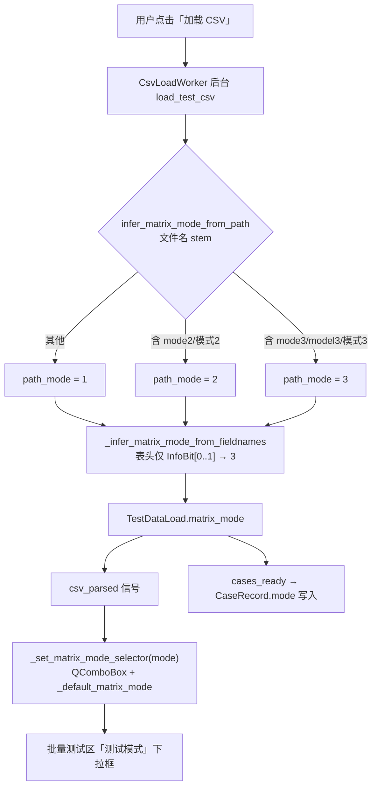
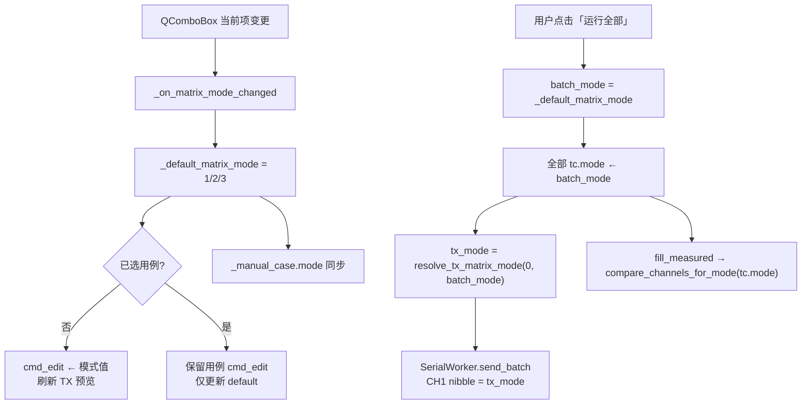
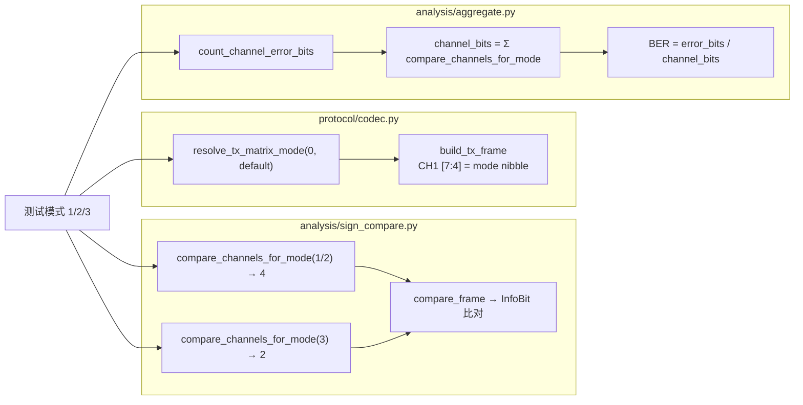
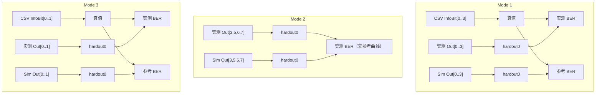
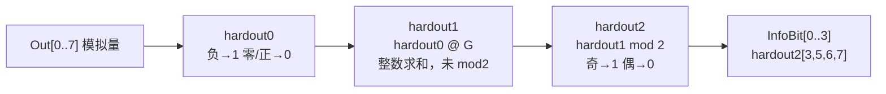
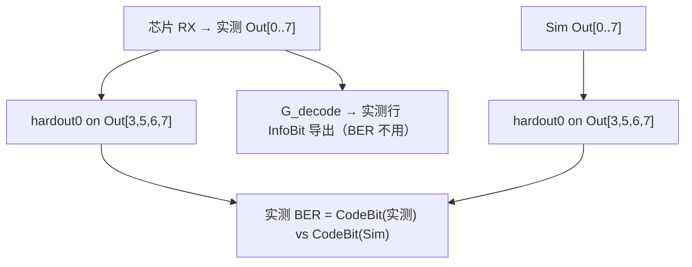

# 测试模式选择器流程图

**Author:** Xander  
**Date:** 2026-06-30  
**项目:** EVB-COM-TOOL  
**相关源码:** `ui/main_window.py` · `csv_loader.py` · `analysis/sign_compare.py` · `protocol/codec.py`

本文档描述批量测试 **模式 1 / 2 / 3** 三路选择器的推断、覆盖与下游处理路由。

硬件重发（`raw < 0x1FF`）与实测行 `Out[]` 十进制换算见 [DEBUG_调试分析.md](DEBUG_调试分析.md)。

---

## 模式差异速查

| 模式 | 比对通道 | InfoBit 来源 | TX CH1 高 4 bit | BER 分母 |
|------|----------|--------------|-----------------|----------|
| **1** | CH1–4 | CSV `InfoBit[0..3]` | 1 | 4×N |
| **2** | Out[3,5,6,7] CodeBit | CSV 列保留（InfoBit 不参与 BER） | 2 | 4×N |
| **3** | CH1–2 | CSV `InfoBit[0..1]` | 3 | 2×N |

---

## 1. CSV 加载 → 模式推断 → 选择器状态



**推断规则（`csv_loader.py`）：**

1. 文件名：`mode3` / `model3` / `模式3` → 3；`mode2` / `模式2` → 2；否则 → 1  
2. 表头：存在 `InfoBit[0]` 或 `[1]` 且无 `InfoBit[2]` → 强制 3  
3. 行内 InfoBit（mode2）：`Out[0..7]` 经 `hardout0@G → mod2` 得 `hardout2[4..7]`，再映射为 `InfoBit[0..3]`（`InfoBit[k]=hardout2[4+k]`；忽略错误 CSV 列）；mode1/3 仍用 CSV 或 `Out[0..n-1]` 硬判

---

## 2. 用户手动覆盖路径



**要点：**

- 加载 CSV 后可在 **运行全部之前** 手动改下拉框，覆盖文件名推断  
- 矩阵模式输入框 `cmd_edit`：单帧时 `0` 表示 **沿用** 选择器模式（`resolve_tx_matrix_mode`）  
- 批量测试统一以选择器为准，忽略各用例原 CSV mode 字段

---

## 3. 按模式下游路由



---

## 4. 与单帧测试的关系

| 场景 | 模式来源 |
|------|----------|
| 粘贴 CSV 行 | 当前选择器 `_default_matrix_mode` |
| 加载 A1 示例 | 固定模式 1（`cmd_edit = 1`） |
| 选中用例行 | 用例 `tc.mode` 显示于 `cmd_edit` |
| 单帧发送 | `resolve_tx_matrix_mode(cmd_edit, _default_matrix_mode)` |

---

## 5. 相关文档

- 协议 TX/RX：[`protocol/协议流程图.md`](../protocol/协议流程图.md)  
- UART 字段：[`docs/PROTOCOL_UART.md`](PROTOCOL_UART.md)  
- 三模式 BER 统一说明：本文 **§6**  
- 需求书 BER 章节：[`docs/EVB通信工具_代码需求书.md`](EVB通信工具_代码需求书.md) §7.0

---

## 6. 三模式 BER 计算统一说明

**实现入口：** `analysis/sign_compare.py`（硬判、`compare_frame`、`mode2_coded_bits_from_outputs`）· `analysis/aggregate.py`（`count_measured_error_bits`、`analyze_by_snr`）· `analysis/mode2_g_decode.py`（Mode2 InfoBit 导出，BER 不用）

### 6.1 硬判规则（三模式相同）

模拟量 **Out / I_col** 经同一函数映射为 bit（仿真与芯片一致）：

| 条件 | bit | 代码 |
|------|-----|------|
| 模拟量 **< 0**（负） | **1** | `chip_value_to_bit` / `sim_value_to_bit` |
| 模拟量 **≥ 0**（零或正） | **0** | 同上 |

```python
# sign_compare.py
def chip_value_to_bit(value: float) -> int:
    return 1 if value < 0 else 0
```

CH5–8 仅展示，**不参与** BER 分子/分母（`judged=False`）。

### 6.2 三模式对照表

| 项目 | **Mode 1** | **Mode 2** | **Mode 3** |
|------|------------|------------|------------|
| 比对通道 | CH1–4（`Out[0..3]`） | **Out[3,5,6,7]** 硬判 CodeBit | CH1–2（`Out[0..1]`） |
| 通道数 C | 4 | 4 | 2 |
| **BER 参考** | CSV 仿真行 InfoBit | **Sim Out[3,5,6,7] 硬判** | CSV 仿真行 InfoBit |
| 实测 BER 分子（单帧） | Σ \|hardout0(实测 Out[i]) − CSV InfoBit[i]\|，i=0..3 | Σ \|hardout0(实测 Out[j]) − hardout0(Sim Out[j])\|，j∈{3,5,6,7} | Σ \|hardout0(实测 Out[i]) − CSV InfoBit[i]\|，i=0..1 |
| 参考 BER | sim_bit vs CSV InfoBit | **无**（图表仅实测曲线） | sim_bit vs CSV InfoBit |
| 分母（每 SNR） | **4 × N_tested** | **4 × N_tested** | **2 × N_tested** |
| CSV InfoBit 列（导出） | 硬判或 CSV 列 | 仿真行 CSV 真值；实测行 `G_decode(实测 Out)`（**BER 不用**） | 硬判或 CSV 列 |
| CodedBit 列（导出） | Out[0..7] 硬判 | Out[0..7] 硬判（BER 仅用 `[3,5,6,7]`） | — |
| TX CH1 高 4 bit | 1 | 2 | 3 |

其中 `hardout0(v) = chip_value_to_bit(v)`；Mode2 BER **不用 G_decode / InfoBit**。

**N_tested**：该 SNR 下 `frame_was_tested` 为真的帧数（含未收敛但收到 RX；完全超时无 RX 不计入）。

### 6.3 三模式 BER 数据流（Mermaid）



### 6.4 公式汇总

**Mode 1 / Mode 3**（`comparison_info_bits` → `tc.info_bits`）：

```
chip_bit[i] = chip_value_to_bit(实测 Out[i])
sim_bit[i]  = sim_value_to_bit(Sim Out[i])
error_bits_frame = Σ (chip_bit[i] ≠ InfoBit[i])，i ∈ 参与通道
ref_error_bits_frame = Σ (sim_bit[i] ≠ InfoBit[i])
MeasuredBER = Σ error_bits / (C × N_tested)    // C=4 或 2
ReferenceBER = Σ ref_error_bits / (C × N_ref)
```

**Mode 2**（`Out[3,5,6,7]` 硬判 CodeBit；InfoBit 列不参与 BER）：

```
meas_bit[j] = chip_value_to_bit(实测 Out[idx_j])   // idx = (3,5,6,7)
sim_bit[j]  = chip_value_to_bit(Sim Out[idx_j])
error_bits_frame = Σ (meas_bit[j] ≠ sim_bit[j])，j=0..3
MeasuredBER = Σ error_bits / (4 × N_tested)
// 无 ReferenceBER 曲线
```

关键函数：`compare_frame` / `compare_frame_mode2` · `count_measured_error_bits` · `count_sim_reference_error_bits` · `analyze_by_snr`。

### 6.5 数值示例

**Mode 1**（真值来自 CSV）：

| 通道 | Sim Out | 实测 Out | CSV InfoBit | sim_bit | chip_bit | 参考误码 | 实测误码 |
|------|---------|----------|-------------|---------|----------|----------|----------|
| CH1 | +0.5 | −0.002 | 0 | 0 | 1 | 0 | **1** |
| CH2 | −0.3 | −0.001 | 1 | 1 | 1 | 0 | 0 |
| CH3 | +0.1 | +0.001 | 0 | 0 | 0 | 0 | 0 |
| CH4 | −0.2 | −0.003 | 1 | 1 | 1 | 0 | 0 |

→ 参考误码 0，实测误码 1 → 单帧贡献 1/4（该 SNR 再按 N_tested 聚合）。

**Mode 3**：同上逻辑，仅 CH1–2 计入，分母为 **2×N_tested**。

**Mode 2**：Sim Out[3]=+0.25→0，实测 Out[3]=−0.02→1 → 误码 1；Out[5,6,7] 同规则 → 单帧实测误码按 4 路聚合。**无参考 BER 曲线**。

---

## 7. Mode2 双行 InfoBit 导出（14000 行 / 7000 帧）

Mode2 测后 CSV 每帧 **2 行**（与 Mode1 相同 `RowKind` 标记），共用 `EbNo_dB`、`FrameIdx`：

| 行序 | RowKind | Out[] 来源 | InfoBit 算法 | 说明 |
|------|---------|------------|--------------|------|
| 1 | **仿真行** | Sim Out（MATLAB） | CSV 测试集自带真值 | `expected_info_bits` / `info_bits` |
| 2 | **实测行** | 实测 Out + RecvHex | `G_decode(实测 Out[0..7])` | 芯片 RX 回填 |

**G_decode 流程**（实测行 InfoBit 与 BER 左端；`mode2_decode_infobit`）：



1. **hardout0**：`hardout0[i] = (Out[i] < 0) ? 1 : 0`（负→1，零/正→0），i = 0..7  
2. **hardout1**：`hardout1 = hardout0 @ G`（1×8 × 8×8，逐元素整数求和，**尚未 mod 2**）  
   G 为 Polar/RM 8×8 矩阵（行 0..7 见 `analysis/mode2_g_decode.py`）  
3. **hardout2**：`hardout2[i] = hardout1[i] mod 2`（奇→1，偶→0）  
4. **InfoBit**（1×4）：`InfoBit[k] = hardout2[{3,5,6,7}[k]]`，`k = 0..3`

**hardout2 → InfoBit 映射**（0-based）：

| k | InfoBit[k] | hardout2 源 |
|---|------------|-------------|
| 0 | InfoBit[0] | hardout2[3] |
| 1 | InfoBit[1] | hardout2[5] |
| 2 | InfoBit[2] | hardout2[6] |
| 3 | InfoBit[3] | hardout2[7] |

**索引示例**（0-based，`hardout0 = [h0..h7]`，hardout2 列求和关系）：

| hardout2 | InfoBit | hardout1（mod2 前） |
|----------|---------|---------------------|
| `[3]` | `[0]` | `h3 + h7` |
| `[5]` | `[1]` | `h5 + h7` |
| `[6]` | `[2]` | `h6 + h7` |
| `[7]` | `[3]` | `h7` |

### BER 公式（Mode2 专节；Mode1/3 见 §6）

| 指标 | 分子 | 分母 |
|------|------|------|
| **实测 BER** | Σ \|hardout0(实测 Out[j]) − hardout0(Sim Out[j])\|，j∈{3,5,6,7} | **4 × N_tested** |
| **参考 BER** | —（图表不显示） | — |

**比对基准**：Sim Out[3,5,6,7] 硬判 CodeBit（非 CSV InfoBit）。



### Mode2 BER UI

「计算 BER / 刷新图表」：`recompute_measured_bit_compare` — Out[3,5,6,7] CodeBit(实测 vs Sim)，刷新曲线（无参考 BER）。
