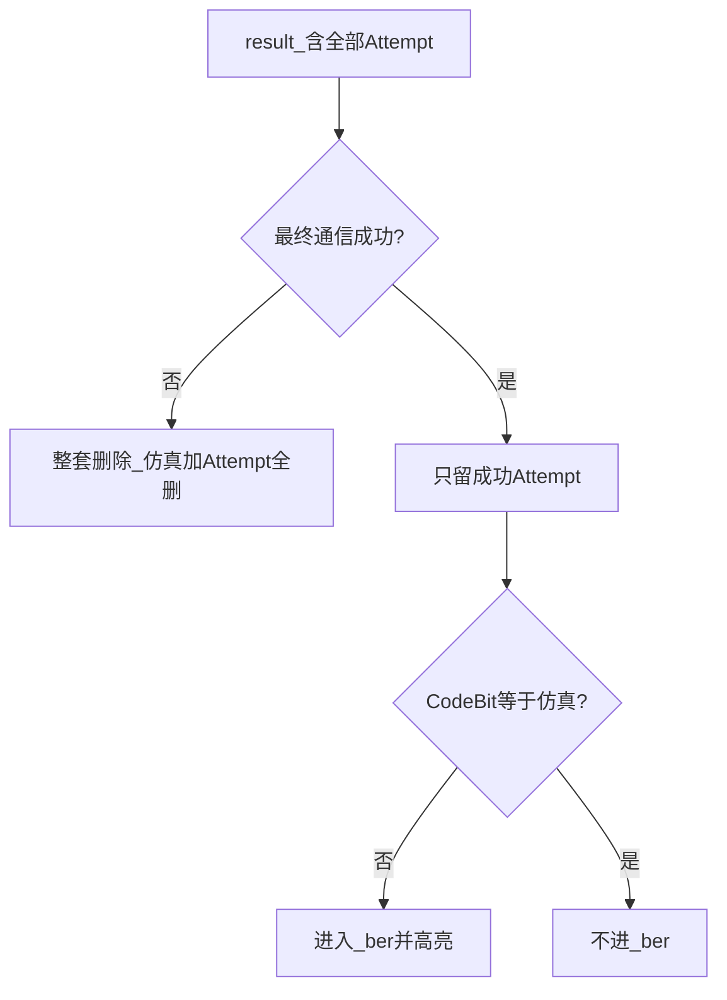

# DAC 译码器测试工具 — 软件使用说明

面向**操作人员**的日常使用说明。不要求读协议或源码。

想理解「为什么这样导出 / 为什么有 2.5」→ [软件工程视角与VibeCoding重建实验.md](软件工程视角与VibeCoding重建实验.md)  
协议字节 / 公式 → [PROTOCOL_UART.md](PROTOCOL_UART.md)、[SIM_TO_REAL.md](SIM_TO_REAL.md)  
串口助手单帧失败 / 硬件配置排查（**2026-07-17**）→ [PROTOCOL_UART.md §12](PROTOCOL_UART.md#12-硬件--串口配置排查串口助手单帧不成功)

---

## 1. 启动

1. 进入项目目录 `evb-comm-tool`
2. 双击 **`run.bat`**（首次会自动建虚拟环境并装依赖）
3. 窗口标题：**「DAC译码器测试工具」**

弱机 / 换电脑卡顿：改用 **`run_lite.bat`**（见 §7）。

测后 Excel 需要 **openpyxl**。若没有三份 xlsx、日志写「缺少 openpyxl」：

```cmd
.\.venv\Scripts\python.exe -m pip install openpyxl
```

打包给别人：见仓库根目录 [DISTRIBUTE.md](../DISTRIBUTE.md)（**不要**拷贝 `.venv`）。

---

## 2. 界面一览

| 标签页 | 用途 |
|--------|------|
| **测试执行** | 串口；单帧入口（粘贴/A1/单帧测试）与批量入口（加载/运行/导出）；**协议解析（左发送 / 右接收）**；**日志** |
| **可视化分析** | BER–SNR / 迭代折线 + 分子分母柱状图 + ok 协议样例（详见 `docs/批量测试可视化分析.md`） |
| **批量测试表格摘录** | 整页物理量解码：每条约 **发送 hex + CH1–12 行电压**、**接收 hex + CH1–8 列电流**；默认每页 **10** 条（可调 5–20），翻页浏览 |
| **单帧信息记录** | 12/8 通道明细表（可编辑）+ TX/RX hex；单帧改电压后再回执行页发送 |

常用按钮：

| 按钮 | 作用 |
|------|------|
| **加载 CSV** | 载入测试集 |
| **▶▶ 运行全部** | 批量串口测试 |
| **■ 停止** | 中止批量 |
| **检查数据准确性** | 核对仿真 CodeBit 是否被改写等 |
| **导出测试后数据集** | 手动再导出测后 CSV + 三份 Excel |
| **📊 导出报告** | 分析报告（曲线用） |

---

## 2.1 批量测试表格摘录（第三页）

原「可视化分析」下方「物理量解码表」整页迁到这里：

1. 批量测完后切到 **批量测试表格摘录**（或点「从当前测试结果刷新」）  
2. 一页约 **10** 条用例（「每页」可调 5–20），每条一块：  
   - 发送帧 hex + CH1–12 行电压  
   - 接收帧 hex（含迭代/Attempt）+ CH1–8 列电流  
3. 用 **上一页 / 下一页** 浏览全部已测帧  
4. **打开表格**（无需进 `data` 翻找）：  
   - **打开 ①完整 result** / **②ok** / **③BER** → 用系统默认程序直接打开对应 xlsx  
   - **整套复制到桌面** / **整套复制到…** → 从 `data` 复制 CSV + 三份 Excel 到桌面或自选文件夹（不删源文件）  

---

## 2.2 单帧信息记录（第四页）

- 改行电压 / 仿真电流、看芯片回传列、编辑 TX hex  
- 改完后回 **测试执行** 点「单帧测试」；协议解析与日志仍在执行页查看  

---

## 3. 日常测试（推荐顺序）


1. **连接串口**  
   选端口（如 COM3）→ 波特率 **9600**、8N1 → **连接**。日志出现「串口 … 已连接」。

2. **加载测试集**  
   点 **加载 CSV**，选如 `data/测试集/mode2_….csv`。  
   - 日志会写：已加载 N 组 → 测前展开为 **2N 行**（每组 1 仿真 + 1 空白实测占位）。  
   - 这是**测前结构**，不是测后最终行数；有重发时测后会 **> 2N**。

3. **确认测试模式**  
   下拉框与文件一致（Mode1 / 2 / 3）。加载后、运行前可手动改。

4. **运行全部**  
   点 **▶▶ 运行全部**。每帧：发 25 字节 → 收 17 字节；若回传未就绪会自动重发（最多约 5 次重发）。

5. **批量结束**  
   - 立刻写出测后 **CSV** 到 `data/测后数据集/YYYY-MM-DD/`  
   - **三份 Excel 在后台生成**（同目录；日志提示写完；**不要立刻关程序**）  
   - 自动做一次仿真 CodeBit 监测（见 §5）

6. **看结果**  
   - 先看 **`_ok.xlsx`**：应只有通信成功的帧  
   - 再看 **`_ber.xlsx`**：只有误码帧，粉红高亮处即不一致通道  
   - 曲线：切到 **可视化分析**  
   - 抽样对照 Attempt：切到 **批量测试表格摘录**  
   - 单帧改电压：切到 **单帧信息记录**

---

## 4. 测后文件怎么读

与源测试集分目录存放，按跑测日期分子文件夹：

```
data/
  测试集/                          ← 加载用的源 CSV
  测后数据集/
    YYYY-MM-DD/                    ← 当天跑测结果
      {源名}_result_{时间戳}.csv
      {源名}_result_{时间戳}.xlsx       ← ① result 全量
      {源名}_result_{时间戳}_ok.xlsx    ← ② 去通信错误
      {源名}_result_{时间戳}_ber.xlsx   ← ③ 仅误码帧
```

文件名时间戳每次不同；同日多次跑测都落在同一天的文件夹里。

| 文件 | 你要它干什么 |
|------|----------------|
| `{stem}_result_{时间}.csv` | 全量文本备份（含每次重发） |
| `{stem}_result_{时间}.xlsx` | **① 完整记录**：所有 Attempt，**可以有** Out≈2.5 |
| `{stem}_result_{时间}_ok.xlsx` | **② 通信成功口径**：见下 |
| `{stem}_result_{时间}_ber.xlsx` | **③ 误码清单**：在②里挑 CodeBit 与仿真不一致的行 |

### ② ok 在干什么（重要）

| 情况 | ok 里还剩什么 |
|------|----------------|
| 这一帧重发多次后**仍然失败**（Out 仍≈2.5） | **整套不要**：仿真行 + Attempt 1、2、3…**全部删除**（不是只删最后一次） |
| 这一帧**最终成功** | 只留仿真行 + **最后成功那次**实测；中间失败 Attempt（2.5）删掉 |

### ③ ber 在干什么

- 只拿 **ok 里成功实测行** 的 CodeBit，和同帧**仿真行** CodeBit 比  
- 不一致才留下，并对该通道的 **CodeBit + Out** 粉红高亮  
- 因此 **ber 里不应再出现 Out≈2.5**



**自检：** 若新导出的 `_ok` / `_ber` 里仍大量 Out≈2.5，多半是**旧程序导出的旧文件**——请重启工具后重新导出。

---

## 5. 仿真 CodeBit 监测

| 行 | CodeBit 规则 |
|----|----------------|
| **仿真行** | 来自测试集；测后**不得改写** |
| **实测行** | 由回传 Out 硬判得到，会变，属正常 |

| 时机 | 行为 |
|------|------|
| 加载 CSV | 快照仿真 CodeBit |
| 测后导出 | 与快照比对；被改写则日志告警 + 弹窗 |
| 随时 | 点 **检查数据准确性** |

弹窗列出「原=x 现=y」时：先确认是否用了旧展开逻辑的缓存结果；用当前版本重新加载 CSV 再测。开发验收：

```cmd
.\.venv\Scripts\python.exe scripts\test_dataset_accuracy.py
```

---

## 6. 行数别搞混

| 阶段 | 行数 |
|------|------|
| 加载后（测前） | 固定 **N×2** |
| 测后 | **≥ N×2**（有重发则更多） |

加载日志里的「展开为 14000 行」= 测前占位，不是测后最终行数。

---

## 7. 换机卡顿 / 弱机模式

| 原因 | 处理 |
|------|------|
| 图表重 | 用 **`run_lite.bat`**，或首次再开「可视化分析」 |
| 拷了别人的 `.venv` | 删掉 `.venv`，再 `run.bat` / `setup.bat` |
| 关太早 | 等日志提示 Excel 写完 |

`run_lite.bat` 会设 `EVB_UI_LITE=1`：进度更稀、图表 dpi 更低、日志更短。

可选环境变量：`EVB_CHART_DPI`、`EVB_PORT_REFRESH_MS`、`EVB_BATCH_PROGRESS_INTERVAL`、`EVB_LOG_MAX_BLOCKS` 等（见 `ui/perf_settings.py`）。

---

## 8. 常见问题

| 现象 | 怎么处理 |
|------|----------|
| 连不上串口 | 换线/口；关占用该口的其他软件；点刷新 |
| 大量 Out≈2.5 在 **result** | 正常：重发过程或最终失败帧 |
| 大量 Out≈2.5 在 **ok/ber** | 应不该有 → 重启后重新导出；仍有则反馈 FrameIdx/Attempt |
| 没有 `_ok.xlsx` / `_ber.xlsx` | 装 openpyxl；看日志是否写盘失败 |
| 曲线是空的 | 先等批量结束；再切「可视化分析」等后台算完 |
| CodeBit 监测失败弹窗 | 见 §5；重新加载源 CSV 再测 |

---

## 9. 深入阅读

| 文档 | 内容 |
|------|------|
| [软件工程视角与VibeCoding重建实验.md](软件工程视角与VibeCoding重建实验.md) | 架构、流程图、result→ok→ber 原理 |
| [师傅带徒弟_代码故事.md](师傅带徒弟_代码故事.md) | 师傅带徒弟：每个文件在实现什么 |
| [SIM_TO_REAL.md](SIM_TO_REAL.md) | 物理量公式、Mode1/2/3 BER 通道 |
| [PROTOCOL_UART.md](PROTOCOL_UART.md) | UART / AA 帧格式 |
| [CODE_GUIDE.md](CODE_GUIDE.md) | 二次开发目录 |
| [../DISTRIBUTE.md](../DISTRIBUTE.md) | 打包分发 |
| [../README.md](../README.md) | 环境安装总览 |

---

*面向使用者；与现码对齐：2026-07-09。*
