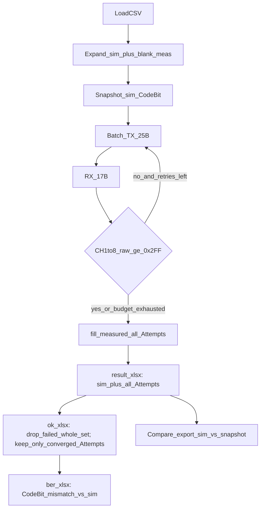
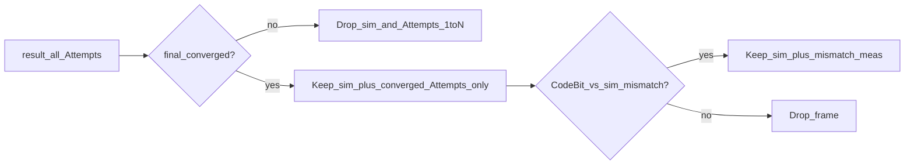
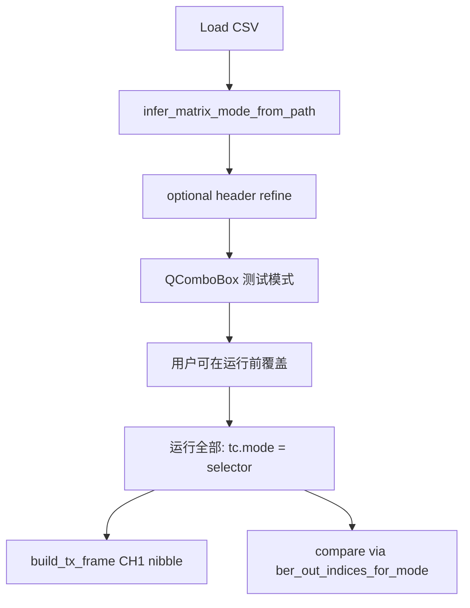

# 软件工程视角：EVB 通信质量监测上位机

兼：**架构原理 / 现码流程图**，以及 **Vibe Coding 从零重建**课程大纲。

对照实现：本仓库 `evb-comm-tool`（只读对照，重建时禁止整文件粘贴）。

| 读者 | 去哪 |
|------|------|
| 操作人员 | [软件使用手册.md](软件使用手册.md) |
| **入门故事（师傅带徒弟）** | [师傅带徒弟_代码故事.md](师傅带徒弟_代码故事.md) |
| 协议字节级 | [PROTOCOL_UART.md](PROTOCOL_UART.md) |
| 公式与 BER 通道 | [SIM_TO_REAL.md](SIM_TO_REAL.md) |
| 二次开发目录 | [CODE_GUIDE.md](CODE_GUIDE.md) |

---

## 第一部分：架构与现码原理

### 1. 问题本质：领域复杂度 > GUI 复杂度

这不是「串口调试助手」，而是一台**硬件在环（HIL）**工具：把仿真激励推到芯片，把物理回传拉回软件，再按通信理论口径算 BER。

必须拆开的三层语义：

| 概念 | 含义 | 代码锚点 |
|------|------|----------|
| **硬件收敛** | CH1–8 全部 `raw ≥ 0x2FF` | `protocol.validator.needs_retry` |
| **通信失败** | 重发耗尽后仍未收敛 | `is_comm_error_frame` / `hardware_converged=False` |
| **误码** | 已收敛实测 CodeBit ≠ 仿真 CodeBit | `filter_ber_error_rows` / `sign_compare` |

`Out ≈ +2.5` 通常对应 `raw ≈ 0`（未收敛），**不是**公式算错。

---

### 2. 分层架构（对照现码）

```
UI (PyQt)  →  Comm (QThread 串口)  →  Protocol (编解码 / 收敛)
     ↓              ↓
  CSV 镜像      Analysis (比对 / 聚合 / 导出 / 监测)
```

| 层 | 职责 | 关键模块 |
|----|------|----------|
| **UI** | 编排、可视化、弱机开关 | `ui/main_window.py`、`chart_panel.py`、`perf_settings.py` |
| **Comm** | 非阻塞 I/O、批量、重试 | `comm/serial_worker.py` |
| **Protocol** | AA 帧、物理量、0x2FF | `protocol/codec.py`、`validator.py` |
| **Analysis** | Sim-to-Real、BER、三份 Excel、CodeBit 监测 | `sign_compare.py`、`aggregate.py`、`report_export.py`、`dataset_accuracy.py` |
| **CSV** | 双行展开、写回、导出口径 | `csv_loader.py` |

**评价：** 适合小团队、强领域的仪器软件；`main_window` 仍是编排上帝对象，属已知技术债。

---

### 3. 端到端流程图（现码）



对照：`SerialWorker._do_send` → `fill_measured` → `build_export_rows` → `filter_ber_error_rows`。

---

### 4. result → ok → ber（导出契约）

| 文件 | 口径 | 代码 |
|------|------|------|
| `{stem}_result_{ts}.xlsx` | **① 全量**：仿真行 + Attempt 1..N（含 Out≈2.5 / HC=N） | `build_export_rows()` |
| `{stem}_result_{ts}_ok.xlsx` | **② 去未收敛**：见下表 | `build_export_rows(exclude_comm_errors=True)` |
| `{stem}_result_{ts}_ber.xlsx` | **③ 仅误码**：在②上只留 CodeBit≠仿真 的实测行（+仿真行对照）；误码通道 CodeBit+Out 粉红高亮 | `filter_ber_error_rows` |

**② ok 细则（必须整套理解）：**

| 帧结局 | ok 行为 |
|--------|---------|
| **最终仍失败**（5 次重发后仍有 raw&lt;0x2FF / Out≈2.5） | **整套删除**：仿真行 + Attempt 1..5 **全部不要**（不是只删第 5 次） |
| **最终成功**（某次 Attempt 收敛） | 删掉中间未收敛 Attempt；**只留** HC=Y 的成功实测行（无 Out≈2.5） |

**③ ber：** 只用 ok 里成功行的 CodeBit 与同帧仿真行比；因此 ber **不应再出现** Out≈2.5。



---

### 5. 重发与 Out≈2.5

| 项目 | 规则 |
|------|------|
| 检查 | CH1–8 **raw**（不是直接比 Out 浮点） |
| 阈值 | `RETRY_THRESHOLD = 0x2FF`（767） |
| 未收敛 | 任一路 raw &lt; 0x2FF → 重发同一 TX |
| 上限 | 默认最多 5 次重发（共 6 次 TX） |
| Out≈+2.5 | 典型 raw≈0 → 该 Attempt 未收敛 |

公式：`I_col = 2.5 − raw×5/4096`（`raw_to_column_current`）。

每次有效 RX 记一条 `RxAttempt` / 实测行（`Attempt=1,2,…`）。**BER 曲线与③表只认最终收敛 Attempt。**

---

### 6. 模式 1 / 2 / 3 路由

| 模式 | BER 通道（CodeBit 下标） | 分母 bit 数 | TX CH1 高 4 bit |
|------|--------------------------|-------------|-----------------|
| 1 | `[0,1,2,3]` | 4×N | 1 |
| 2 | `[3,5,6,7]` | 4×N | 2 |
| 3 | `[0,1]` | 2×N | 3 |



硬判：`I_col < 0 → bit 1`；`≥ 0 → bit 0`。Mode2 仿真行 InfoBit 列保留但**不参与 BER**；BER = 实测 CodeBit vs 仿真 CodeBit。

---

### 7. 关键不变量

1. **仿真行 CodeBit 不可被管道静默改写** — 展开补齐必须 `only_empty=True`  
2. **加载时快照仿真 CodeBit**；测后导出自动比对（`dataset_accuracy`）  
3. **实测行 InfoBit 应留空**；实测 CodeBit = Out 硬判  
4. **收敛 ≠ 译码正确**；通信失败整帧不进 ok/ber  
5. **主线程不做**大 CSV 构建 / 大 Excel / 全量 BER 扫表（Worker + 节流）

**教学反例（已修）：** `build_interleaved_rows_from_legacy` 曾用 Out 硬判覆盖给定 CodeBit → 监测误报「改写」。现仅空列补齐。

---

### 8. 工程化成熟度与技术债

| 维度 | 水平 |
|------|------|
| 需求/协议文档 | 高（本体系 + PROTOCOL + SIM） |
| 领域规则显式化 | 中高 |
| 可移植部署 | 中高（`run` / `run_lite` / `pack`） |
| 自动化测试 | 中低（`scripts/test_*.py`，缺统一 CI） |
| 主窗口可测性 | 偏低（上帝对象） |

**可迁移教训：** 先钉语义再写界面；数据管道禁止静默改写真值；规模上来后主线程是敌人。

---

## 第二部分：Vibe Coding 从零重建实验

### 0. 课程定位

| 不是 | 是 |
|------|----|
| 一次生成完整 GUI | **垂直切片**：每片可运行、可测、可讲 |
| 「能连上串口就行」 | 钉死：协议 / 收敛 / BER / 导出契约 |

**课堂口号：** AI 写草稿，学生当审稿人；合并前必须回答——输入、输出、哪条不变量被破坏会怎样。

建议：**6～8 次课（每次 2～3 小时）**。

### 1. 四拍教学法

```
① Prompt → ② Generate(30–80行) → ③ Dissect(掰开看表) → ④ Lock(测试)
```

**掰开看表：** 领域问题 / 依赖哪一层 / 有无静默改数据 / 失败时用户与日志 / 帧数×10 哪里卡 / 对应 SE 概念。

**禁止：** 一次生成整仓；UI 里写 BER 公式；展开覆盖仿真 CodeBit；未测就接下一层。

### 2. 垂直切片

| 片 | 目标 | 对照本仓 |
|----|------|----------|
| 1 | `raw_to_column_current` + 硬判 | `protocol/codec.py` |
| 2 | 25B/17B 编解码 | `codec.py`、PROTOCOL |
| 3 | 0x2FF 重试 + 多 Attempt | `validator.py`、`serial_worker.py` |
| 4 | `CaseRecord` / `fill_measured` | `aggregate.py` |
| 5 | 双行展开 + `only_empty`（事故演练） | `csv_loader.py`、`dataset_accuracy.py` |
| 6 | 按模式 BER 聚合 | `sign_compare.py`、`aggregate.py` |
| 7 | 最小 GUI 单帧 | `main_window.py` 局部 |
| 8 | 三份 Excel：①全量 ②整套删失败帧+只留成功 Attempt ③仅误码高亮 | `report_export.py`、`build_export_rows` |
| 9（选修） | `EVB_UI_LITE`、延迟图表 | `perf_settings.py`、`run_lite.bat` |

第 8 片掰开看：最终失败是「只删第 5 次」还是「仿真+1..5 整套删」？ber 该拿哪一行 CodeBit？

### 3. 课堂组织

每组：Prompt 工程师 / 审稿人 / 测试官；AI 无合并权。  
每片结束对照本仓只读 diff，填工程体检表（分层 / 不变量 / 可复现 / 异步）。

### 4. 验收清单（重建版）

- [ ] 假 RX：未收敛→重发；耗尽→`hardware_converged=N`  
- [ ] ok 对最终失败帧导出为空列表（整套删除）  
- [ ] ok 对最终成功帧无 Out≈2.5 实测行  
- [ ] ber 仅 CodeBit 不一致行；高亮通道正确  
- [ ] 展开不覆盖给定仿真 CodeBit  
- [ ] 7000 帧批量时 UI 可停止、可导出  

---

*文档与现码对齐：2026-07-09。*
