# EVB-COM-TOOL 协议流程图

**Author:** Xander  
**Date:** 2026-06-30  
**项目:** EVB-COM-TOOL  
**相关源码:** `protocol/codec.py` · `protocol/validator.py` · `comm/serial_worker.py`  
**详细协议说明:** [`docs/PROTOCOL_UART.md`](../docs/PROTOCOL_UART.md)

本文档以 Mermaid 流程图描述 AA 应用层协议、物理量换算、RX 收敛校验及 UART 收发逻辑。  
**仅文档，不修改 Python 实现。**

---

## 目录

1. [AA 协议 TX/RX 一问一答总览](#1-aa-协议-txrx-一问一答总览)
2. [TX 25 字节帧组帧流程](#2-tx-25-字节帧组帧流程)
3. [RX 17 字节帧解析流程](#3-rx-17-字节帧解析流程)
4. [物理量换算：DAC→V_row / ADC→I_col](#4-物理量换算dacv_row--adci_col)
5. [RX 校验与收敛判定](#5-rx-校验与收敛判定)
6. [UART 收发与重试循环（serial_worker）](#6-uart-收发与重试循环serial_worker)

---

## 1. AA 协议 TX/RX 一问一答总览

UART 物理层（9600 8N1）承载 **AA 应用层定长帧**：PC 发 **25 B**，芯片回 **17 B**。

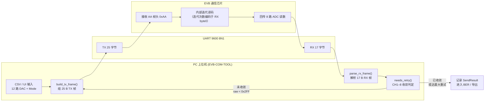

| 方向 | 帧长 | 首字节含义 | 载荷 |
|------|------|-----------|------|
| **TX** (PC→芯片) | 25 B | `0xAA` 帧头 | 12 组 × 2 B（12-bit DAC，大端） |
| **RX** (芯片→PC) | 17 B | 迭代次数编码 | 8 组 × 2 B（12-bit ADC，大端） |

> RX 首字节 **不是** `0xAA`；迭代次数 = `byte0 + 1`。

---

## 2. TX 25 字节帧组帧流程

对应 `codec.build_tx_frame()` / `codec.decode_tx_frame()`。

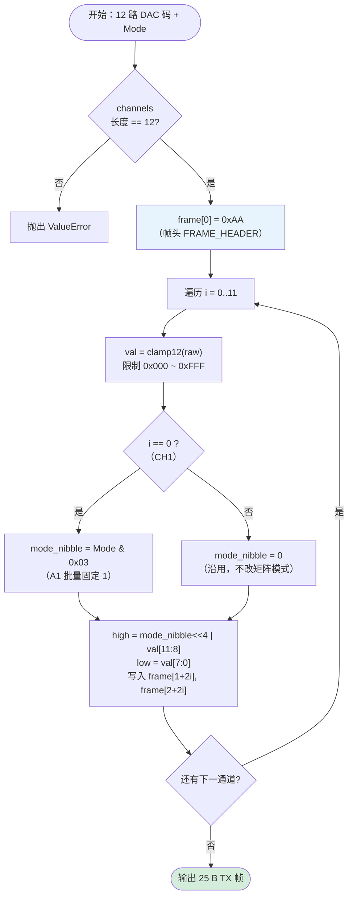

### TX 帧字节布局

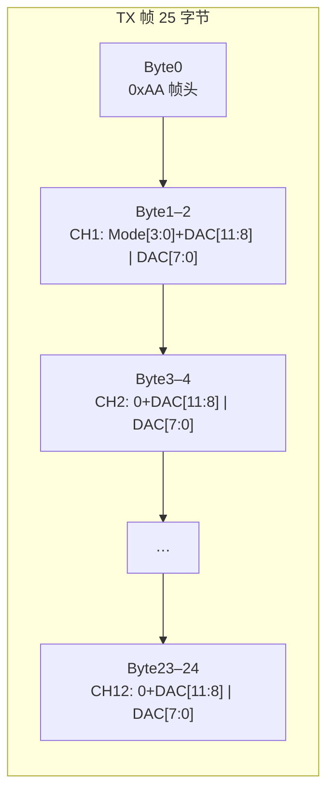

---

## 3. RX 17 字节帧解析流程

对应 `codec.parse_rx_frame()` / `codec.decode_rx_frame()`。

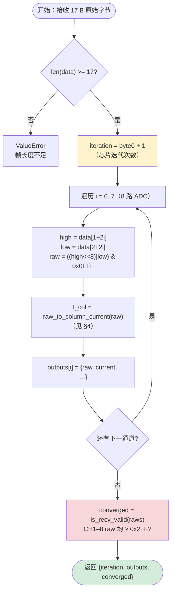

### RX 帧字节布局

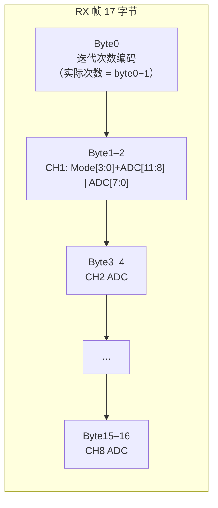

> **收敛判定看 CH1–8**（全部 8 路）；任一路 raw < 0x2FF 即触发重发。

---

## 4. 物理量换算：DAC→V_row / ADC→I_col

对应 `codec.py` 中常量与换算函数。

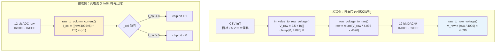

### 换算公式速查

| 方向 | 函数 | 公式 | 备注 |
|------|------|------|------|
| TX | `raw_to_row_voltage` | **V_row = (raw / 4096) × 4.096** | 满量程 4.096 V |
| TX | `in_value_to_row_voltage` | V_row = 2.5 + In[i]，clamp [0, 4.096] | CSV 输入映射 |
| RX | `raw_to_column_current` | **I_col = ((raw/4096×5) − 2.5) × (−1)** | raw=2048 → I_col=0 |
| RX | 逆变换 | raw = (2.5 − I_col) / 5 × 4096 | `column_current_to_raw` |

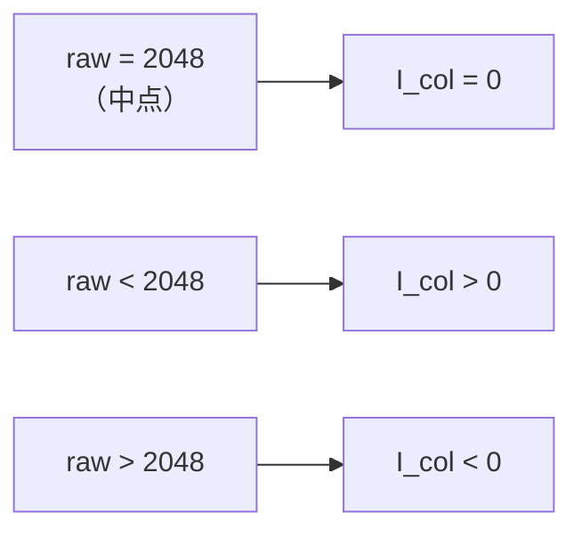

---

## 5. RX 校验与收敛判定

对应 `validator.py`：`validate_rx_frame()` 与 `needs_retry()` 逻辑等价，输入形态不同。

### 5.1 双入口一致性

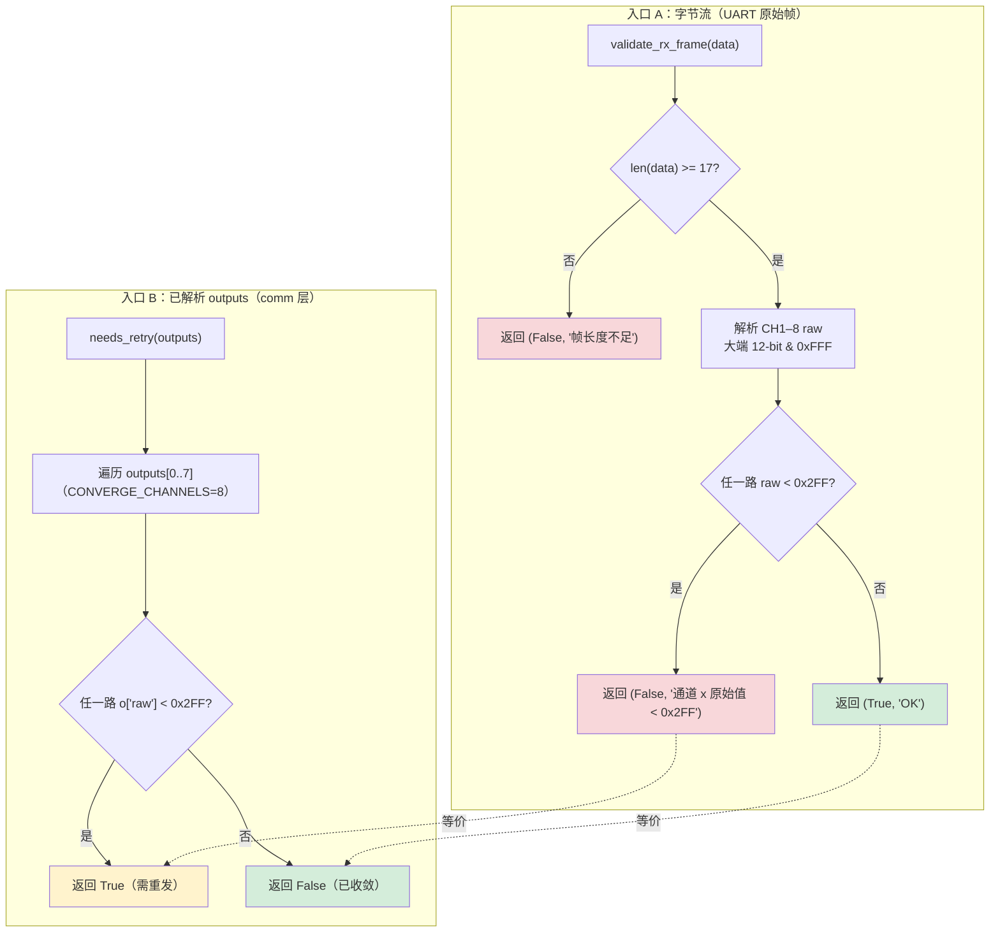

> **一致性：** `needs_retry(outputs) == True` ⟺ 等长帧上 `validate_rx_frame(data)` 返回 `(False, …)`  
> **范围：** CH1–8 全部参与；阈值 `RETRY_THRESHOLD = 0x2FF`（767）。

### 5.2 CH1–8 收敛判定细节

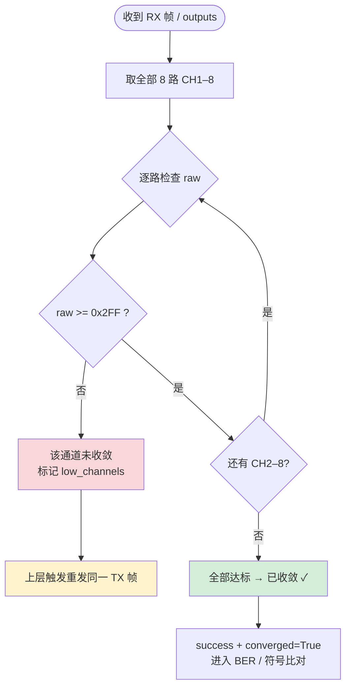

### 5.3 codec 层辅助函数关系

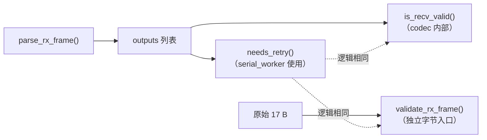

---

## 6. UART 收发与重试循环（serial_worker）

对应 `comm/serial_worker.py`：QThread 工作线程中的 `_do_send()` 重试逻辑。

### 6.1 线程与命令队列总览

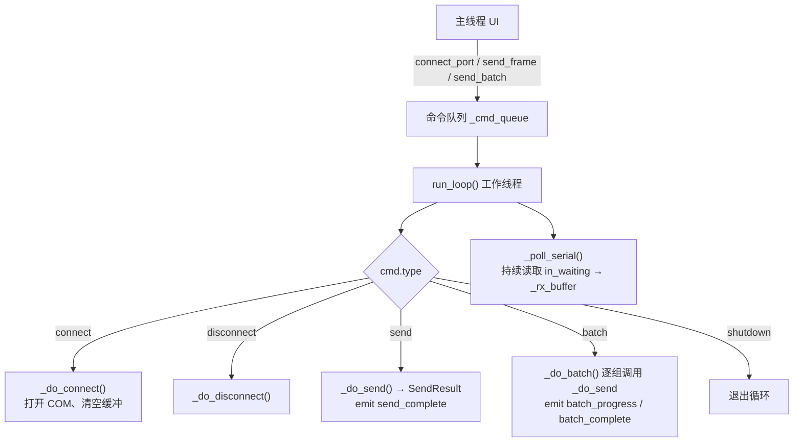

### 6.2 单次发送/接收 + 重试循环

默认 `_max_retries = 5`（不含首次，最多 **6 次 TX**）。

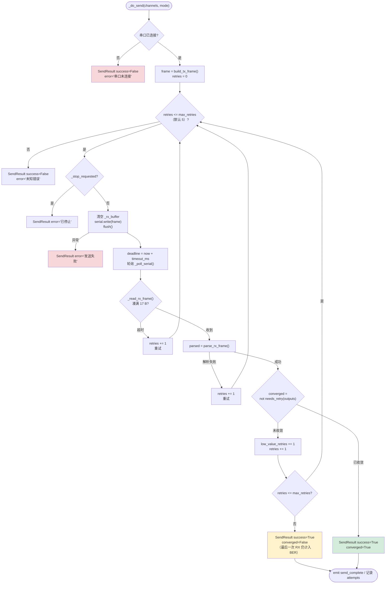

### 6.3 重试触发条件汇总

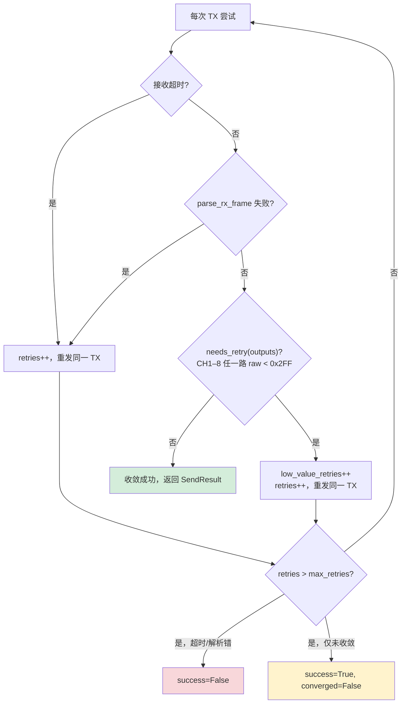

### 6.4 SendResult 字段说明

| 字段 | 含义 |
|------|------|
| `success` | 是否收到有效 17 B RX（最后一次尝试为准） |
| `converged` | 最后一次 RX 的 CH1–8 是否均 ≥ 0x2FF |
| `retries` | 总重试次数（含超时、解析失败、未收敛） |
| `low_value_retries` | 仅因 raw < 0x2FF 触发的重试次数 |
| `attempts` | 每次有效 RX 快照（含未收敛中间帧，供多行实测导出） |

---

## 附录：关键常量

| 常量 | 值 | 位置 |
|------|-----|------|
| `FRAME_HEADER` | `0xAA` | codec.py |
| `TX_FRAME_LEN` | 25 | codec.py |
| `RX_FRAME_LEN` | 17 | codec.py |
| `DAC_MIN_VALID` / `RETRY_THRESHOLD` | `0x2FF` (767) | codec.py / validator.py |
| `CONVERGE_CHANNELS` | 8（CH1–8） | validator.py |
| `MAX_RETRY` | 5 | codec.py（文档常量） |
| `_max_retries` | 5（默认） | serial_worker.py |
| `TX_VOLTAGE_REF` | 4.096 V | codec.py |
| `RX_CURRENT_SCALE` | 5.0 | codec.py |
| `RX_CURRENT_MID` | 2.5 | codec.py |

---

*文档版本与源码同步至 2026-06-30。渲染环境：GitHub / Cursor Mermaid 预览。*
