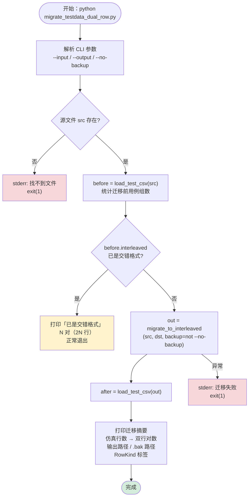
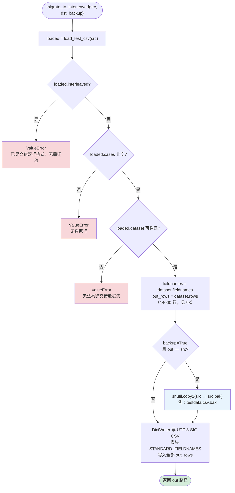
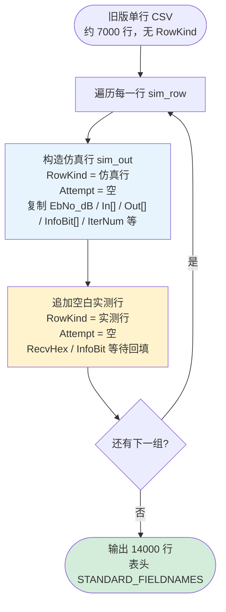
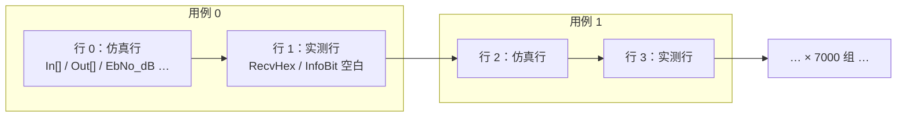

# testdata.csv 双行格式迁移流程图

**Author:** Xander  
**Date:** 2026-06-30  
**项目:** EVB-COM-TOOL  
**相关源码:** `scripts/migrate_testdata_dual_row.py` · `csv_loader.py`  
**入口命令:** `python scripts/migrate_testdata_dual_row.py`

本文档以 Mermaid 流程图描述旧版 7000 行仿真 CSV 迁移为 14000 行交错双行格式（仿真行 + 实测行）的逻辑。  
**仅文档，不修改 Python 实现。**

---

## 目录

1. [迁移总览（CLI 入口）](#1-迁移总览cli-入口)
2. [核心迁移逻辑（migrate_to_interleaved）](#2-核心迁移逻辑migrate_to_interleaved)
3. [单行 → 双行展开（build_interleaved_rows_from_legacy）](#3-单行--双行展开build_interleaved_rows_from_legacy)
4. [格式对比](#4-格式对比)

---

## 1. 迁移总览（CLI 入口）

对应 `scripts/migrate_testdata_dual_row.py` 的 `main()`。

### CLI 参数说明

| 参数 | 默认值 | 说明 |
|------|--------|------|
| `--input` / `-i` | `data/testdata.csv` | 待迁移的源 CSV |
| `--output` / `-o` | 与 `--input` 相同 | 输出路径；默认可就地覆盖 |
| `--no-backup` | 关闭 | 就地更新时不生成 `.bak` 备份 |

---

## 2. 核心迁移逻辑（migrate_to_interleaved）

对应 `csv_loader.migrate_to_interleaved()`。

> **备份规则：** 仅当输出路径与源路径相同（就地更新）且 `backup=True` 时，才复制 `src.suffix + ".bak"`。  
> 若指定不同 `--output`，不创建备份。

---

## 3. 单行 → 双行展开（build_interleaved_rows_from_legacy）

在 `load_test_csv()` 加载旧版单行 CSV 时，于内存中调用；迁移写盘时复用同一 `dataset.rows`。

### 交错行序示例

---

## 4. 格式对比

| 项目 | 旧版单行 | 新版交错双行 |
|------|----------|--------------|
| 行数 | ~7000 | ~14000（7000 对） |
| `RowKind` 列 | 无 | 仿真行 / 实测行 交替 |
| `Attempt` 列 | 无 | 实测行可记录多次重试 |
| 实测字段 | 无 | `RecvHex`、`InfoBit[0..3]` 等 |
| 加载行为 | 内存展开为双行 | 直接按对解析 |
| 备份 | — | 就地迁移时生成 `.bak` |

### RowKind 常量

| 常量 | 值 | 含义 |
|------|-----|------|
| `ROW_KIND_SIM` | `仿真行` | 含仿真输入/输出，来自原 CSV |
| `ROW_KIND_MEASURED` | `实测行` | 初始空白，UART 测试后回填 |

---

*文档版本与源码同步至 2026-06-30。渲染环境：GitHub / Cursor Mermaid 预览。*
